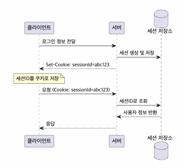
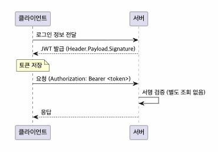
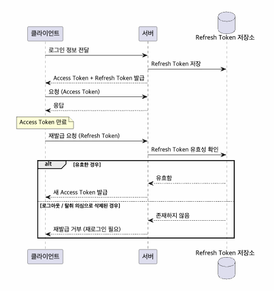

HTTP는 Connectionless(비연결 지향), Stateless(상태 비유지) 프로토콜이다.

클라이언트가 요청을 보내고 서버가 응답을 하면 연결이 끊기고, 이전 통신에서 주고받은 데이터도 유지되지 않는다.

그런데 로그인처럼 누가 요청 중인지 상태를 기억해야 하는 경우가 있다. 이때 사용하는 것이 쿠키, 세션, 토큰이다.

## 1. 쿠키(Cookie)

서버가 응답 헤더의 `Set-Cookie`에 담아 클라이언트에게 전달하는 key-value 데이터다.

```text
Set-Cookie: sessionId=abc123; Domain=example.com; Path=/; Max-Age=3600; HttpOnly; Secure; SameSite=Lax
```

클라이언트(브라우저)에 저장되며, 이후 같은 서버로 요청을 보낼 때마다 쿠키가 자동으로 함께 전송된다.

쿠키는 도메인당 4KB 정도로 용량이 크지 않다. 클라이언트 측에 저장되는 구조라 탈취나 변조에도 취약하다. 대신 만료 시간은 자유롭게 설정할 수 있다.

### 보안 속성

#### 1. `HttpOnly`

JS에서 접근할 수 없도록 제한한다.

일반적으로 브라우저에서는 `document.cookie`를 통해 쿠키를 읽거나 수정할 수 있다. 하지만 `HttpOnly`가 적용된 쿠키는 JS에서 접근이 차단되고, 브라우저가 HTTP 요청을 보낼 때만 자동으로 서버에 전송된다.

이 속성은 공격자가 XSS(Cross-Site Scripting) 공격으로 악성 스크립트를 실행하더라도 세션 쿠키나 JWT와 같은 중요한 인증 정보를 탈취하는 것을 방지하는 데 효과적이다.

> - `document.cookie`는 브라우저에 저장된 쿠키를 JS에서 읽거나 수정할 수 있게 해주는 객체이다.
>
- XSS(Cross-Site Scripting)는 공격자가 웹사이트에 악성 JS 코드를 삽입하여, 그 사이트를 방문한 사용자의 브라우저에서 해당 코드가 실행되도록 만드는 공격이다.

#### 2. `Secure`

HTTPS로 암호화된 연결에서만 전송된다.

만약 HTTP와 HTTPS를 모두 사용하는 환경에서 `Secure` 속성이 없다면, 사용자가 HTTP로 접속했을 때 쿠키가 평문으로 전송되어 네트워크 중간에서 탈취될 위험이 있다.

`Secure`를 적용하면 HTTPS 요청에서만 쿠키가 전송되므로, 패킷 가로채기(스니핑)와 같은 공격으로부터 인증 정보를 보호할 수 있다.

> - 스니핑(Sniffing)이란 네트워크를 통해 오가는 데이터를 몰래 가로채서 읽는 공격을 말한다.

#### 3. `SameSite`

다른 사이트에서 발생한 요청에 쿠키를 함께 보낼지 여부를 제어하는 속성이다.

기본적으로 브라우저는 요청을 보낼 때 해당 사이트의 쿠키를 함께 전송한다. 하지만 다른 사이트에서 사용자를 대신해 요청을 보내는 경우(CSRF 공격)에도 쿠키가 함께 전송될 수 있다.

`SameSite`를 설정하면 이러한 교차 사이트(Cross-Site) 요청에서 쿠키 전송을 제한하여 CSRF(Cross-Site Request Forgery) 공격을 예방할 수 있다.

>**`SameSite` 옵션**
>
- `Strict` : 다른 사이트에서 오는 요청에는 쿠키를 절대 보내지 않는다. 가장 안전하지만, 외부 링크를 타고 들어와도 로그인이 풀려있는 것처럼 보이는 불편함이 있다.
>
>
- `Lax` : 다른 사이트에서 왔어도 GET 같은 페이지 이동 요청에는 쿠키를 보낸다. 폼 제출(POST) 같은 요청에는 보내지 않는다. 기본값으로 많이 쓰인다.
>
>
- `None` : 다른 사이트에서 오는 요청에도 쿠키를 무조건 보낸다. 반드시 `Secure`와 함께 써야 하며, CSRF 방어 효과는 없다.

`Strict`나 `Lax`로 설정하면 타 도메인에서 오는 요청에는 쿠키가 실리지 않아 CSRF를 상당 부분 막을 수 있다.

> **CSRF(Cross-Site Request Forgery)**
>
> CSRF는 공격자가 사용자의 브라우저를 이용해, 사용자의 의도와 상관없이 다른 웹사이트에 요청을 보내도록 만드는 공격이다.
>
사용자가 로그인하면 서버는 쿠키를 브라우저에 저장한다. 이후 해당 사이트로 요청을 보낼 때마다 브라우저는 이 쿠키를 자동으로 함께 전송한다.
>
공격자는 이러한 동작을 악용하여 사용자가 악성 사이트를 방문하도록 유도한 뒤, 그 사이트에서 로그인된 사이트로 요청을 보내게 만든다. 이때 브라우저는 사용자가 직접 요청한 것이 아니더라도 저장된 인증 쿠키를 자동으로 함께 전송한다.
>
서버는 전달된 쿠키를 보고 정상적으로 로그인한 사용자의 요청이라고 판단하기 때문에, 송금, 비밀번호 변경, 회원 탈퇴와 같은 중요한 기능이 사용자의 의도와 다르게 수행될 수 있다.


## 2. 세션(Session)

로그인에 성공하면 서버가 세션 저장소에 사용자 정보를 저장하고, 이를 식별할 수 있는 세션 ID를 발급한다.

이 세션 ID를 클라이언트가 쿠키에 담아 저장하고, 요청마다 함께 전송한다. 즉, 세션은 쿠키라는 운반 수단을 빌려 쓰는 것이다. 세션 ID 자체는 랜덤 문자열이라 그 안에 정보가 없고, 실제 데이터는 서버 메모리(혹은 별도 저장소)에 있다.

클라이언트가 로그인 정보를 서버에 전달한다. 서버는 세션을 생성해 세션 ID를 발급한다. 클라이언트는 이 세션 ID를 쿠키로 저장해두었다가 이후 요청마다 함께 보낸다. 서버는 세션 저장소에서 해당 ID를 조회해 사용자를 식별한다.



민감한 정보가 서버에 저장되기 때문에 쿠키 방식보다 안전하다. 서버가 세션을 직접 관리하므로 특정 사용자를 강제로 로그아웃시키기도 쉽다. 세션 삭제 한 줄이면 끝난다. 다만 동시 접속자가 많아질수록 서버 메모리 부담이 커진다. Stateful 방식의 대가다.

트래픽이 늘어 서버를 여러 대로 늘리면(스케일 아웃), 로드밸런서가 요청을 아무 서버에나 분배한다. 그런데 세션이 A서버 메모리에만 저장돼 있다면, 다음 요청이 B서버로 가는 순간 세션을 찾지 못한다.

해결책은 두 가지다.

로드밸런서가 같은 사용자의 요청을 항상 같은 서버로 보내도록 고정하는 Sticky Session은 구현이 간단하지만, 특정 서버에 부하가 몰리거나 그 서버가 죽으면 세션이 통째로 날아간다.

Redis 같은 별도 저장소에 세션을 두고 모든 서버가 공유하는 세션 클러스터링은, 어느 서버가 요청을 받든 동일한 세션 데이터를 조회할 수 있게 해준다.

즉, 세션이 확장에 불리하다는 말은 정확히는 메모리에 세션을 들고 있는 방식의 문제다. Redis 같은 외부 저장소로 세션을 빼내면 상당 부분 해결된다.

## 3. 토큰(Token) & JWT

MSA(마이크로서비스 아키텍처)처럼 서버가 잘게 쪼개진 환경에서는 세션 클러스터링도 결국 모든 서비스가 같은 세션 저장소를 바라봐야 한다는 의존성을 만든다. 서비스 간 결합도가 높아지는 셈이다.

이 문제를 근본적으로 없애기 위해 등장한 게 토큰 기반 인증이다. 서버가 사용자 상태를 별도로 저장하지 않고, 필요한 정보를 토큰 자체에 담아 클라이언트에게 발급한다. 서버는 토큰이 위조되지 않았는지만 검증하면 되므로, 어떤 서버가 요청을 받든 별도 저장소 조회 없이 동일하게 처리할 수 있다.

가장 널리 쓰이는 형태가 JWT(JSON Web Token)다.

### 3.1 JWT 구조

JWT는 `.`으로 구분된 세 부분으로 이루어진다.

```text
header.payload.signature

예)
eyJhbGciOiJIUzI1NiJ9.eyJ1c2VySWQiOjEsImV4cCI6MTcwMDAwMDAwMH0.4f2a9...
```

- Header: 토큰 타입(JWT)과 서명 알고리즘(`HS256`, `RS256` 등) 정보가 담긴다.

- Payload: 사용자 식별 정보 등 실제 데이터(claim)가 들어간다.

- Signature: `HMACSHA256(base64Url(header) + "." + base64Url(payload), secret)`처럼 Header와 Payload를 secret key로 서명(해싱)한 값이다.

Header와 Payload는 Base64Url 인코딩일 뿐 암호화가 아니다. 아래처럼 누구나 디코딩해서 내용을 볼 수 있다.

```java
// payload 부분만 떼서 디코딩하면 그대로 JSON이 보인다
String payload = "eyJ1c2VySWQiOjEsImV4cCI6MTcwMDAwMDAwMH0";
String decoded = new String(Base64.getUrlDecoder().decode(payload));
System.out.println(decoded);
// {"userId":1,"exp":1700000000}
```

그래서 서명(Signature)이 핵심이다. 서버만 아는 secret key로 서명했기 때문에, 클라이언트가 Payload 내용을 바꾸면 Signature가 맞지 않게 되고, 서버는 검증 단계에서 이를 걸러낸다. JWT는 내용을 숨기는 게 아니라 내용이 변조되지 않았음을 보장하는 것이다.

동작 순서도 세션과 비슷하다. 클라이언트가 로그인 정보를 서버에 전달한다. 서버는 로그인 성공 시 사용자 식별 정보를 Payload에 담아 JWT를 발급한다. 클라이언트는 토큰을 저장해두었다가 이후 요청 시 `Authorization: Bearer <token>` 헤더에 담아 보낸다. 서버는 별도 조회 없이 토큰의 서명만 검증하면 요청을 처리할 수 있다.



서버가 별도로 상태를 저장하지 않기 때문에(Stateless) HTTP의 특성과 잘 맞고, 서버나 서비스를 확장하는 데도 유리하다. 다만 Payload는 암호화된 것이 아니라 인코딩된 것이므로 민감한 정보를 담으면 안 된다. 세션 ID보다 토큰 길이가 길어서, 인증 요청이 많아질수록 네트워크 부하도 늘어난다.

세션은 서버 저장소에서 삭제하면 즉시 로그아웃 처리가 되지만, JWT는 서버가 상태를 들고 있지 않으므로 발급한 토큰을 지금부터 무효로 한다는 개념 자체가 없다. 서명만 유효하면 서버는 무조건 믿고 받아준다. 그래서 만료 시간(`exp`) 전까지는 탈취당해도 계속 사용 가능하다는 게 JWT의 구조적 약점이다.

### 3.2 Access Token · Refresh Token으로 절충하기

이 문제는 실무에서 보통 토큰을 두 개로 나눠서 완화한다.

Access Token은 실제 API 요청에 사용하는 토큰으로, 수명을 15분~1시간 정도로 짧게 잡아서 탈취당해도 피해 시간을 최소화한다.

Refresh Token은 Access Token이 만료됐을 때 재발급받는 용도로, 수명은 2주 정도로 길지만 대신 서버가 DB나 Redis에 저장해두고 관리한다. 로그아웃이나 탈취 의심이 있을 때 이 Refresh Token만 삭제하면 더 이상 Access Token을 재발급받을 수 없다.

즉, Refresh Token은 사실상 세션처럼 서버가 상태를 들고 관리하는 것이다. Access Token만으로는 무효화가 안 되니, 무효화가 필요한 부분(재발급 권한)만 서버가 통제권을 갖도록 절충한 구조다.



Access Token은 보통 JS 변수(메모리)나 `LocalStorage`에 저장한다.

메모리에 담아두면 새로고침하거나 탭을 닫는 순간 사라지지만, XSS로 악성 스크립트가 실행되더라도 상대적으로 접근하기 까다롭다.

`LocalStorage`에 저장하면 새로고침해도 유지돼 구현이 간편하지만, JS로 직접 접근할 수 있어 XSS 공격에 그대로 노출된다.

다만 Access Token은 수명이 15분~1시간으로 짧아 탈취돼도 피해 범위가 제한적이기 때문에, Refresh Token만큼 저장 위치를 까다롭게 따지지 않는 경우가 많다. 반면 Refresh Token은 탈취되면 Access Token을 계속 재발급받을 수 있어 파급력이 크기 때문에 저장 위치가 훨씬 중요하다.

Refresh Token을 `LocalStorage`나 `SessionStorage`에 저장하면 JS로 접근이 가능해서 XSS 공격에 그대로 노출된다.

`HttpOnly` 쿠키에 저장하면 JS로는 접근할 수 없어 XSS에는 강하지만, 쿠키 자체의 특성상 CSRF 방어(`SameSite`)는 별도로 신경 써야 한다.

결국 토큰을 어디에 저장할 것인가도 쿠키에서 봤던 XSS/CSRF 트레이드오프를 다시 마주치는 문제다.

그래서 실무에서는 `HttpOnly` + `Secure` + `SameSite` 쿠키에 Refresh Token을 저장하는 방식이 가장 널리 쓰인다. 결국 쿠키, 세션, 토큰 모두 완벽한 해법이 있다기보다, 매번 이전 방식의 약점을 어디까지, 어떤 대가로 메울 것인지를 절충해온 것이다.
