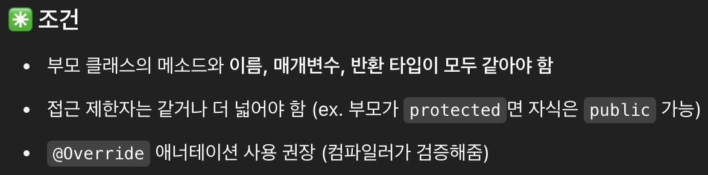
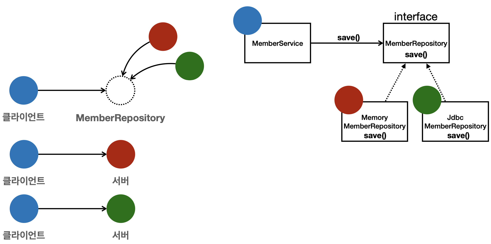
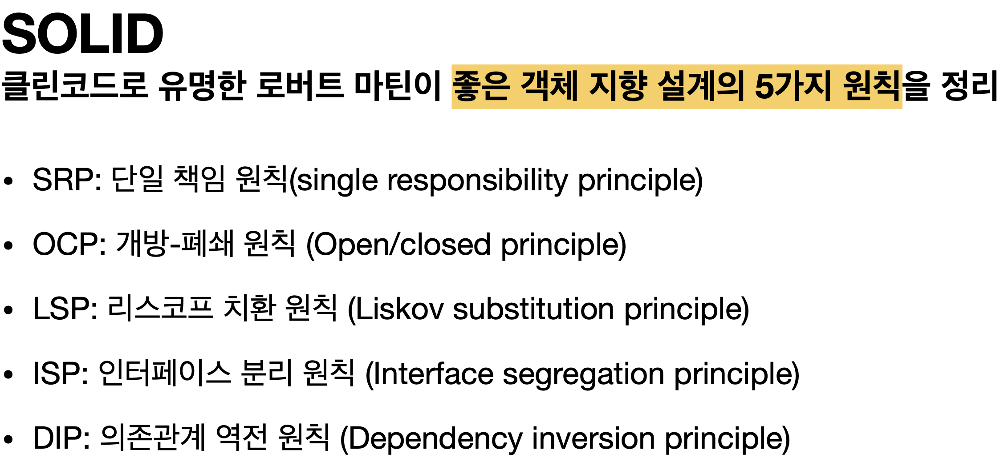
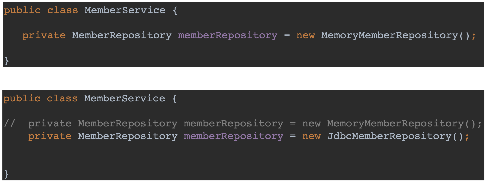

[(출처) 스프링 핵심 원리 - 기본편](https://www.inflearn.com/course/%EC%8A%A4%ED%94%84%EB%A7%81-%ED%95%B5%EC%8B%AC-%EC%9B%90%EB%A6%AC-%EA%B8%B0%EB%B3%B8%ED%8E%B8?gad_source=1&gad_campaignid=20714471420&gbraid=0AAAAADAClSB81nOfyUPym-Hq8jxqt7XS6&gclid=Cj0KCQjw8eTFBhCXARIsAIkiuOzXYq7ocyYtwsAYGU9mf90LptHZBEPRpIiIe0AUTlu0Geu5eJD1ByoaAsW0EALw_wcB)

## 다형성(Polymorphism)
객체 지향 프로그래밍은 **프로그램을 유연하고 변경이 용이하게** 만드는데 이것을 **다형성**이라 하고 **객체 지향의 핵심**이라고 볼 수 있다.

**즉, 하나의 메서드나 클래스가 있을 때 그것이 다양한 방법으로 동작하는 것을 말한다.**

(**타입은 고정**하고 **구현체만 변경**하면 되는 -> 코드 재사용성, 확장성 높아짐)

> **객체 지향 프로그래밍(Object-Oriented Programming, OOP)
:** 프로그래밍에서 필요한 데이터를 추상화시켜 상태와 행위를 가진 객체로 만들고 객체들간의 상호작용을 통해 로직을 구성하는 프로그래밍 방법이다.

## 역할과 구현을 분리

다형성을 실세계에 비유하자면 **역할과 구현으로 세상을 구분한다** 볼 수 있다.

예를 들면,

운전자(Client) 역할과 자동차 역할이 있을 때, 자동차의 구현을 이리저리 바꿔도 자동차 역할은 바뀌지 않기때문에 운전자(Client)에게 영향이 가지 않는다.

**결국 역할과 구현으로 구분하면 세상이 단순해지고, 유연해지며 변경도 편리해진다.**

**즉, 클라이언트는 대상의 역할(인터페이스)만 알면 된다.**  
구현 대상의 내부 구조를 몰라도 되고, 변경되어도 영향 받지 않는다.

> 역할 = 인터페이스
구현 = 인터페이스를 구현한 클래스, 구현 객체

- 객체 설계시 **역할(인터페이스)을 먼저 부여**하고, 그 역할을 수행하는 **구현 객체 만들기**

## 자바 언어의 다형성

여기서 잠깐 **오버로딩**과 **오버라이딩**에 대해 다시 복습해보자.

#### 오버로딩(Overloading)
**오버로딩**이란 **메소드 이름은 같지만** 유사하지만 입력에 따라 **동작이 다른 기능**으로 사용할 수 있다.

**단, 매개변수의 타입이나 개수가 달라야 한다.**

```java
public class Calculator {
    
    public int add(int a, int b) {
        return a + b;
    }

    public double add(double a, double b) {
        return a + b;
    }

    public int add(int a, int b, int c) {
        return a + b + c;
    }
}
```

#### 오버라이딩(Overriding)
**오버라이딩**은 **상속받은 메소드를 자식 클래스에서 재정의**하여, 자식 클래스에 맞는 방식으로 동작하게 만드는 것이다.



**오버라이딩은 다형성의 핵심**이다. 오버라이딩 없이 다형성은 무의미하다.

```java
class Animal {
    void sound() {
        System.out.println("동물이 소리를 냅니다.");
    }
}

class Dog extends Animal {
    @Override
    void sound() {
        System.out.println("멍멍!");
    }
}

class Cat extends Animal {
    @Override
    void sound() {
        System.out.println("야옹~");
    }
}

// 다형성 적용
Animal a1 = new Dog();
Animal a2 = new Cat();

a1.sound();  // "멍멍!"
a2.sound();  // "야옹~"
```

#### 오버라이딩 다형성

**다형성으로 인터페이스를 구현한 객체**를 **실행 시점에 유연하게 변경**할 수 있다.
  
**클라이언트를 변경하지 않고**, **서버의 구현 기능을 유연하게 변경**할 수 있다. 이것이 **다형성의 본질**이다.

주의할 점은 인터페이스를 안정적으로 잘 설계하는 것이 중요하다. 역할(인터페이스) 자체가 변하면, 클라이언트, 서버 모두에 큰 변경이 발생한다.

## SOLID

#### <span style="color: red">S</span>RP(Single Responsibility Principle) 단일 책임 원칙

한 클래스는 **하나의 책임**만 가져야 한다.  
-> 하나의 책임이라는 것은 모호하다.  
-> **중요한 기준은 변경**이다. 변경이 있을 때 파급 효과가 적다면 잘 따른 것  
-> 클래스 하나 = 역할 하나

#### <span style="color: red">O</span>CP(Open/Closed Principle) 개방-폐쇄 원칙

소프트웨어 요소는 **확장에는 열려** 있으나, **변경에는 닫혀** 있어야 한다.  
(새 기능 추가 = 새 클래스 추가)

**문제점 예시**
  
위 코드에서 분명 다형성을 사용했지만 OCP 원칙을 지킬 수 없다.  
객체를 생성하고, 연관관계를 맺어주는 별도의 조립, 설정자가 필요하다.

#### <span style="color: red">L</span>SP(Liskov Substitution Principle) 리스코프 치환 원칙
프로그램의 객체는 프로그램의 **정확성을 깨뜨리지 않으면서** 하위 타입의 인스턴스로 바꿀 수 있어야 한다.

예시로 자동차 인터페이스의 엑셀은 앞으로 가라는 기능만 있어야 한다. 뒤로 가게 구현하면 LSP 위반, 느리더라도 앞으로 가야한다.

#### <span style="color: red">I</span>SP(Interface Segregation Principle) 인터페이스 분리 원칙
특정 클라이언트를 위한 **인터페이스 여러 개가 범용 인터페이스 하나보다 낫다.**

(클라이언트는 자신이 쓰지 않는 메서드에 의존하면 안 된다.)  
예시로 자동차 인터페이스를 운전, 정비 인터페이스로 분리.  
사용자 클라이언트를 운전자, 정비사 클라이언트로 분리.

이렇게 되면 정비 인터페이스가 운전자 클라이언트에 영향을 주지 않는다.

**인터페이스가 명확해지고, 대체 가능성이 높아진다.**

#### <span style="color: red">D</span>IP(Dependency Inversion Principle) 의존관계 역전 원칙

**구현에 의존하지 말고 인터페이스에 의존하라는 원칙**이다.

앞에서 이야기한 **역할(인터페이스)에 의존해야** 한다는 것과 같다.

**문제점 예시**
  
MemberService는 인터페이스에 의존하지만, 구현 클래스도 동시에 의존한다.

이렇게 되면 MemberService 클라이언트가 구현 클래스를 직접 선택 하는 꼴이다.  
-> DIP 위반

#### 정리
**다형성 만으로는 OCP, DIP를 지킬 수 없다.**

## 스프링
스프링은 다음 기술로 **다형성 + OCP, DIP**를 가능하게 지원한다.
> - **DI(Dependency Injection)**: 의존관계, 의존성 주입
- **DI 컨테이너** 제공


**클라이언트 코드의 변경 없이 기능을 확장할 수 있다.**

## 정리
모든 설계에 **역할과 구현을 분리**하자.

애플리케이션 설계도 공연을 설계 하듯이 **배역(인터페이스)만 만들어두고**, **배우(구현)는 언제든지 유연하게 변경**할 수 있도록 만드는 것이 **좋은 객체 지향 설계이다.**

이상적으로는 모든 설계에 인터페이스를 부여하면 좋다. 하지만 인터페이스를 도입하면 **추상화라는 비용이 발생**한다.

기능을 확장할 가능성이 없다면 **구체(구현) 클래스를 직접 사용**하고, 향후 꼭 필요할 때 **리펙터링해서 인터페이스를 도입**하는 것도 방법이다.
