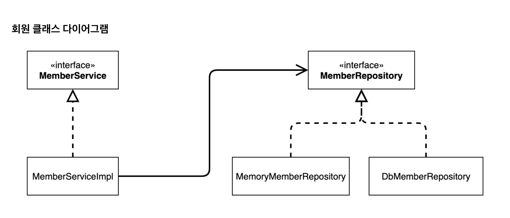
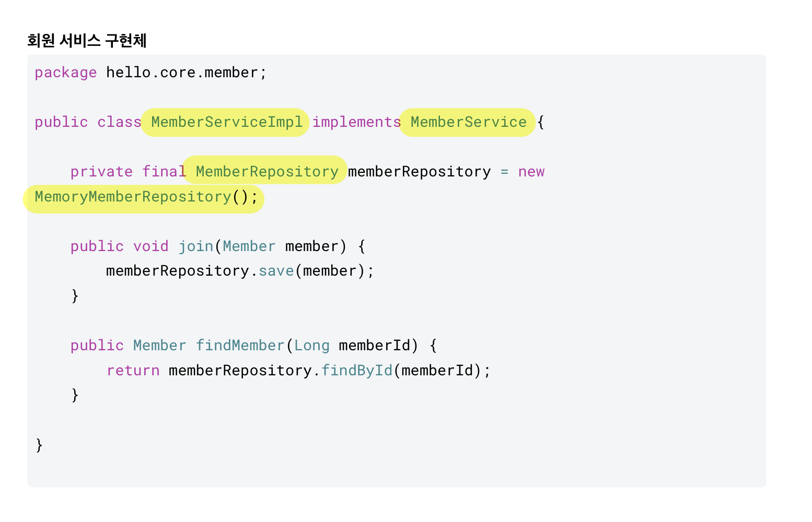
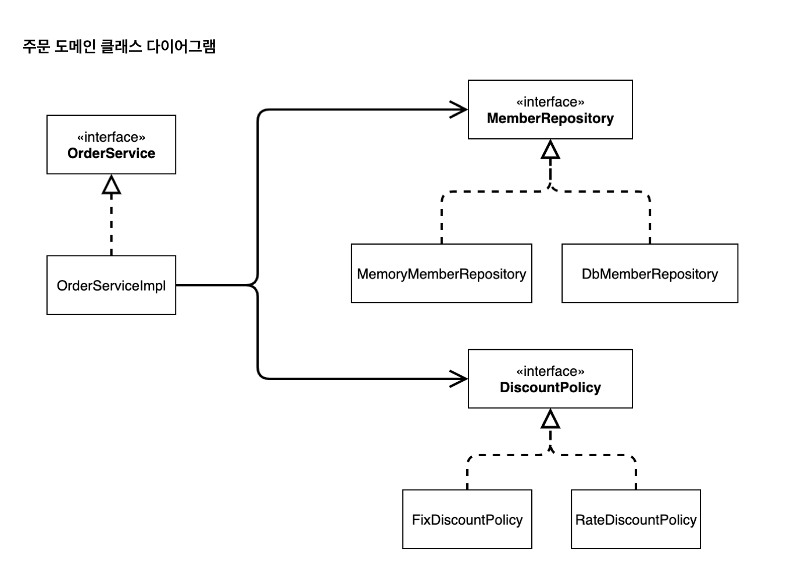
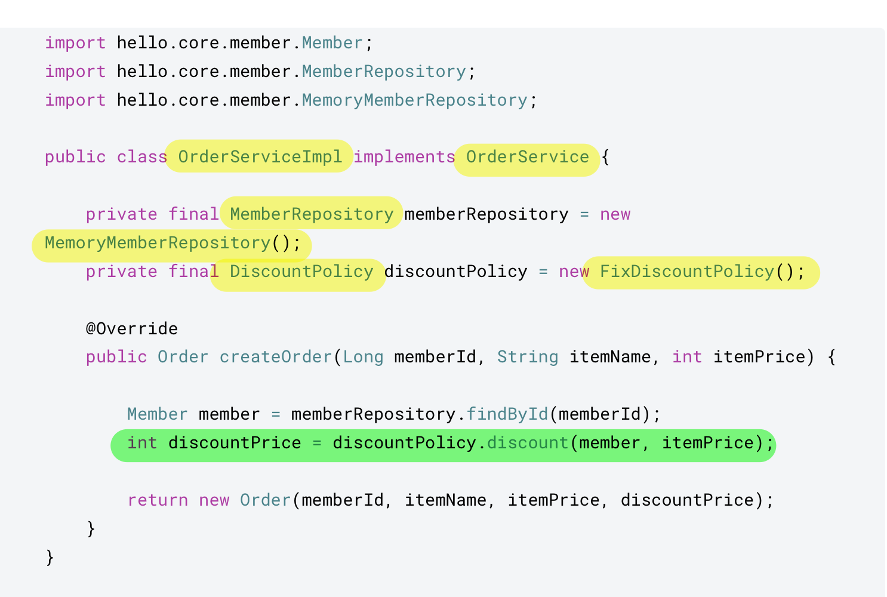

[(출처) 스프링 핵심 원리 - 기본편](https://www.inflearn.com/course/%EC%8A%A4%ED%94%84%EB%A7%81-%ED%95%B5%EC%8B%AC-%EC%9B%90%EB%A6%AC-%EA%B8%B0%EB%B3%B8%ED%8E%B8?gad_source=1&gad_campaignid=20714471420&gbraid=0AAAAADAClSB81nOfyUPym-Hq8jxqt7XS6&gclid=Cj0KCQjw8eTFBhCXARIsAIkiuOzXYq7ocyYtwsAYGU9mf90LptHZBEPRpIiIe0AUTlu0Geu5eJD1ByoaAsW0EALw_wcB)

## 프로젝트 생성
IDE: IntelliJ IDEA Ultimate

Gradle 전체 설정

```java
plugins {
	id 'java'
	id 'org.springframework.boot' version '3.5.4'
	id 'io.spring.dependency-management' version '1.1.7'
}

group = 'hello'
version = '0.0.1-SNAPSHOT'

java {
	toolchain {
		languageVersion = JavaLanguageVersion.of(17)
	}
}

repositories {
	mavenCentral()
}

dependencies {
	implementation 'org.springframework.boot:spring-boot-starter'
	testImplementation 'org.springframework.boot:spring-boot-starter-test'
	testRuntimeOnly 'org.junit.platform:junit-platform-launcher'
}

tasks.named('test') {
	useJUnitPlatform()
}
```

## 회원 도메인
  
회원 서비스의 인터페이스를 구현한 구현체 코드를 보면
  
**회원서비스의 구현체가 인터페이스에 의존하는 것 뿐만 아니라 회원 저장소 구현체에 까지 의존하고 있는 문제점 발생 -> DIP 위반**

**또한 구현체를 Memory가 아닌 Db로 바꾸려면 코드를 직접 수정해야 하는 문제 발생 -> OCP 위반**

쉽게 생각하면 **회원 서비스 구현체가 왜 회원 저장소 구현체까지 신경써야하지?** 이렇게 생각하면 된다.

## 주문과 할인 도메인
  
주문 서비스 구현체를 코드를 보면
  
회원 서비스의 경우와 마찬가지로 **주문 서비스 구현체가 인터페이스에 의존하는 것 뿐만 아니라 주문 회원 저장소 구현체와 할인 정책 구현체까지 의존 하는 문제 발생 -> DIP, OCP 위반**

**녹색 부분은 SRP가 잘 지켜진 예시**라고 볼 수 있다. 만약 주문 서비스 구현체 안에서 **할인 정책 로직 자체를 바꾸게 된다면 SRP 위반**이다.

## 정리
다형성만으로는 DIP, OCP를 지킬 수 없는 예시를 다뤄보았다. 다음에는 할인 정책 변경을 할 때 앞서 생긴 위반 때문에 어떤 문제점이 발생하는지 알아보고 **관심사를 분리**하여 해결해보자.
