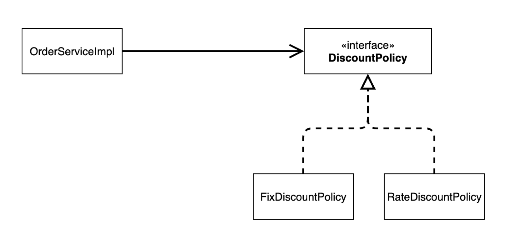
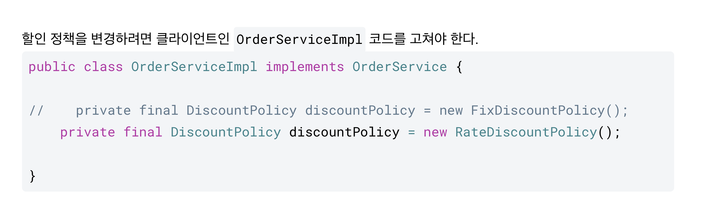
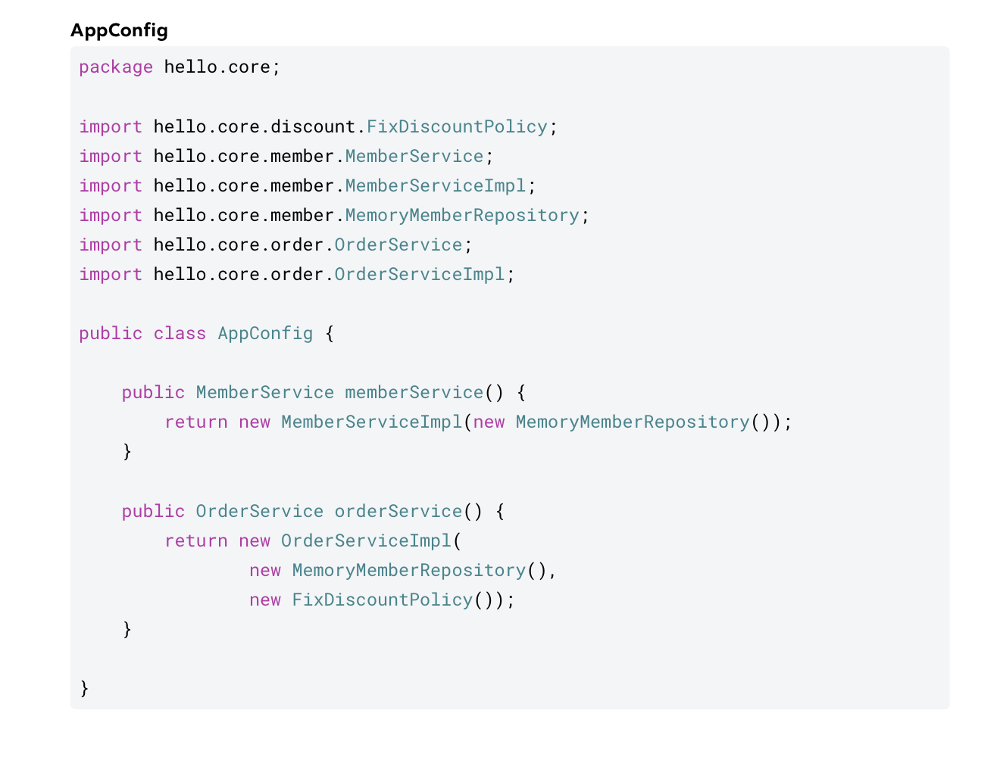
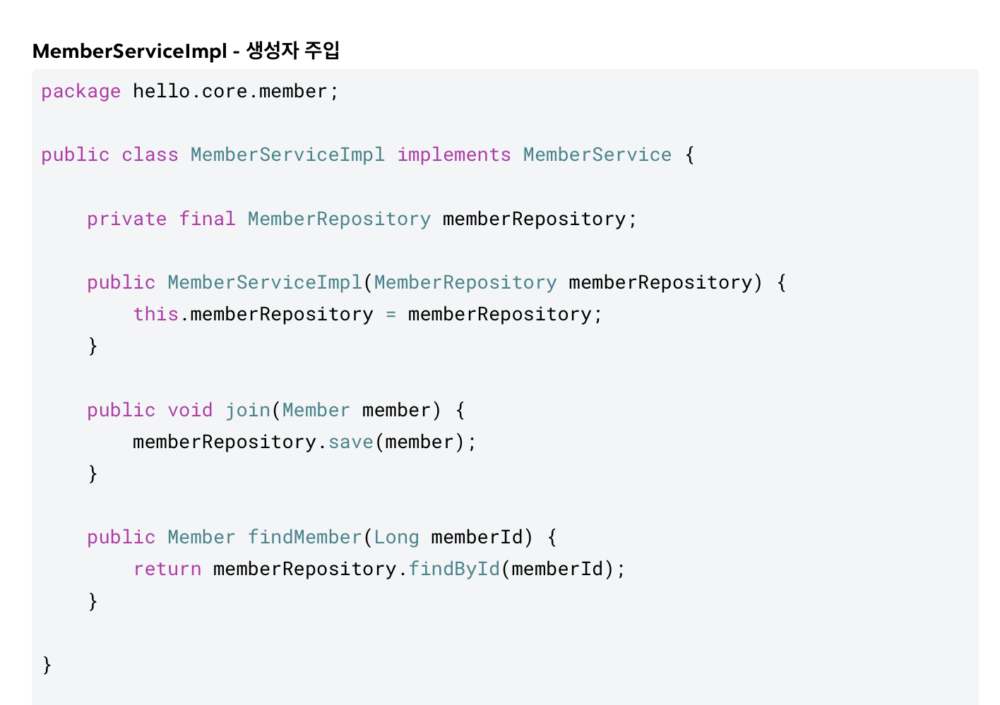
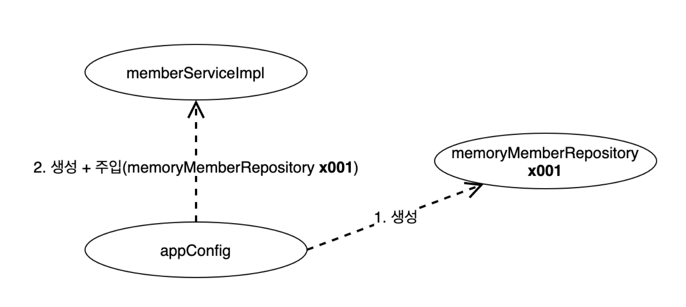
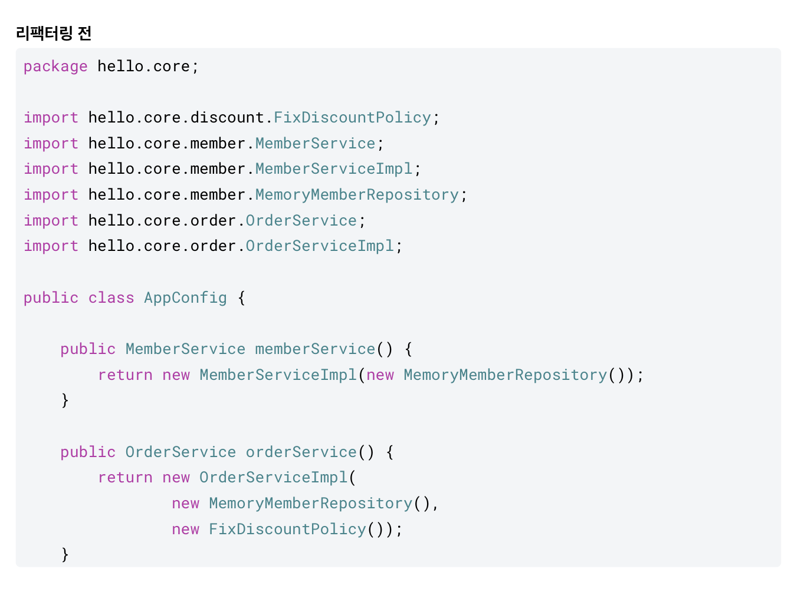
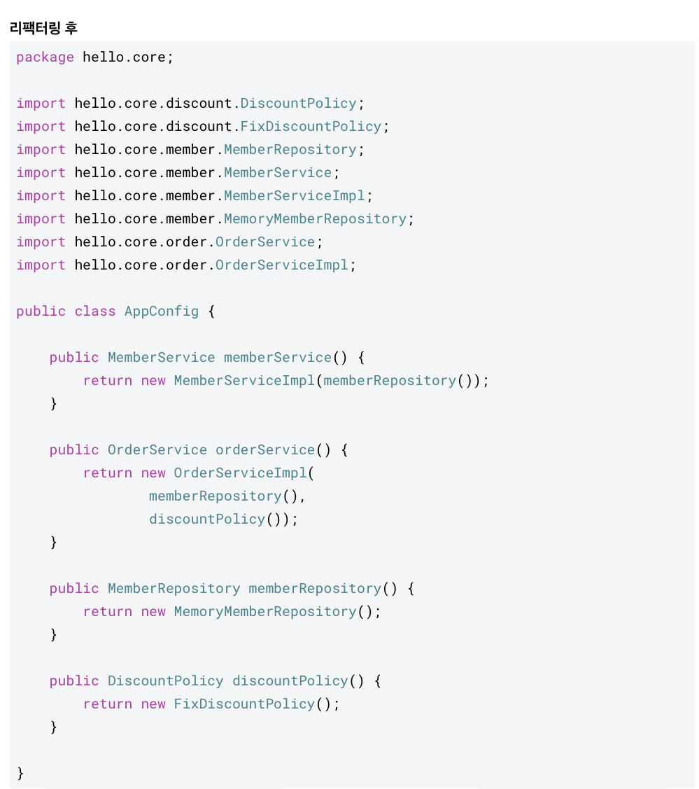

[(출처) 스프링 핵심 원리 - 기본편](https://www.inflearn.com/course/%EC%8A%A4%ED%94%84%EB%A7%81-%ED%95%B5%EC%8B%AC-%EC%9B%90%EB%A6%AC-%EA%B8%B0%EB%B3%B8%ED%8E%B8?gad_source=1&gad_campaignid=20714471420&gbraid=0AAAAADAClSB81nOfyUPym-Hq8jxqt7XS6&gclid=Cj0KCQjw8eTFBhCXARIsAIkiuOzXYq7ocyYtwsAYGU9mf90LptHZBEPRpIiIe0AUTlu0Geu5eJD1ByoaAsW0EALw_wcB)

## 새로운 할인 정책 개발
기존에 고정 금액 할인이 아닌 **정률 할인으로 변경**
  
할인 정책을 애플리케이션에 적용을 해보자.
  
여기서 문제가 생긴다.
##### 1. DIP 위반
주문서비스 클라이언트`(OrderServiceImpl)`은 `DiscountPolicy` 인터페이스에 의존하면서 **동시에 구현 클래스`(FixDiscountPolicy, RateDiscountPolicy)`에도 의존하고 있다.**

##### 2. OCP 위반
지금 코드는 기능을 확장해서 변경하면 **클라이언트`(OrderServiceImpl)` 코드에 영향을 준다.**

#### 어떻게 문제를 해결할 수 있을까?
DIP를 위반하지 않도록 인터페이스에만 의존하도록 의존관계를 변경하면 된다.

```java
//변경 전
private final DiscountPolicy discountPolicy = new RateDiscountPolicy();

//변경 후
private DiscountPolicy discountPolicy;
```

인터페이스에만 의존하도록 설계와 코드를 변경했다.

하지만, 구현체가 없어 실제 실행을 해보면 NPE(null pointer exception)가 발생한다.

##### 해결방안
이 문제를 해결하려면 누군가가 클라이언트인 `OrderServiceImpl`에 `DiscountPolicy`의 **구현 객체를 대신 생성하고 주입해주어야 한다.**

## 관심사의 분리
**배우(구현)는 본인의 역할(인터페이스)을 수행하는 것에만 집중**해야 한다.

즉, 어떤 여자 주인공이 선택되더라도 똑같이 공연할 수 있어야 한다.

근데 지금은 **어떤 여자 주인공을 할지 직접 선택하고 있는 꼴**이다.

따라서 공연을 구성하고, 담당 배우를 누가 할지 섭외하고, 역할에 맞는 배우를 지정하는 책임을 담당하는 별도의 **공연 기획자를 만들자.**

**즉, 배우와 공연 기획자의 책음을 확실히 분리하자.**

##### AppConfig (애플리케이션의 전체 동작 방식을 구성하기 위해, 구현 객체를 생성하고, 연결하는 책임을 가지는 별도의 설정 클래스)
  
AppConfig는 애플리케이션의 **실제 동작에 필요한 구현 객체를 생성한다.**

또한, **생성한 객체 인스턴스의 참조(래퍼런스)를 생성자를 통해서 주입해준다.**

**생성자 주입을 받기위해 각 클래스에서 생성자를 만들어 주자.**
  
이제는 더 이상 구현 클래스에 의존하지 않는다. 단지 인터페이스에만 의존한다.

또한, `MemberServiceImpl`입장에서는 생성자를 통해 **어떤 구현 객체가 주입될지는 알 수 없다.**

즉, `MemberServiceImpl`은 이제부터 **의존관계에 대한 고민은 외부에 맡기고 오직 실행에만 집중하면 된다.**

  
`appConfig`객체는 **`memoryMemberRepository`객체를 생성**하고 그 **참조값을 `memberServiceImpl`을 생성하면서 생성자로 전달**한다.

**클라이언트인 `memberServiceImpl`입장에서 보면 의존관계를 마치 외부에서 주입해주는 것 같다고 해서 DI(Dependency Injection) 우리말로 의존관계 주입 또는 의존성 주입이라고 한다.**

#### AppConfig 리팩터링
현재 AppConfig를 보면 중복이 있고, 역할에 따른 구현이 잘 안보인다.

##### 리팩터링 전
  
**중복을 제거**하고, **역할에 따른 구현이 보이도록** 리팩터링 하자.

##### 리팩터링 후
  
`new MemoryMemberRepository()` 이 부분이 중복 제거 되었다.

이제 예를들어 외부 DB로 변경한다면 한 부분만 변경하면 된다.

그리고 `AppConfig`를 보면 역할과 구현 클래스가 한눈에 들어온다. 애플리케이션 전체 구성이 어떻게 되어있는지 빠르게 파악할 수 있다.

## 관심사의 분리 결과
이제는 할인 정책을 바꾼다고 해서 **`OrderServiceImpl`를 포함해서 사용 영역의 어떤 코드도 변경할 필요 없이 `AppConfig`에서 한 부분만 변경해 주면 된다.**

```java
public DiscountPolicy discountPolicy(){
        //return new FixDiscountPolicy();
        return new RateDiscountPolicy();
    }
```

## IoC, DI, 그리고 컨테이너
#### 제어의 역전 IoC(Inversion of Control)
AppConfig가 등장하기 전에는 **클라이언트 구현 객체가 프로그램의 제어 흐름을 스스로 조종했다.**

반면에 AppConfig가 등장한 이후에는 프로그램의 제어흐름은 이제 AppConfig가 가져간다. **예를 들어서 OrderServiceImpl은 필요한 인터페이스들을 호출하지만 어떤 구현 객체들이 실행될지 모른다.**

이렇듯 프로그램의 제어 흐름을 직접 제어하는 것이 아니라 **외부에서 관리하는 것을 제어의 역전(IoC)이라 한다.**

#### 프레임워크 vs 라이브러리
프레임워크가 내가 작성한 코드를 제어하고, 대신 실행하면 그것은 프레임워크가 맞다. (JUnit)

반면에 **내가 작성한 코드가 직접 제어의 흐름을 담당한다면 그것은 프레임워크가 아니라 라이브러리다.**

#### 의존관계 주입 DI(Dependency Injection)
의존관계는 **정적인 클래스 의존관계**와 실행 시점에 결정되는 **동적인 객체(인스턴스) 의존 관계** 둘을 분리해서 생각해야 한다.
> **정적인 클래스 의존 관계**
- 코드만 봤을 때 어떤 클래스가 어떤 클래스를 사용하는지 나타내는 관계

> **동적인 객체 의존 관계**
- 프로그램을 실행할 때, 실제로 어떤 객체 인스턴스가 주입되어 연결되는지에 대한 관계

```java
public class OrderServiceImpl {
    private final DiscountPolicy discountPolicy;

    public OrderServiceImpl(DiscountPolicy discountPolicy) {
        this.discountPolicy = discountPolicy;
    }
}
```

이 **코드를 보면 `OrderServiceImpl`은 `DiscountPolicy`에 의존한다는걸 알 수 있다.**

이것이 정적인 의존 관계이다. **즉, 컴파일 시점 클래스 파일만 봐도 확인 가능한 것.**

```java
public class AppConfig {
    public OrderService orderService() {
        return new OrderServiceImpl(new RateDiscountPolicy());
    }
}
```

실제 프로그램이 **실행될 땐 RateDiscountPolicy객체가 DiscountPolicy자리에 들어가서 연결된다.**

이것이 동적인 의존 관계. **즉, 런타임 시점, 어떤 객체가 실제로 주입되는지.**

##### 결론
**의존관계 주입을 사용하면 정적인 클래스 의존관계를 변경하지 않고, 동적인 객체 인스턴스 의존관계를 쉽게 변경할 수 있다.**

#### IoC 컨테이너, DI 컨테이너
`AppConfig`처럼 **객체를 생성하고 관리하면서 의존관계를 연결해 주는** 것을 **IoC 컨테이너** 또는 **DI 컨테이너**라고 한다.

## 스프링으로 전환하기
##### AppConfig 스프링 기반으로 변경

```java
package hello.core;

import hello.core.discount.*;
import hello.core.member.MemberService;
import hello.core.member.MemberServiceImpl;
import hello.core.member.MemoryMemberRepository;
import org.springframework.context.annotation.Bean;
import org.springframework.context.annotation.Configuration;

@Configuration
public class AppConfig {
    @Bean
    public MemberService memberService(){
        return new MemberServiceImpl(memberRepository()); //의존성 주입
    }
    @Bean
    public MemoryMemberRepository memberRepository() {
        return new MemoryMemberRepository();
    }
    @Bean
    public OrderService orderService(){
        return new OrderServiceImpl(memberRepository(), discountPolicy());
    }
    @Bean
    public DiscountPolicy discountPolicy(){
        //return new FixDiscountPolicy();
        return new RateDiscountPolicy();
    }
}
```

AppConfig에 설정을 구성한다는 뜻의 `@Configuration`을 붙여준다.

각 매서드에 `@Bean`을 붙여준다. 이렇게 하면 스프링 컨테이너에 스프링 빈으로 등록된다.

##### MemberApp에 스프링 컨테이너 적용

```java
package hello.core;

import hello.core.member.Grade;
import hello.core.member.Member;
import hello.core.member.MemberService;
import org.springframework.context.ApplicationContext;
import org.springframework.context.annotation.AnnotationConfigApplicationContext;

public class MemberApp {
    public static void main(String[] args) {
        //AppConfig appConfig = new AppConfig();
        //MemberService memberService = appConfig.memberService();

        ApplicationContext applicationContext = new AnnotationConfigApplicationContext(AppConfig.class);
        MemberService memberService = applicationContext.getBean("memberService", MemberService.class);


        Member member = new Member(1L, "memberA", Grade.VIP);
        memberService.join(member);

        Member findMember = memberService.findMember(1L);
        System.out.println("new member = " + member.getName());
        System.out.println("find Member = " + findMember.getName());
    }
}
```

`ApplicationContext`를 스프링 컨테이너라 한다.

기존에는 개발자가 `AppConfig`를 사용해서 직접 **객체를 사용하고 DI**를 했지만, 이제부터는 **스프링 컨테이너를 통해서 사용**한다.

스프링 컨테이너는 **`@Configuration`이 붙은 것을 설정(구성) 정보로 사용**한다. 여기서 **`@Bean`이라 적힌 매서드를 모두 호출해서 반환된 객체를 스프링 컨테이너에 등록**한다. 이렇게 **스프링 컨테이너에 등록된 객체를 스프링 빈이라 한다.**

스프링 빈은 `@Bean`이 붙은 매서드의 명을 스프링 빈의 이름으로 사용한다.

## 정리
코드가 약간 더 복잡해진 것 같은데, 스프링 컨테이너를 사용하면 어떤 장점이 있는지 생각해보자.
