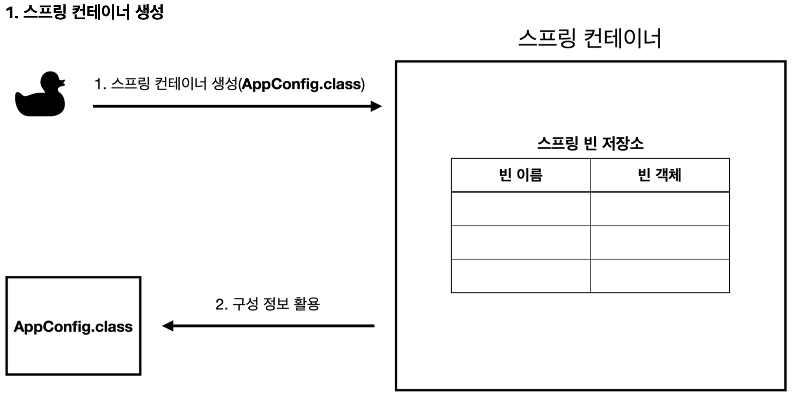
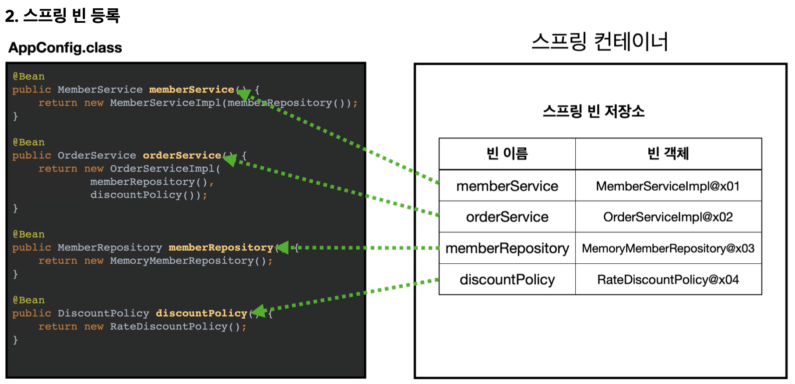
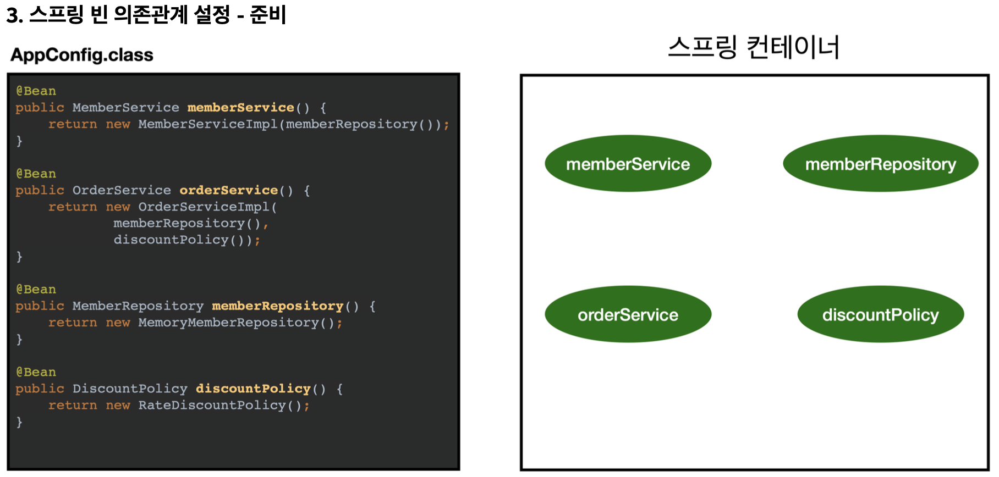
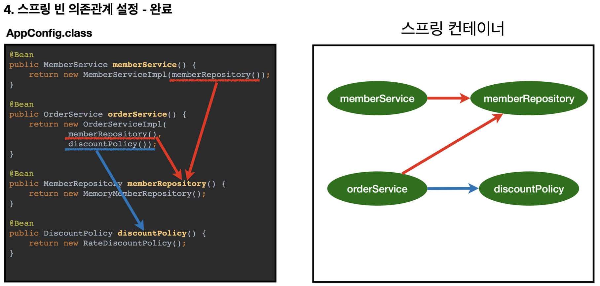

[(출처) 스프링 핵심 원리 - 기본편](https://www.inflearn.com/course/%EC%8A%A4%ED%94%84%EB%A7%81-%ED%95%B5%EC%8B%AC-%EC%9B%90%EB%A6%AC-%EA%B8%B0%EB%B3%B8%ED%8E%B8?gad_source=1&gad_campaignid=20714471420&gbraid=0AAAAADAClSB81nOfyUPym-Hq8jxqt7XS6&gclid=Cj0KCQjw8eTFBhCXARIsAIkiuOzXYq7ocyYtwsAYGU9mf90LptHZBEPRpIiIe0AUTlu0Geu5eJD1ByoaAsW0EALw_wcB)

## 스프링 컨테이너 생성

```java
//스프링 컨테이너 생성
ApplicationContext applicationContext = new AnnotationConfigApplicationContext(AppConfig.class);
```

`ApplicationContext`를 스프링 컨테이너라 하고, BeanFactory를 확장한 인터페이스이다.

스프링 컨테이너는 XML을 기반으로 만들 수 있고, 애노테이션 기반의 자바 설정 클래스로 만들 수 있다.

직전에 `AppConfig`를 사용했던 방식이 애노테이션 기반의 자바 설정 클래스로 스프링 컨테이너를 만든 것이다.

#### 스프링 컨테이너 생성 과정
  
**스프링 컨테이너를 생성할 때는 구성 정보를 지정**해주어야 한다.

여기서는 `AppConfig.class`를 구성 정보로 저장했다.
  
스프링 컨테이너는 파라미터로 넘어온 설정 클래스 정보를 사용해서 스프링 빈을 등록한다.
  
빈 이름은 매서드 이름을 사용하지만, 직접 부여할 수도 있다.

**빈 이름은 항상 다른 이름을 부여해야 한다.** 같은 이름을 부여하면, 다른 빈이 무시되거나, 기존 빈을 덮어버리거나 설정에 따라 오류가 발생한다.
  
스프링 컨테이너는 설정 정보를 참고해서 의존관계 주입(DI)한다.

단순히 자바 코드를 호출하는 것 같지만, 차이가 있다. 이 차이는 뒤에 싱글톤 컨테이너에서 설명한다.

## 스프링 컨테이너 장점
**1. 객체 생명주기 관리**

- 생성 → 의존성 주입 → 초기화 → 소멸까지 한 번에 관리
- 기본 싱글톤 스코프 → 중복 객체 생성 방지, 메모리 절약
- 필요하면 프로토타입, 요청(request) 단위 등 다양한 스코프 지원

**2. 의존성 주입(DI) 자동화**

- 코드에서 new로 직접 만들지 않고 필요한 의존 객체를 자동 주입
- DIP(의존 역전 원칙) 지키기 쉬움 → 구현체 교체도 설정만 변경하면 끝
- 테스트 시 Mock 객체 주입이 편리

**3. 설정과 사용 코드의 분리**

- 객체 생성·연결 로직(AppConfig, @Bean 등)은 한 곳에 모음
- 비즈니스 로직은 “무엇을 쓸지” 몰라도 “어떻게 동작하는지”만 신경 쓰면 됨
- 환경별(dev/prod/test)로 설정 변경도 용이

**4. 확장 기능(AOP 등) 쉽게 적용**

- 트랜잭션 관리(@Transactional)
- 로깅, 성능 측정, 보안 처리 등 횡단 관심사(공통 기능) 자동 적용
- 빈을 프록시로 감싸서 부가 기능 주입

**5. 자동 스캔 & 환경 설정**

- @Component, @Service, @Repository로 클래스 자동 빈 등록
- @Profile, @PropertySource 등으로 환경별 설정 분리 가능
