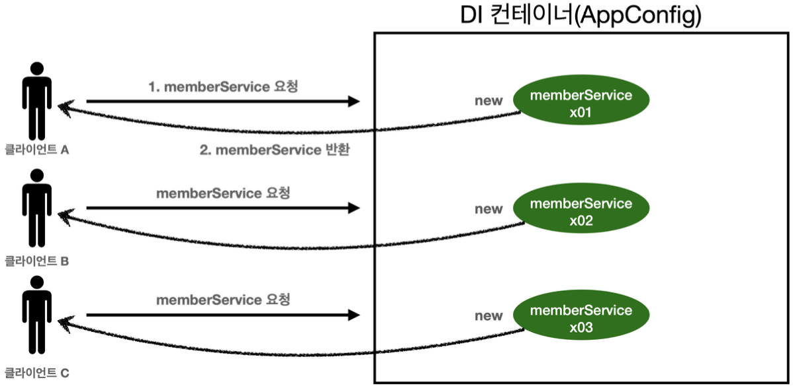
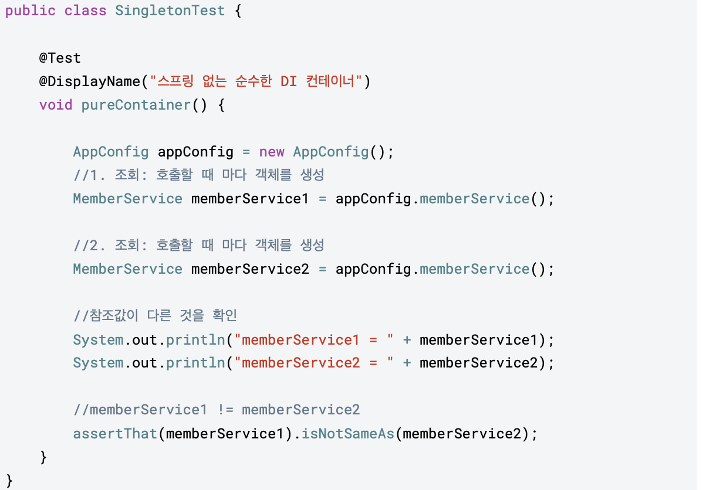
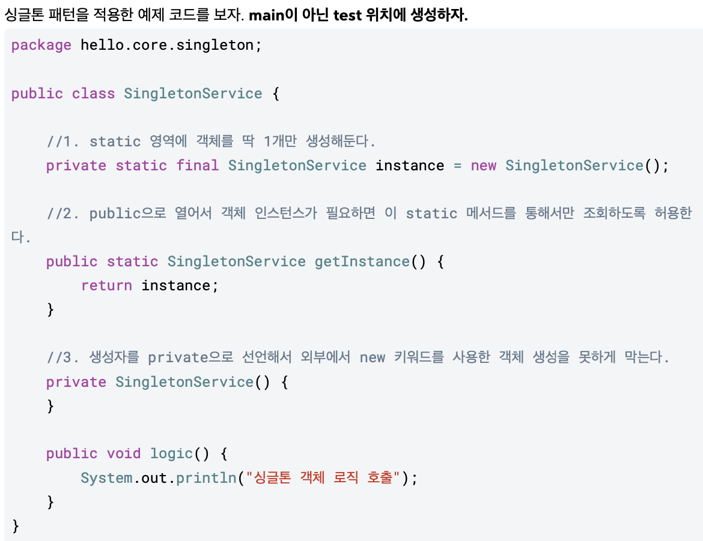
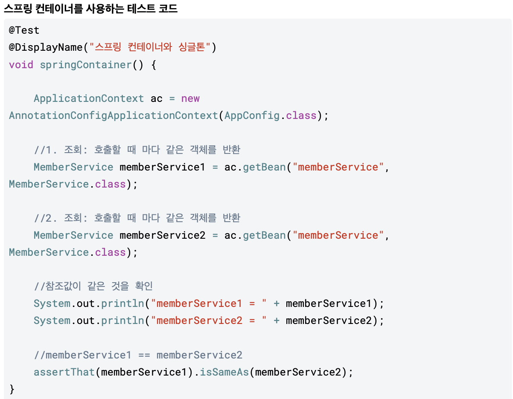
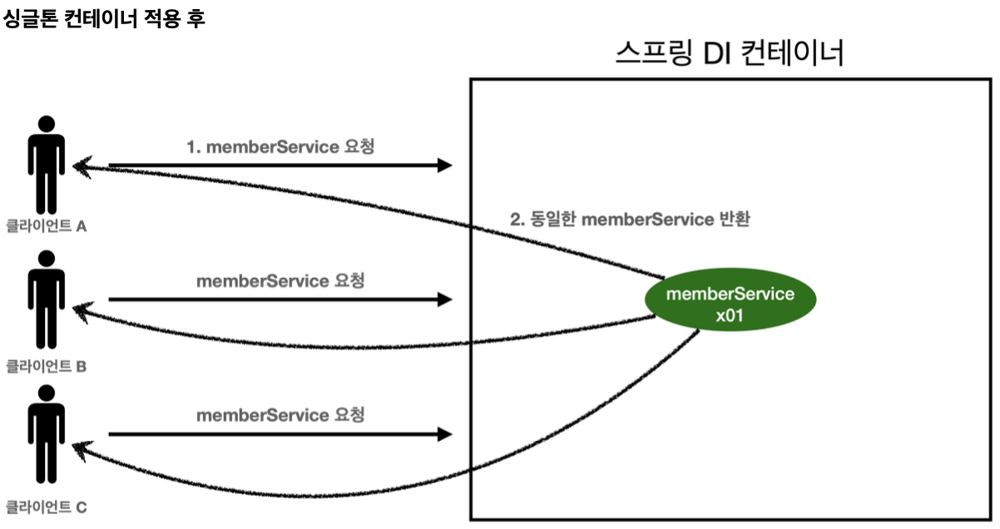
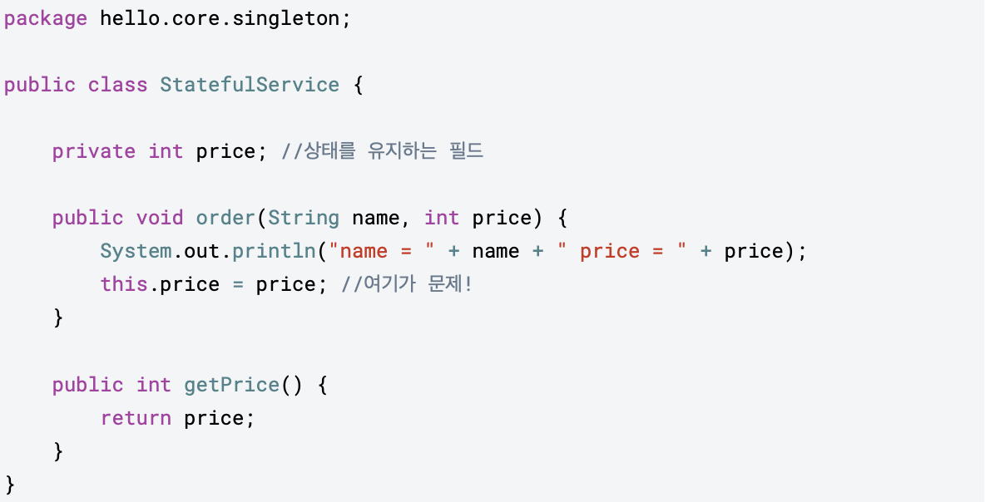
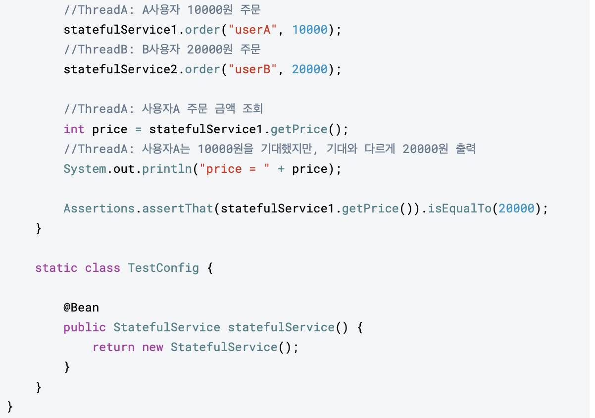
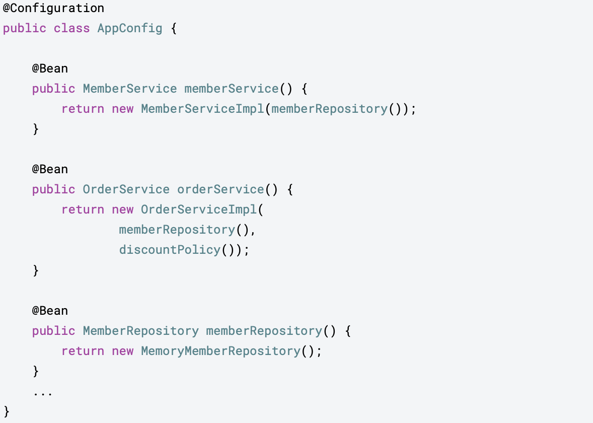
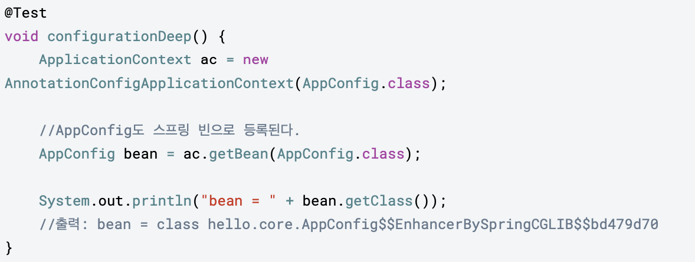
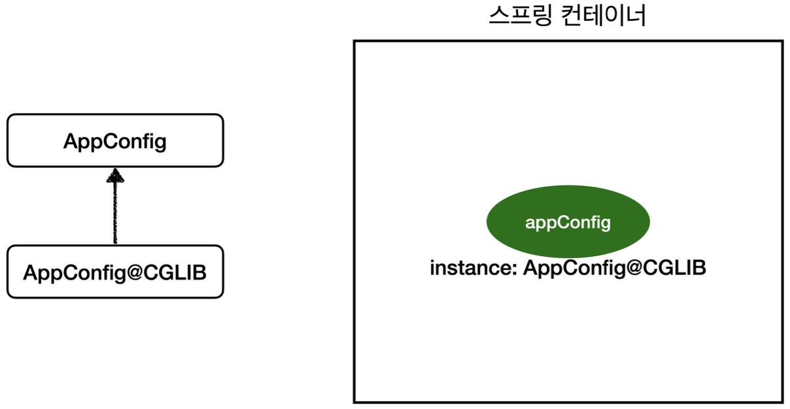

[(출처) 스프링 핵심 원리 - 기본편](https://www.inflearn.com/course/%EC%8A%A4%ED%94%84%EB%A7%81-%ED%95%B5%EC%8B%AC-%EC%9B%90%EB%A6%AC-%EA%B8%B0%EB%B3%B8%ED%8E%B8?gad_source=1&gad_campaignid=20714471420&gbraid=0AAAAADAClSB81nOfyUPym-Hq8jxqt7XS6&gclid=Cj0KCQjw8eTFBhCXARIsAIkiuOzXYq7ocyYtwsAYGU9mf90LptHZBEPRpIiIe0AUTlu0Geu5eJD1ByoaAsW0EALw_wcB)

## 웹 애플리케이션과 싱글톤
웹 애플리케이션은 보통 여러 고객이 동시에 요청을 한다.

  
스프링 없는 순수한 DI 컨테이너인 `AppConfig`는 요청을 할 때 마다 객체를 새로 생성한다.

고객 트래픽이 초당 100이 나오면 초당 100개 객체가 생성되고 소멸된다  
-> 메모리 낭비가 심하다.

**해결방안**은 해당 객체가 딱 1개만 생성되고, 공유하도록 설계하면 된다.  
**-> 싱글톤 패턴**

#### 싱글톤 패턴
**클래스의 인스턴스가 딱 1개만 생성되는 것을 보장하는 디자인 패턴이다.**

그래서 객체 인스턴스를 2개 이상 생성하지 못하도록 막아야 한다.
  
static영역에 객체 instance를 미리 하나 생성해서 올려둔다.

이 객체 인스턴스가 필요하면 오직 `getInstance()`메서드를 통해서만 조회할 수 있다. 이 메서드를 호출하면 항상 같은 인스턴스를 반환한다.

딱 1개의 객체 인스턴스만 존재해야 하므로, 생성자를 `private`으로 막아서 혹시라도 외부에서 `new` 키워드로 객체 인스턴스가 생성되는 것을 막는다.

#### 싱글톤 패턴의 문제점
- 싱글톤 패턴을 구현하는 코드 자체가 많이 들어간다.
- 의존관계상 클라이언트가 구체 클래스에 의존한다. -> DIP를 위반한다.
- 클라이언트가 구체 클래스에 의존해서 OCP 원칙을 위반할 가능성이 높다.
- 테스트하기 어렵다.
- 내부 속성을 변경하거나 초기화 하기 어렵다.
- `private`생성자로 자식 클래스를 만들기 어렵다.
- 결론적으로 유연성이 떨어진다.
- 안티패턴으로 불리기도 한다.

## 싱글톤 컨테이너
**스프링 컨테이너는 싱글턴 패턴을 적용하지 않아도, 객체 인스턴스를 싱글톤으로 관리한다.**

스프링 컨테이너는 싱글톤 컨테이너의 역할을 한다. 이렇게 싱글톤 객체를 생성하고 관리하는 기능을 **싱글톤 레지스트리**라 한다.

**스프링 컨테이너**의 이런 기능 덕분에 싱글턴 패턴의 모든 단점을 해결하면서 **객체를 싱글톤으로 유지할 수 있다.**


> 스프링의 기본 빈 등록 방식은 싱글톤이지만, 싱글톤 방식만 지원하는 것은 아니다. 요청할 때 마다 새로운 객체를 생성해서 반환하는 기능도 제공한다. 자세한 내용은 뒤에 빈 스코프에서 설명하겠다.

## 싱글톤 방식의 주의점
객체 인스턴스를 하나만 생성해서 공유하는 싱글톤 방식은 여러 클라이언트가 하나의 같은 객체 인스턴스를 공유하기 때문에 싱글톤 객체는 상태를 유지(stateful)하게 설계하면 안된다.  
**-> 무상태(stateless)로 설계해야 한다!!!**
> **무상태(stateless)**
- 특정 클라이언트에 의존적인 필드가 있으면 안된다.
- 특정 클라이언트가 값을 변경할 수 있는 필드가 있으면 안된다.
- 가급적 읽기만 가능해야 한다.
- 필드 대신에 자바에서 공유되지 않는, 지역변수, 파라미터, ThreadLocal 등을 사용해야 한다.

**스프링 빈의 필드에 공유 값을 설정하면 정말  큰 장애가 발생할 수 있다!!!**

#### 상태를 유지할 경우 발생하는 문제점 예시

  
**상태를 유지하는 필드**로 설계를 하면 **특정 클라이언트가 값을 변경할 수 있다.**

실무에서 이런 경우를 종종 보는데, 이로인해 정말 해결하기 어려운 큰 문제들이 터진다. **항상 무상태(stateless)로 설계하자!!!**

```java
package hello.core.singleton;

public class StatefulService {

    //지금은 무상태 필드 stateless

    public int order(String name, int price) {
        System.out.println("name = " + name + " price = " + price);
        return price;
    }
}
```

## @Configuration과 싱글톤
  
코드를 보면 `new MemoryMemberRepository()`를 여러번 호출하게 된다.

싱글톤이 깨지는 것 처럼 보이는데, 스프링 컨테이너는 이 문제를 어떻게 해결할까?

사실 `AnnotationConfigApplicationContext`에 파라미터로 넘긴 값은 스프링 빈으로 등록된다. 그래서 `AppConfig`도 스프링 빈이 된다.

`AppConfig`스프링 빈을 조회해서 클래스 정보를 출력해보자.



`bean = class hello.core.AppConfig$$EnhancerBySpringCGLIB$$bd479d70`

순수한 클래스라면 `class hello.core.AppConfig`이렇게 출력이 되어야 하는데...?

스프링이 `CGLIB`라는 바이트코드 조작 라이브러리를 사용해서 `AppConfig` 클래스를 상속받은 임의의 다른 클래스를 만들고, 그 클래스를 스프링 빈으로 등록한 것이다!

**그 임의의 다른 클래스가 바로 싱글톤이 보장되도록 해준다.**



**`@Configuration`은 설정 클래스임을 명시하는 것과 동시에 싱글톤을 보장한다.**

**스프링 설정 정보는 항상 `@Configuration`을 사용하자.**
