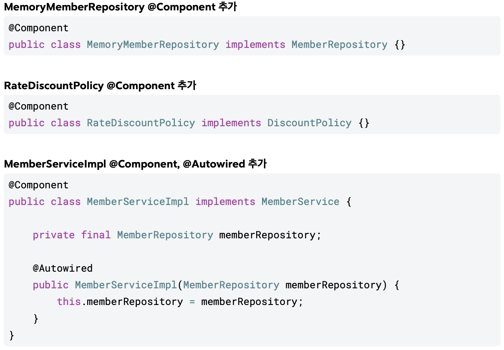
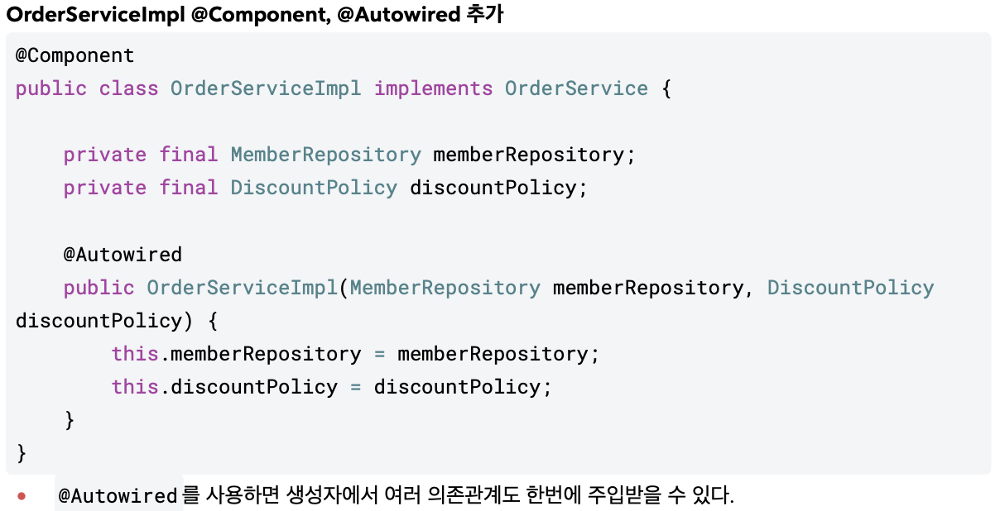
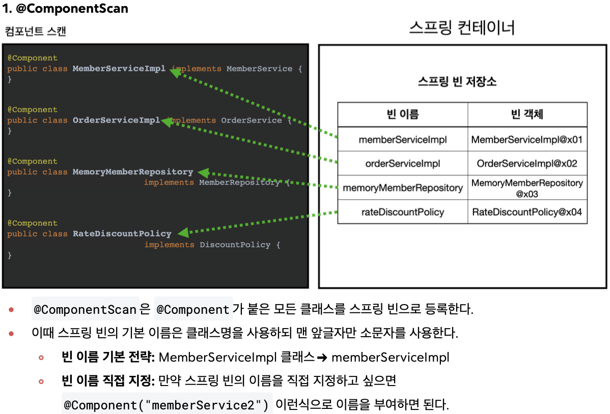
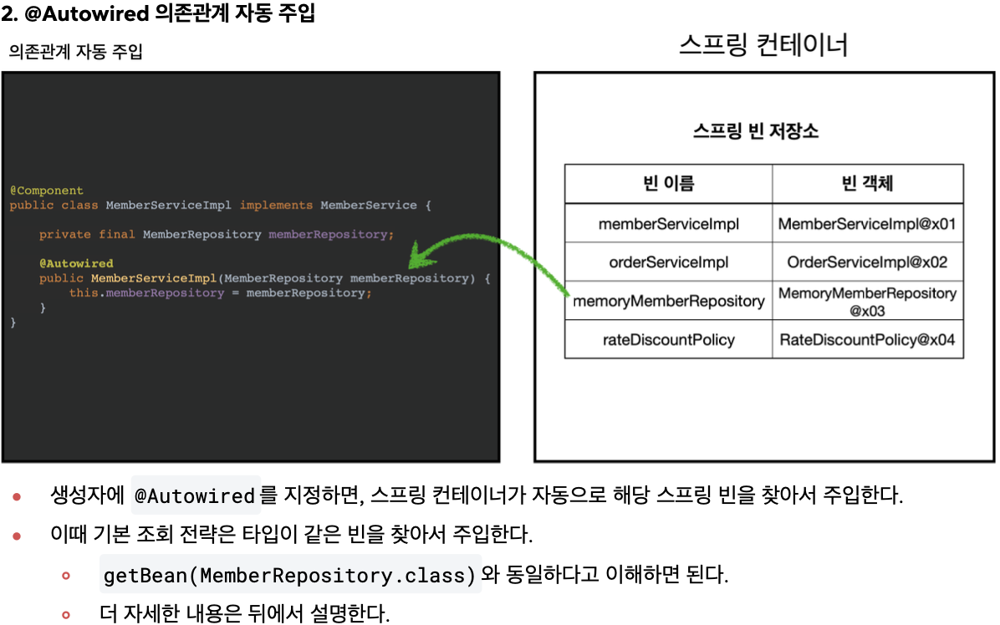
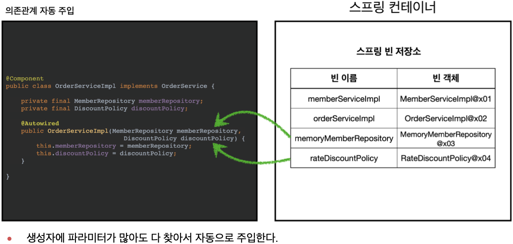
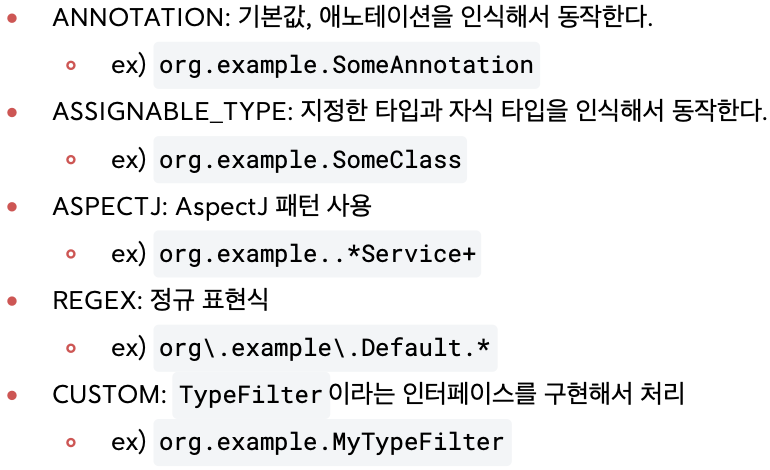
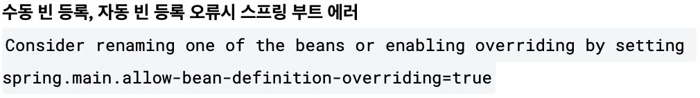

[(출처) 스프링 핵심 원리 - 기본편](https://www.inflearn.com/course/%EC%8A%A4%ED%94%84%EB%A7%81-%ED%95%B5%EC%8B%AC-%EC%9B%90%EB%A6%AC-%EA%B8%B0%EB%B3%B8%ED%8E%B8?gad_source=1&gad_campaignid=20714471420&gbraid=0AAAAADAClSB81nOfyUPym-Hq8jxqt7XS6&gclid=Cj0KCQjw8eTFBhCXARIsAIkiuOzXYq7ocyYtwsAYGU9mf90LptHZBEPRpIiIe0AUTlu0Geu5eJD1ByoaAsW0EALw_wcB)

## 컴포넌트 스캔과 의존관계 자동 주입
지금까지 스프링 빈을 등록할 때는 자바 코드의 `@Bean`이나 XML의 `<bean>`등을 통해서 설정 정보에 직접 등록할 스프링 빈을 나열했다.

```java
@Configuration
public class AppConfig {


    @Bean
    public MemberService memberService(){
        return new MemberServiceImpl(memberRepository()); //의존성 주입
    }
    
    @Bean
    public MemoryMemberRepository memberRepository() {
        return new MemoryMemberRepository();
    }
    
    @Bean
    public OrderService orderService(){
        return new OrderServiceImpl(memberRepository(), discountPolicy());
    }
    
    @Bean
    public DiscountPolicy discountPolicy(){
        return new RateDiscountPolicy();
    }
}
```

스프링은 설정 정보가 없어도 자동으로 스프링 빈을 등록하는 컴포넌트 스캔이라는 기능을 제공한다.

또한, 의존관계도 자동으로 주입하는 `@Autowired`라는 기능도 제공한다.

```java
@Configuration
@ComponentScan(
//기존 코드를 남겨두기 위한 방법
//@Configuration 소스코드를 열어보면 @Component 애노테이션이 붙어있기 때문에 스캔 대상에서 제외

    excludeFilters = @ComponentScan.Filter(type = FilterType.ANNOTATION, classes = Configuration.class)
)
public class AutoAppConfig {

}
```

컴포넌트 스캔을 사용하려면 먼저 `@ComponentScan`을 설정 정보에 붙여주면 된다.

기존의 AppConfig와는 다르게 `@Bean`으로 등록한 클래스가 하나도 없다!!!

컴포넌트 스캔은 이름 그대로 `@Component` 애노테이션이 붙은 클래스를 스캔해서 스프링 빈으로 등록한다.

이제 각 클래스가 컴포넌트 스캔의 대상이 되도록 `@Component`애노테이션을 붙여주자.




#### 컴포넌트 스캔과 자동 의존관계 주입이 어떻게 동작하는지 그림으로 알아보자.





## 탐색 위치와 기본 스캔 대상
모든 자바 클래스를 다 컴포넌트 스캔하면 시간이 오래 걸린다. 그래서 꼭 필요한 위치부터 탐색하도록 시작 위치를 지정할 수 있다.

```java
 @ComponentScan(
         basePackages = "hello.core",
}
```

`basePackages`는 탐색할 패키지의 시작 위치를 지정한다. 이 패키지를 포함해서 하위 패키지를 모두 탐색한다.

`basePackages = {"hello.core", "hello.service"}`이렇게 여러 시작 위치를 지정할 수도 있다.

만약 지정하지 않으면 `@ComponentScan`이 붙은 설정 정보 클래스의 패키지가 시작 위치가 된다.

**권장하는 방법은 설정 정보 클래스의 위치를 프로젝트 최상단 위치에 두는 것**이다.

강의에서 하는 것 처럼 `com.hello` 여기에 `AppConfig` 같은 메인 설정 정보를 두고, `@ComponentScan`애노테이션을 붙이고, `basePackages` 지정은 생략한다.

## FilterType 옵션
FilterType은 5가지 옵션이 있다.


## 중복 등록과 충돌
#### 자동 빈 등록 vs 자동 빈 등록
`ConflictingBeanDefinitionException` 예외가 발생한다.

#### 수동 빈 등록 vs 자동 빈 등록
이 경우 수동 빈 등록이 우선권을 가진다.  
(수동 빈이 자동 빈을 오버라이딩 해버린다.)

이렇게 되면 꼬여서 정말 잡기 어려운 버그가 만들어진다. **항상 잡기 어려운 버그는 애매한 버그다.**

그래서 최근 스프링 부트에서는 수동 빈 등록과 자동 빈 등록이 충돌나면 오류가 발생하도록 기본 값을 바꾸었다.


