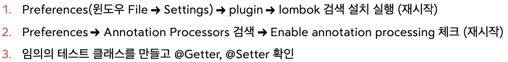
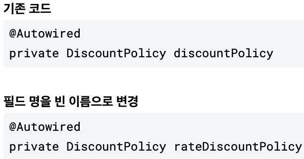
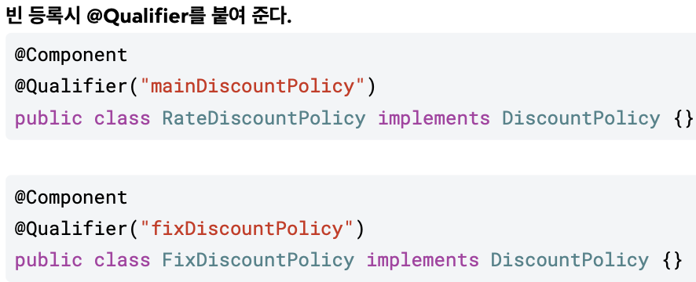
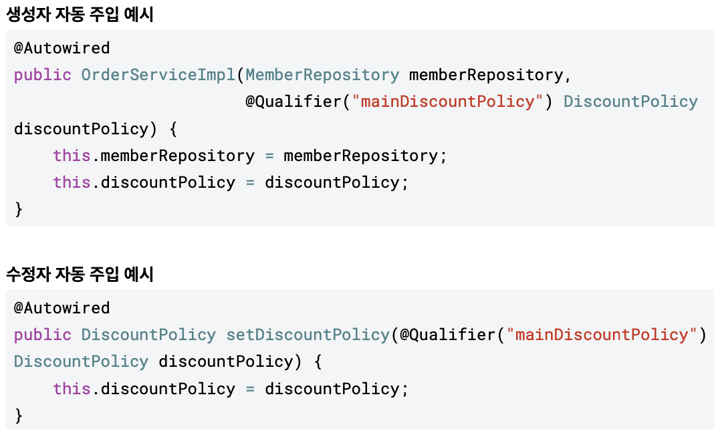
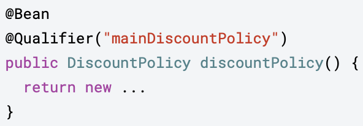

[(출처) 스프링 핵심 원리 - 기본편](https://www.inflearn.com/course/%EC%8A%A4%ED%94%84%EB%A7%81-%ED%95%B5%EC%8B%AC-%EC%9B%90%EB%A6%AC-%EA%B8%B0%EB%B3%B8%ED%8E%B8?gad_source=1&gad_campaignid=20714471420&gbraid=0AAAAADAClSB81nOfyUPym-Hq8jxqt7XS6&gclid=Cj0KCQjw8eTFBhCXARIsAIkiuOzXYq7ocyYtwsAYGU9mf90LptHZBEPRpIiIe0AUTlu0Geu5eJD1ByoaAsW0EALw_wcB)

## 다양한 의존관계 주입 방법
의존관계 주입은 크게 4가지 방법이 있다.

- 생성자 주입
- 수정자 주입 (setter 주입)
- 필드 주입
- 일반 메서드 주입

#### 생성자 주입
이름 그대로 생성자를 통해서 의존 관계를 주입 받는 방법이다.

지금까지 우리가 진행했던 방법이 바로 생성자 주입이다.

**생성자 호출시점에 딱 1번만 호출되는 것이 보장되고 불변, 필수 의존관계에 사용된다.**

```java
@Component
public class OrderServiceImpl implements OrderService {

    private final MemberRepository memberRepository;
    private final DiscountPolicy discountPolicy;

    @Autowired
    public OrderServiceImpl(MemberRepository memberRepository, @MainDiscountPolicy DiscountPolicy discountPolicy) {
        this.memberRepository = memberRepository;
        this.discountPolicy = discountPolicy;
    }
}
```

**생성자가 1개만 있으면 `@Autowired`를 생략해도 자동 주입 된다.** 물론 스프링 빈에만 해당된다.

#### 수정자 주입 (setter 주입)
setter라 불리는 필드의 값을 변경하는 수정자 메서드를 통해서 의존관계를 주입하는 방법이다.

**선택, 변경 가능성이 있는 의존관계에 사용한다.**

자바빈 프로퍼티 규약의 수정자 메서드 방식을 사용하는 방법이다.

```java
@Component
public class OrderServiceImpl implements OrderService {

    private MemberRepository memberRepository;
    private DiscountPolicy discountPolicy;

    @Autowired
    public void setMemberRepository(MemberRepository memberRepository){
    	this.memberRepository = memberRepository
	}
    
    @Autowired
    public void setDiscountPolicy(DiscountPolicy discountPolicy){
    	this.discountPolicy = discountPolicy
	}
}
```

`@Autowired`의 기본 동작은 주입할 대상이 없으면 오류가 발생한다. **주입할 대상이 없어도 동작하게 하려면 `@Autowired(required = false)`로 지정하면 된다.**

#### 필드 주입
이름 그대로 필드에 바로 주입하는 방법이다.

코드가 간결하다는 장점이 있지만, 외부에서 변경이 불가능해서 테스트 하기 어렵다는 치명적인 단점이 있다.

또한, `final`을 사용하지 못해 불변성이 보장되지 않고, Spring DI 컨테이너 밖에서 사용할 수 없다

**사용하지 말자!**

```java
@Component
public class OrderServiceImpl implements OrderService {
	
    @Autowired
    private MemberRepository memberRepository;
    @Autowired
    private DiscountPolicy discountPolicy;
    
}
```

#### 일반 메서드 주입
일반 메서드를 통해서 주입 받을 수 있다.

한번에 여러 필드를 주입 받을 수 있고, 순환 의존성 처리를 할 수 있다는 장점이 있다.

일반적으로 잘 사용하지 않는다.

```java
@Component
public class OrderServiceImpl implements OrderService {

    private MemberRepository memberRepository;
    private DiscountPolicy discountPolicy;

    @Autowired
    public void init(MemberRepository memberRepository, DiscountPolicy discountPolicy){
    	this.memberRepository = memberRepository;
        this.discountPolicy = discountPolicy;
	}
}
```

### 생성자 주입을 선택해야 하는 이유!
**1. 불변**

- 대부분의 의존관계 주입은 한번 일어나면 애플리케이션 종료 시점까지 의존관계를 변경할 일이 없다. 오히려 대부분의 의존관계는 애플리케이션 종료 전까지 변하면 안된다. 불변해야 한다.

- 수정자 주입을 사용하면, setXxx 메서드를 public으로 열어두어야 한다. 열어두면 누군가 실수로 변경할 수 있고, 변경하면 안되는 메서드를 열어두는 것은 좋은 설계 방법이 아니다.

- 생성자 주입은 객체를 생성할 때 딱 1번만 호출되므로 이후에 호출되는 일이 없다. 따라서 불변하게 설계할 수 있다.

**2. 누락**

다음과 같이 수정자 의존관계인 경우

```java
public class OrderServiceImpl implements OrderService {

     private MemberRepository memberRepository;
     private DiscountPolicy discountPolicy;
     
    @Autowired
    public void setMemberRepository(MemberRepository memberRepository) {
        this.memberRepository = memberRepository;
    }
    
    @Autowired
    public void setDiscountPolicy(DiscountPolicy discountPolicy) {
        this.discountPolicy = discountPolicy;
    }
//...
}
```

---

```java
 @Test
 void createOrder() {
     OrderServiceImpl orderService = new OrderServiceImpl(); // 의존관계 주입 누락
     orderService.createOrder(1L, "itemA", 10000);
 }
```

이렇게 테스트를 수행하면 실행은 되지만 막상 실행 결과는 NPE가 발생하는데, 의존관계 주입이 누락되었기 때문이다.

**생성자 주입을 사용하면** 위의 주입 데이터를 누락 했을 때 **컴파일 오류**가 발생하고, **IDE에서 바로 어떤 값을 필수로 주입해야 하는지 알 수 있다!**

**3. final 키워드**

생성자 주입을 사용하면 필드에 `final` 키워드를 사용할 수 있다. 그래서 생성자에서 혹시라도 값이 설정되지 않는 **오류를 컴파일 시점에 막아준다.**

```java
@Component
public class OrderServiceImpl implements OrderService {

    private final MemberRepository memberRepository;
    private final DiscountPolicy discountPolicy;
    
    @Autowired
    public OrderServiceImpl(MemberRepository memberRepository, DiscountPolicy
            discountPolicy) {
        this.memberRepository = memberRepository;
    }
//...
}
```

위의 코드를 보면 필수 필드인 `discountPolicy`에 값을 설정해야 하는데, 이 부분이 누락되었다. 자바는 컴파일 시점에 다음 오류를 발생시킨다.

`java: variable discountPolicy might not have been initialized`

**컴파일 오류는 세상에서 가장 빠르고, 좋은 오류다!**

#### 정리


## 옵션 처리
주입할 스프링 빈이 없어도 동작해야 할 때가 있다.  
그런데 `@Autowired`만 사용하면 `required` 옵션의 기본값이 `true`로 되어 있어서 자동 주입 대상이 없으면 오류가 발생한다.

자동 주입 대상을 옵션으로 처리하는 방법은 다음과 같다.

- `@Autowired(required=false)` : 자동 주입할 대상이 없으면 수정자 메서드 자체가 호출 안됨
- `org.springframework.lang.@Nullable` : 자동 주입할 대상이 없으면 null이 입력된다.
- `Optional<>` : 자동 주입할 대상이 없으면 `Optional.empty` 가 입력된다.

```java
//호출 안됨
@Autowired(required = false)
public void setNoBean1(Member member) {
     System.out.println("setNoBean1 = " + member);
 }
 
//null 호출
@Autowired
public void setNoBean2(@Nullable Member member) {
     System.out.println("setNoBean2 = " + member);
 }
 
//Optional.empty 호출
@Autowired(required = false)
public void setNoBean3(Optional<Member> member) {
     System.out.println("setNoBean3 = " + member);
 }
```

## 롬복과 최신 트렌드
개발자는 귀찮은 것은 못 참는다...

다음 기본 코드를 최적화 해보자.

```java
@Component
public class OrderServiceImpl implements OrderService {
	 
    private final MemberRepository memberRepository;
    private final DiscountPolicy discountPolicy;
     
    @Autowired
    public OrderServiceImpl(MemberRepository memberRepository, DiscountPolicy discountPolicy) {
        this.memberRepository = memberRepository;
        this.discountPolicy = discountPolicy;
	}
}
```

**Lombok 라이브러리**가 제공하는 **`@RequireArgsConstructor` 기능**을 사용하면 **`final`이 붙은 필드를 모아서 생성자를 자동으로 만들어준다.**

```java
 @Component
 @RequiredArgsConstructor
 public class OrderServiceImpl implements OrderService {
     private final MemberRepository memberRepository;
     private final DiscountPolicy discountPolicy;
}
```

#### 롬복 라이브러리 적용 방법

`build.gradle`에 라이브러리 및 환경 추가

```java
plugins {
	id 'java'
	id 'org.springframework.boot' version '3.5.4'
	id 'io.spring.dependency-management' version '1.1.7'
}

group = 'hello'
version = '0.0.1-SNAPSHOT'

java {
	toolchain {
		languageVersion = JavaLanguageVersion.of(17)
	}
}

//lombok 설정 추가 시작
configurations {
    compileOnly {
        extendsFrom annotationProcessor
    }
}
//lombok 설정 추가 끝

repositories {
	mavenCentral()
}

dependencies {
	implementation 'org.springframework.boot:spring-boot-starter'
    implementation 'jakarta.inject:jakarta.inject-api:2.0.1'
    implementation 'org.springframework.boot:spring-boot-starter-web'

    //lombok 라이브러리 추가 시작
    compileOnly 'org.projectlombok:lombok'
    annotationProcessor 'org.projectlombok:lombok'

    testCompileOnly 'org.projectlombok:lombok'
    testAnnotationProcessor 'org.projectlombok:lombok'
    //lombok 라이브러리 추가 끝


    testImplementation 'org.springframework.boot:spring-boot-starter-test'
	testRuntimeOnly 'org.junit.platform:junit-platform-launcher'
}

tasks.named('test') {
	useJUnitPlatform()
}
```



## 조회 빈이 2개 이상일 때 생기는 문제
`@Autowired`는 타입(Type)으로 조회한다.

타입으로 조회하기 때문에, 마치 다음 코드와 유사하게 동작한다. (실제로는 더 많은 기능을 제공한다)

```text
ac.getBean(DiscountPolicy.class)
```

스프링 빈 조회에서 학습했듯이 타입으로 조회하면 선택된 빈이 2개 이상일 때 문제가 발생한다.

`DiscountPolicy`의 하위 타입인 `FixDiscountPolicy`, `RateDiscountPolicy` 둘다 스프링 빈으로 선언하고 의존관계 자동 주입을 실행하면 `NoUniqueBeanDefinitionException` 오류가 발생한다.

오류메시지를 보면 친절하게도 하나의 빈을 기대했는데, 2개가 발견되었다고 알려준다.

이러한 문제를 의존 관계 자동 주입에서 해결하는 여러 방법이 있다.


#### @Autowired 필드 명 매치

`@Autowired`는 타입 매칭을 시도하고, 이때 여러 빈이 있으면 필드 이름, 파라미터 이름으로 빈 이름을 추가 매칭한다.



#### @Qualifier 사용
`@Qualifier`는 추가 구분자를 붙여주는 방법이다. 주입시 추가적인 방법을 제공하는 것이지 빈 이름을 변경하는 것은 아니다.



**그리고 주입시에 @Qualifier를 붙여주고 등록한 이름을 적어준다.**



그런데 만약, `@Qualifier`로 주입할 때 `@Qualifier("mainDiscountPolicy")`를 못찾으면 어떻게 될까? 그러면 `mainDiscountPolicy`라는 이름의 스프링 빈을 추가로 찾는다.

하지만 경험상 `@Qualifier`는 `@Qualifier`를 찾는 용도로만 사용하는게 명확하고 좋다.

다음과 같이 직접 `@Bean` 등록시에도 `@Qualifier`를 동일하게 사용할 수 있다.



#### @Primary 사용
`@Primary`는 우선순위를 정하는 방법이다. `@Autowired`시에 여러 빈이 매칭되면 `@Primary`가 우선권을 가진다.

`rateDiscountPolicy`가 우선권을 가지도록 하자.

```java
@Component
@Primary
public class RateDiscountPolicy implements DiscountPolicy {}
 
@Component
public class FixDiscountPolicy implements DiscountPolicy {}
```

---

```java
//생성자
@Autowired
public OrderServiceImpl(MemberRepository memberRepository, DiscountPolicy discountPolicy) {
	this.memberRepository = memberRepository;
	this.discountPolicy = discountPolicy;
}
 
//수정자
@Autowired
public DiscountPolicy setDiscountPolicy(DiscountPolicy discountPolicy) {
	this.discountPolicy = discountPolicy;
}
```

코드를 실행해보면 문제 없이 `@Primary`가 잘 동작하는 것을 확인할 수 있다.

##### @Primary vs @Qualifier

코드에서 **자주 사용하는 메인 데이터베이스의 커넥션을 획득하는 스프링 빈**이 있고, 코드에서 특별한 기능으로 **가끔 사용하는 서브 데이터베이스의 커넥션을 획득하는 스프링 빈**이 있다고 생각해보자.

메인 스프링 빈은 `@Primary`를 적용해서 조회하는 곳에서 `@Qualifier` 지정 없이 편리하게 조회하고,

서브 스프링 빈은 `@Qualifier`를 지정해서 명시적으로 획득하는 방식으로 사용하면 코드를 깔끔하게 유지할 수 있다.

우선순위는 더 상세하게 동작하는 `@Qualifier`이다.

## 애노테이션 직접 만들기
`@Qualifier("mainDiscountPolicy")` 이렇게 문자를 적으면 **컴파일시 타입 체크가 안된다.** 다음과 같은 애노테이션을 만들어서 문제를 해결할 수 있다.

```java
package hello.core.annotation;

import org.springframework.beans.factory.annotation.Qualifier;

import java.lang.annotation.*;

@Target({ElementType.FIELD, ElementType.METHOD, ElementType.PARAMETER, ElementType.TYPE, ElementType.ANNOTATION_TYPE})
@Retention(RetentionPolicy.RUNTIME)
@Inherited
@Qualifier("mainDiscountPolicy")
public @interface MainDiscountPolicy {
}
```

---

```java
@Component
@MainDiscountPolicy
public class RateDiscountPolicy implements DiscountPolicy {}
```

---

```java
//생성자 자동 주입
@Autowired
public OrderServiceImpl(MemberRepository memberRepository, @MainDiscountPolicy DiscountPolicy discountPolicy) {
	this.memberRepository = memberRepository;
	this.discountPolicy = discountPolicy;
 }
 
//수정자 자동 주입
@Autowired
public DiscountPolicy setDiscountPolicy(@MainDiscountPolicy DiscountPolicy discountPolicy) {
	this.discountPolicy = discountPolicy;
 }
```

## 조회한 빈이 모두 필요할 때 - List, Map

의도적으로 정말 해당 타입의 스프링 빈이 다 필요한 경우도 있다.

예를 들어서 할인 서비스를 제공하는데, 클라이언트가 할인의 종류(rate, fix)를 선택할 수 있다고 가정해보자. 스프링을 사용하면 소위 말하는 전략 패턴을 매우 간단하게 구현할 수 있다.

```java
package hello.core.autowired;

import hello.core.AutoAppConfig;
import hello.core.discount.DiscountPolicy;
import hello.core.member.Grade;
import hello.core.member.Member;
import org.junit.jupiter.api.Test;
import org.springframework.beans.factory.annotation.Autowired;
import org.springframework.context.ApplicationContext;
import org.springframework.context.annotation.AnnotationConfigApplicationContext;

import java.util.List;
import java.util.Map;

import static org.assertj.core.api.Assertions.assertThat;

public class AllBeanTest {

    @Test
    void findAllBean() {
        ApplicationContext ac = new AnnotationConfigApplicationContext(AutoAppConfig.class, DiscountService.class);

        DiscountService discountService = ac.getBean(DiscountService.class);
        Member member = new Member(1L, "userA", Grade.VIP);
        int discountprice = discountService.discount(member, 10000, "fixDiscountPolicy");
        assertThat(discountprice).isEqualTo(1000);

        int rateDiscountPrice = discountService.discount(member, 20000, "rateDiscountPolicy");
        assertThat(rateDiscountPrice).isEqualTo(2000);


    }

    static class DiscountService{
        private final Map<String, DiscountPolicy> policyMap;
        private final List<DiscountPolicy> policies;

        @Autowired
        public DiscountService(Map<String, DiscountPolicy> policyMap, List<DiscountPolicy> policies) {
            this.policyMap = policyMap;
            this.policies = policies;
            System.out.println("policyMap = " + policyMap);
            System.out.println("policies = " + policies);
        }

        public int discount(Member member, int price, String discountCode) {
            DiscountPolicy discountPolicy = policyMap.get(discountCode);
            return discountPolicy.discount(member, price);
        }
    }
}

```

`DiscountService`는 `Map`으로 모든 `DiscountPolicy`를 주입받는다.

이때 `fixDiscountPolicy`, `rateDiscountPolicy`가 주입된다.

`discount()`메서드는 `discountCode`로 `fixDiscountPolicy`가 넘어오면 `map`에서 `fixDiscountPolicy` 스프링 빈을 찾아서 실행한다. (`rateDiscountPolicy`도 마찬가지이다.)

- **`Map<String, DiscountPolicy>`**  
map의 키에 스프링 빈의 이름을 넣어주고, 그 값으로 `DiscountPolicy` 타입으로 조회한 모든 스프링 빈을 담아준다.

- **`List<DiscountPolicy>`**  
`DiscountPolicy` 타입으로 조회한 모든 스프링 빈을 담아준다.

만약 해당하는 타입의 스프링 빈이 없으면, 빈 컬렉션이나 Map을 주입한다.

> **참고 - 스프링 컨테이너를 생성하면서 스프링 빈 등록하기**
>

```java
new AnnotationConfigApplicationContext(AutoAppConfig.class, DiscountService.class);
```

>
위의 코드는 스프링 컨테이너를 생성하면서, 해당 컨테이너에 동시에 `AutoAppConfig`, `DiscountService`를 스프링 빈으로 자동 등록한다.

## 자동, 수동의 올바른 실무 운영 기준
편리한 자동 기능을 기본으로 사용하자

**그러면 수동 빈 등록은 언제 사용하면 좋을까?**

애플리케이션은 크게 업무 로직과 기술 지원 로직으로 나눌 수 있다.

- **업무 로직 빈**  
웹을 지원하는 컨트롤러, 핵심 비즈니스 로직이 있는 서비스, 데이터 계층의 로직을 처리하는 리포지토리 등 모두 업무 로직이다. 보통 비즈니스 요구사항을 개발할 때 추가되거나 변경된다.

- **기술 지원 빈**  
기술적인 문제나 공통 관심사(AOP)를 처리할 때 주로 사용된다. 데이터베이스 연결이나, 공통 로그 처리 처럼 업무 로직을 지원하기 위한 하부 기술이나 공통 기술들이다.


**업무 로직은** 숫자도 매우 많고, 한번 개발해야 하면 컨트롤러, 서비스, 리포지토리 처럼 어느정도 유사한 패턴이 있다. **이런 경우 자동 기능을 적극 사용하는 것이 좋다.** 보통 문제가 발생해도 어떤 곳에서 문제가 발생했는지 명확하게 파악하기 쉽다.

**기술 지원 로직은** 업무 로직과 비교해서 그 수가 매우 적고, **보통 애플리케이션 전반에 걸쳐서 광범위하게 영향을 미친다.** 그리고 업무 로직은 문제가 발생했을 때 어디가 문제인지 명확하게 잘 드러나지만, **기술 지원 로직은 적용이 잘 되고 있는지 아닌지 조차 파악하기 어려운 경우가 많다.** 그래서 이런 기술 지원 로직들은 **가급적 수동 빈 등록을 사용해서 명확하게 드러내는 것이 좋다.**

**애플리케이션에 광범위하게 영향을 미치는 기술 지원 객체는 수동 빈으로 등록해서 설정 정보에 바로 나타나게 하는 것이 유지보수 하기 좋다.**

#### 비즈니스 로직 중에서 다형성을 적극 활용할 때
`조회한 빈이 모두 필요할 때 - List, Map` 이 부분을 다시 보자.

`DiscountService`가 의존관계 자동 주입으로 `Map<String, DiscountPolicy>`에 주입을 받는 상황을 생각해보자. 

여기에 어떤 빈들이 주입될 지, 각 빈들의 이름은 무엇일지 코드만 보고 한번에 쉽게 파악할 수 있을까?

자동 등록을 사용하고 있기 때문에 파악하려면 여러 코드를 찾아봐야 한다.

이런 경우 수동 빈으로 등록하거나 또는 자동으로하면 **특정 패키지에 같이 묶어두는게 좋다! 핵심은 딱 보게 이해가 되어야 한다!**

이 부분을 별도의 설정 정보로 만들고 수동으로 등록하면 다음과 같다.

```java
@Configuration
 public class DiscountPolicyConfig {
     @Bean
     public DiscountPolicy rateDiscountPolicy() {
         return new RateDiscountPolicy();
     }
     
     @Bean
     public DiscountPolicy fixDiscountPolicy() {
         return new FixDiscountPolicy();
     }
}
```

이 설정 정보만 봐도 한눈에 빈의 이름은 물론이고, 어떤 빈들이 주입될지 파악할 수 있다.

그래도 빈 자동 등록을 사용하고 싶으면 파악하기 좋게 `DiscountPolicy`의 구현 빈들만 따로 모아서 특정 패키지에 모아두자.

> 스프링이나 스프링 부트가 자동으로 등록하는 수 많은 빈들은 메뉴얼을 잘 참고해서 스프링 부트가 의도한 대로 편리하게 사용하면 된다.
>
반면에 스프링 부트가 아니라 **내가 직접 기술 지원 객체를 스프링 빈으로 등록한다면 수동으로 등록해서 명확하게 드러내는 것이 좋다.**
