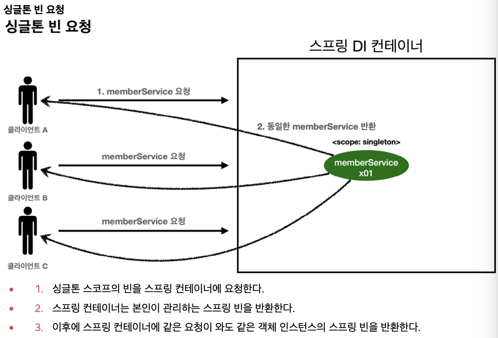
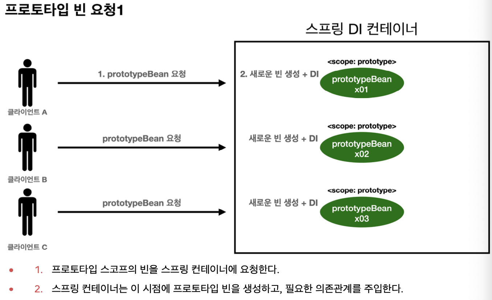
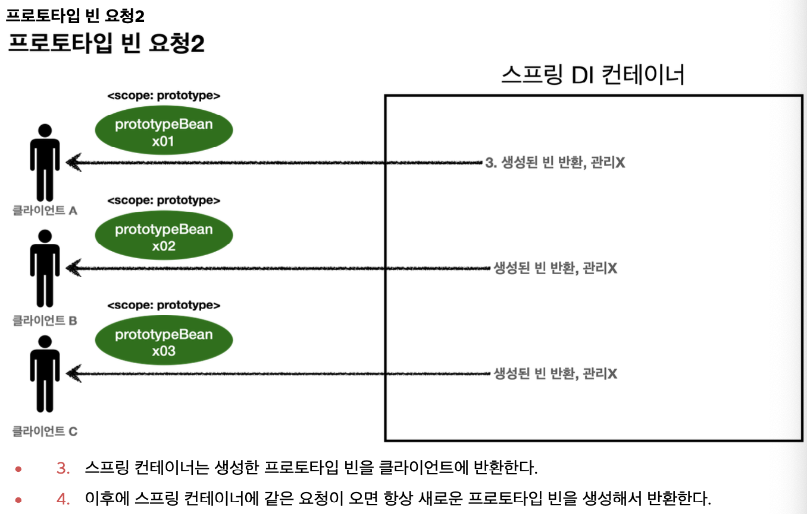
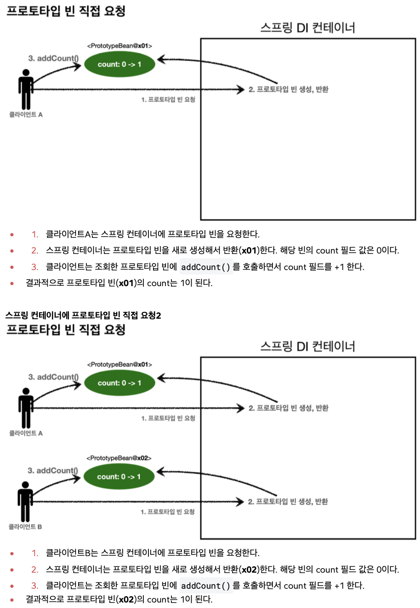
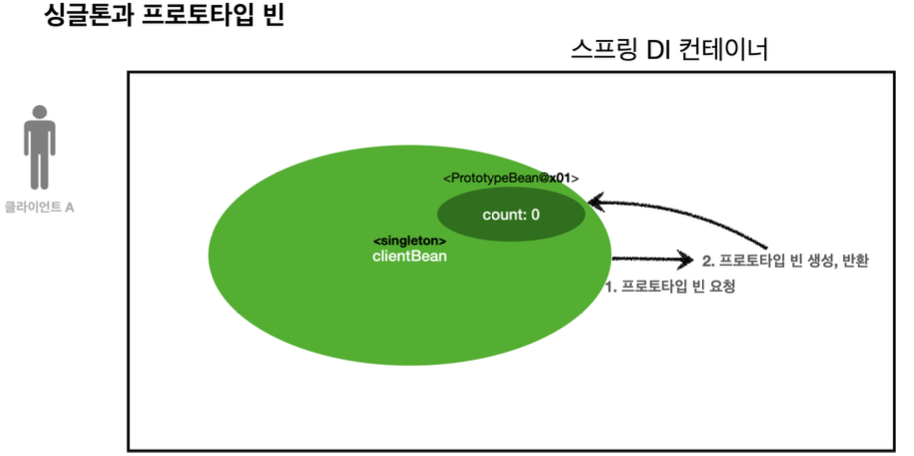
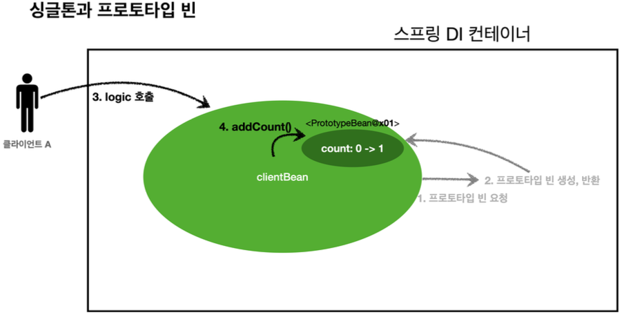
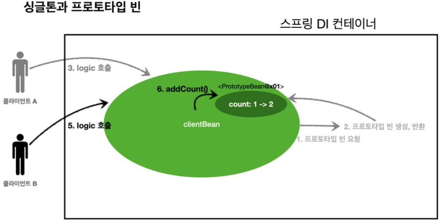
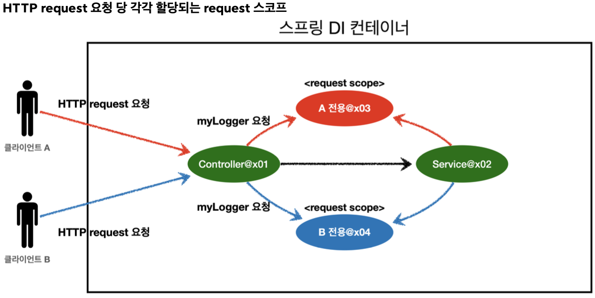
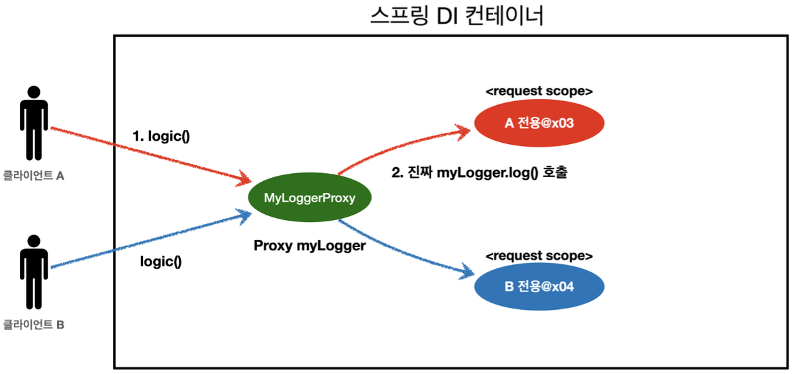

[(출처) 스프링 핵심 원리 - 기본편](https://www.inflearn.com/course/%EC%8A%A4%ED%94%84%EB%A7%81-%ED%95%B5%EC%8B%AC-%EC%9B%90%EB%A6%AC-%EA%B8%B0%EB%B3%B8%ED%8E%B8?gad_source=1&gad_campaignid=20714471420&gbraid=0AAAAADAClSB81nOfyUPym-Hq8jxqt7XS6&gclid=Cj0KCQjw8eTFBhCXARIsAIkiuOzXYq7ocyYtwsAYGU9mf90LptHZBEPRpIiIe0AUTlu0Geu5eJD1ByoaAsW0EALw_wcB)

## 빈 스코프란?
지금까지 우리는 스프링 빈이 스프링 컨테이너의 시작과 함께 생성되어서 스프링 컨테이너가 종료될 때 까지 유지된다고 학습했다.

이것은 스프링 빈이 기본적으로 싱글톤 스코프로 생성되기 때문이다.

스코프는 번역 그대로 **빈이 존재할 수 있는 범위**를 뜻한다.

스프링은 다음과 같은 다양한 스코프를 지원한다.

- **싱글톤**  
기본 스코프, 스프링 컨테이너의 시작과 종료까지 유지되는 가장 넓은 범위의 스코프이다.

- **프로토타입**  
스프링 컨테이너는 프로토타입 빈의 생성과 의존관계 주입까지만 관여하고 더는 관리하지 않는 매우 짧은 범위의 스코프이다.

- **웹 관련 스코프**
  - **request**  
  웹 요청이 들어오고 나갈때 까지 유지되는 스코프이다.
  
  - **session**  
  웹 세션이 생성되고 종료될 때 까지 유지되는 스코프이다.
  
  - **application**  
  웹의 서블릿 컨텍스트와 같은 범위로 유지되는 스코프이다.

##### 빈 스코프는 다음과 같이 지정할 수 있다.

**컴포넌트 스캔 자동 등록**

```java
@Scope("prototype")
@Component
public class HelloBean {}
```

**수동 등록**

```java
@Scope("prototype")
@Bean
PrototypeBean HelloBean() {
    return new HelloBean();
}
```

지금까지 싱글톤 스코프를 계속 사용해보았으니, 프로토타입 스코프부터 확인해보자.

## 프로토타입 스코프
싱글톤 스코프의 빈을 조회하면 스프링 컨테이너는 항상 같은 인스턴스의 스프링 빈을 반환한다.


---

반면에 프로토타입 스코프를 스프링 컨테이너에 조회하면 스프링 컨테이너는 항상 새로운 인스턴스를 생성해서 반환한다.



**핵심은 스프링 컨테이너는 프로토타입 빈을 생성하고, 의존관계 주입, 초기화까지만 처리한다는 것이다.**

클라이언트에 빈을 반환하고, 이후 스프링 컨테이너는 생성된 프로토타입 빈을 관리하지 않는다.

프로토타입 빈을 관리할 책임은 프로토타입 빈을 받은 클라이언트에 있다.

그래서 `@PreDestroy` 같은 종료 메서드가 호출되지 않는다.

> **프로토타입 빈의 특징 정리**
>
- 스프링 컨테이너에 요청할 때 마다 새로 생성된다.
>
>
- 스프링 컨테이너는 프로토타입 빈의 생성과 의존관계 주입 그리고 초기화까지만 관여한다.
>
>
- 종료 메서드가 호출 되지 않는다.
>
>
- 그래서 프로토타입 빈은 프로토타입 빈을 조회한 클라이언트가 관리해야 한다. 종료 메서드에 대한 호출도 클라이언트가 직접 해야한다.

## 프로토타입 스코프 - 싱글톤 빈과 함께 사용시 문제점

스프링 컨테이너에 프로토타입 스코프의 빈을 요청하면 항상 새로운 객체 인스턴스를 생성해서 반환한다.



하지만 싱글톤 빈과 함께 사용할 때는 의도한 대로 잘 동작하지 않으므로 주의해야 한다.



`clientBean`은 싱글톤이므로, 보통 스프링 컨테이너 생성 시점에 함께 생성되고, 의존관계 주입도 발생한다.

`clientBean`은 의존관계 자동 주입을 사용한다. 주입 시점에 스프링 컨테이너에 프로토타입 빈을 요청한다.

스프링 컨테이너는 프로토타입 빈을 생성해서 `clientBean`에 반환한다. 프로토타입 빈의 `count` 필드 값은 0이다.

이제 `clientBean`은 프로토타입 빈을 내부 필드에 보관한다. (정확히는 참조값을 보관한다.)



클라이언트 A는 `clientBean`을 스프링 컨테이너에 요청해서 받는다. 싱글톤이므로 항상 같은 `clientBean`이 반환된다.

클라이언트 A는 `clientBean.logic()`을 호출한다.

`clientBean`은 `prototypeBean`의 `addCount()`를 호출해서 프로토타입 빈의 `count`를 증가한다. `count`값이 1이 된다.



클라이언트 B는 `clientBean`을 스프링 컨테이너에 요청해서 받는다. 싱글톤이므로 항상 같은 `clientBean`이 반환된다.

**여기서 중요한 점! `clientBean`이 내부에 가지고 있는 프로토타입 빈은 이미 과거에 주입이 끝난 빈이다. 주입 시점에 스프링 컨테이너에 요청해서 프로토타입 빈이 새로 생성이 된 것이지, 사용 할 때마다 새로 생성되는 것은 아니다!**

그래서 클라이언트 B가 `clientBean.logic()`을 호출했을때, `clientBean`은 `prototypeBean`의 `addCount()`를 호출해서 프로토타입 빈의 `count`를 증가한다.

원래 `count`값이 1이었으므로 2가 된다.

스프링은 일반적으로 싱글톤 빈을 사용하므로, 싱글톤 빈이 프로토타입 빈을 사용하게 된다.

그런데 싱글톤 빈은 생성시점에만 의존관계 주입을 받기 때문에, 프로토타입 빈이 새로 생성되기는 하지만, 싱글톤 빈과 함께 계속 유지되는 것이 문제다.

아마 원하는 것은 이런 것은 아닐 것이다. (클라이언트 B가 요청했을 때는 `count`가 2가아닌 새롭게 1이 되길 원했을 것이다.)

**즉, 프로토타입 빈을 주입 시점에만 새로 생성하는게 아니라, 사용할 때 마다 새로 생성해서 사용하는 것을 원할 것이다.**

어떻게 해결할 수 있을까?

## 프로토타입 스코프 - 싱글톤 빈과 함께 사용시 Provider로 문제 해결

싱글톤 빈과 프로토타입 빈을 함께 사용할 때, 어떻게 하면 사용할 때 마다 항상 새로운 프로토타입 빈을 생성할 수 있을까?

가장 간단한 방법은 **싱글톤 빈**이 프로토타입 을 **사용할 때 마다 스프링 컨테이너에 새로 요청하는 것**이다.

**변경 전**

```java
@Autowired
public ClientBean(PrototypeBean prototypeBean) {
	this.prototypeBean = prototypeBean;
}

public int logic() {
	prototypeBean.addCount();
	int count = prototypeBean.getCount();
	return count;
}
```

**변경 후**

```java
@Autowired
private ApplicationContext ac;

public int logic() {
    PrototypeBean prototypeBean = ac.getBean(PrototypeBean.class);
	prototypeBean.addCount();
    int count = prototypeBean.getCount();
    return count;
}
```

실행해보면 `ac.getBean()`을 통해서 항상 새로운 프로토타입 빈이 생성되는 것을 확인할 수 있다.

이렇게 **직접 필요한 의존관계를 찾는 것을 Dependency Lookup(DL) 즉, 의존관계 조회(탐색)** 이라한다.

**그러나 이렇게 스프링의 애플리케이션 컨텍스트 전체를 주입받게 되면, 스프링 컨테이너에 종속적인 코드가 되고, 단위 테스트도 어려워진다.**

지금 필요한 기능은 지정한 프로토타입 빈을 컨테이너에서 대신 찾아주는 **딱 DL 정도의 기능만 제공하는 무언가**만 있으면 된다!!!

#### ObjectProvider

지정한 빈을 컨테이너에서 대신 찾아주는 DL 서비스를 제공하는 것이 바로 `ObjectProvider`이다.

참고로 과거에는 `ObjectFactory`가 있었는데, 여기에 편의 기능을 추가해서 `ObjectProvider`가 만들어졌다.

**핵심 코드**

```java
@Autowired
private ObjectProvider<PrototypeBean> prototypeBeanProvider;

public int logic() {
	PrototypeBean prototypeBean = prototypeBeanProvider.getObject();
    prototypeBean.addCount();
    int count = prototypeBean.getCount();
    return count;
}
```

`prototypeBeanProvider.getObject()`를 통해서 항상 새로운 프로토타입 빈이 생성되는 것을 확인 할 수 있다.

`ObjectProvider`의 `getObject()`를 호출하면 내부에서는 **스프링 컨테이너를 통해 해당 빈을 찾아서 반환한다.(DL)**

기능이 단순하고, 별도의 라이브러리 필요 없다. 스프링에 의존한다.

#### JSR-330 Provider

마지막 방법은 `javax.inject.Provider` 라는 JSR-330 자바 표준을 사용하는 방법이다.

**스프링 부트 3.0**은 `jakarta.inject.Provider` 사용한다.

이 방법을 사용하려면 다음 라이브러리를 gradle에 추가해야 한다.

- **스프링부트 3.0 미만**  
`javax.inject:javax.inject:1` 라이브러리를 gradle에 추가해야 한다.

- **스프링부트 3.0 이상**  
`jakarta.inject:jakarta.inject-api:2.0.1` 라이브러리를 gradle에 추가해야 한다.

**핵심 코드**

```java
@Autowired
 private Provider<PrototypeBean> provider;
 
 public int logic() {
     PrototypeBean prototypeBean = provider.get();
     prototypeBean.addCount();
     int count = prototypeBean.getCount();
     return count;
}
```

`provider.get()` 을 통해서 항상 새로운 프로토타입 빈이 생성되는 것을 확인할 수 있다.

`provider` 의 `get()` 을 호출하면 내부에서는 스프링 컨테이너를 통해 해당 빈을 찾아서 반환한다.(DL)

자바 표준이므로 스프링이 아닌 다른 컨테이너에서도 사용할 수 있다.

#### 정리

프로토타입 빈을 언제 사용할까? 매번 사용할 때 마다 의존관계 주입이 완료된 새로운 객체가 필요하면 사용하면 된다.

그런데 실무에서 웹 애플리케이션을 개발해보면, 싱글톤 빈으로 대부분의 문제를 해결할 수 있기 때문에 프로토타입 빈을 직접적으로 사용하는 일은 매우 드물다.

참고로 정말 그럴일은 거의 없겠지만 스프링이 아닌 다른 컨테이너에서도 사용할 수 있어야 한다면 JSR-330 Provider를 사용해야 한다. (기본적으로는 스프링이 제공하는 기능을 사용하자!)

## 웹 스코프

**웹 스코프의 특징**

- 웹스코프는 웹 환경에서만 동작한다.

- 웹 스코프는 프로토타입과 다르게 스프링이 해당 스코프의 종료시점까지 관리한다. 따라서 종료 메서드가 호출된다.

**웹 스코프 종류**

- **request**  
HTTP 요청 하나가 들어오고 나갈 때 까지 유지되는 스코프, 각각의 HTTP 요청마다 별도의 빈 인스턴스가 생성되고 관리된다.

- **session**  
HTTP Session과 동일한 생명주기를 가지는 스코프

- **application**  
서블릿 컨텍스트( `ServletContext` )와 동일한 생명주기를 가지는 스코프

- **websocket**  
웹 소켓과 동일한 생명주기를 가지는 스코프



### request 스코프 예제 만들기

#### 웹 환경 추가

웹 스코프는 웹 환경에서만 동작하므로 web 환경이 동작하도록 라이브러리를 추가하자.

**build.gradle에 추가**

```text
//web 라이브러리 추가
implementation 'org.springframework.boot:spring-boot-starter-web
```

이제 `hello.core.CoreApplication` 의 main 메서드를 실행하면 웹 애플리케이션이 실행되는 것을 확인할 수 있다.

> **참고**
>
`spring-boot-starter-web` 라이브러리를 추가하면 스프링 부트는 내장 톰켓 서버를 활용해서 웹 서 버와 스프링을 함께 실행시킨다.

만약 기본 포트인 8080 포트를 다른 곳에서 사용중이어서 오류가 발생하면 포트를 변경해야한다.

9090 포트로 변경하려면 `main/resources/application.properties`에 다음 설정을 추가하자.

```text
server.port = 9090
```

#### request 스코프 예제 개발

동시에 여러 HTTP 요청이 오면 정확히 어떤 요청이 남긴 로그인지 구분하기 어렵다.

이럴때 사용하기 딱 좋은 것이 바로 request 스코프이다.

- **기대하는 공통 포멧**  
UUID {message}

- UUID를 사용해서 HTTP 요청을 구분하자.

- requestURL 정보도 추가로 넣어서 어떤 URL을 요청해서 남은 로그인지 확인하자.

**로그를 출력하기 위한 클래스**

```java
@Component
@Scope(value = "request")
public class MyLogger {
	private String uuid;
    private String requestURL;
    
    public void setRequestURL(String requestURL) {
		this.requestURL = requestURL;
	}
    
	public void log(String message) {
		System.out.println("[" + uuid + "]" + "[" + requestURL + "] " + message);
	}
        
	@PostConstruct
    public void init() {
		uuid = UUID.randomUUID().toString();
        System.out.println("[" + uuid + "] request scope bean create:" + this);
    }
    
    @PreDestroy
    public void close() {
        System.out.println("[" + uuid + "] request scope bean close:" + this);
    }
}
```

`@Scope(value = "request")`를 사용해서 request 스코프로 지정했다. 이제 이 빈은 HTTP 요청 당 하나씩 생성되고, HTTP 요청이 끝나는 시점에 소멸된다.

이 빈이 생성되는 시점에 자동으로 `@PostConstruct` 초기화 메서드를 사용해서 uuid를 생성해서 저장해둔다.

이 빈은 HTTP 요청 당 하나씩 생성되므로, uuid를 저장해두면 다른 HTTP 요청과 구분할 수 있다.

이 빈이 소멸되는 시점에 `@PreDestroy` 를 사용해서 종료 메시지를 남긴다.

`requestURL` 은 이 빈이 생성되는 시점에는 알 수 없으므로, 외부에서 setter로 입력 받는다.

**테스트용 컨트롤러**

```java
@Controller
@RequiredArgsConstructor
public class LogDemoController {
	private final LogDemoService logDemoService;
	private final MyLogger myLogger;
    
    @RequestMapping("log-demo")
    @ResponseBody
    public String logDemo(HttpServletRequest request) {
        String requestURL = request.getRequestURL().toString();
        myLogger.setRequestURL(requestURL);
        
        myLogger.log("controller test");
        logDemoService.logic("testId");
		return "OK";
	}
}
```

`HttpServletRequest`를 통해서 요청 URL을 받았다.

`requestURL`값 `http://localhost:8080/log-demo`

이렇게 받은 `requestURL`값을 `myLogger`에 저장해둔다.

`myLogger`는 HTTP 요청 당 각각 구분되므로 다른 HTTP 요청 때문에 값이 섞이는 걱정은 하지 않아도 된다.

> **참고**
>
requestURL을 MyLogger에 저장하는 부분은 컨트롤러 보다는 공통 처리가 가능한 스프링 인터셉터나 서블릿 필터 같은 곳을 활용하는 것이 좋다. 여기서는 예제를 단순화하고, 아직 스프링 인터셉터를 학습하지 않은 분들을 위해서 컨트롤러를 사용했다. 스프링 웹에 익숙하다면 인터셉터를 사용해서 구현해보자.

**서비스 계층**

```java
@Service
@RequiredArgsConstructor
public class LogDemoService {
	private final MyLogger myLogger;
	
    public void logic(String id) {
		myLogger.log("service id = " + id);
	}
}
```

여기서 중요한점이 있다. request scope를 사용하지 않고 파라미터로 이 모든 정보를 서비스 계층에 넘긴다면 파라미터가 많아서 지저분해진다.

더 문제는 `requestURL` 같은 웹과 관련된 정보가 웹과 관련없는 서비스 계층까지 넘어가게 된다.

웹과 관련된 부분은 컨트롤러까지만 사용해야 한다. 서비스 계층은 웹 기술에 종속되지 않고, 가급적 순수하게 유지하는 것이 유지보수 관점에서 좋다.

request scope의 `MyLogger` 덕분에 이런 부분을 파라미터로 넘기지 않고 `MyLogger`의 멤버변수에 저장해서 코드와 계층을 깔끔하게 유지할 수 있다.

##### 이제 실행을 해보면 오류가 발생한다!

스프링 애플리케이션을 실행하는 시점에 싱글톤 빈은 생성해서 주입이 가능하지만, request 스코프 빈은 아직 생성되지 않는다. 이 빈은 실제 고객의 요청이 와야 생성할 수 있는데 그런 요청이 없어서 오류가 난 것이다!

> **정리**
>
request scope 빈이 생성되는 시점은 HTTP 요청의 생애주기에 맞춰 관리한다.
>
`@RequestMapping`에 정의된 URL HTTP 요청이 들어오는 시점에 request scope 빈이 생성 되고, `@RequestMapping`에 매핑된 컨트롤러 메서드가 실행된다.
>
이 메서드에서 이미 생성된 `@RequestScope` 빈을 사용할 수 있다.
>
지금은 스프링 애플리케이션을 실행 시키면 오류가 발생한다. 요청이 들어오지 않았기 때문이다.


#### 스코프와 Provider

첫번째 해결방안은 앞서 배운 Provider를 사용하는 것이다.

간단히 `ObjectProvider`를 사용해보자.

**컨트롤러**

```java
@Controller
@RequiredArgsConstructor
public class LogDemoController {

	private final LogDemoService logDemoService;
    private final ObjectProvider<MyLogger> myLoggerProvider;
    
    @RequestMapping("log-demo")
    @ResponseBody
    public String logDemo(HttpServletRequest request) {
		String requestURL = request.getRequestURL().toString();
        MyLogger myLogger = myLoggerProvider.getObject(); //여기가 포인트
        myLogger.setRequestURL(requestURL);
        
        myLogger.log("controller test");
        logDemoService.logic("testId");
        return "OK";
	}
}
```

---
**서비스**

```java
@Service
@RequiredArgsConstructor
public class LogDemoService {

    private final ObjectProvider<MyLogger> myLoggerProvider;
    
	public void logic(String id) {
        MyLogger myLogger = myLoggerProvider.getObject();
		myLogger.log("service id = " + id);
	}
}
```

`main()` 메서드로 스프링을 실행하고, 웹 브라우저에 `http://localhost:8080/log-demo` 를 입력하면 잘 작동한다.

> **정리**
>
애플리케이션 실행 시, 싱글톤으로 관리되는 컨트롤러를 스프링이 생성하려고 하는데, 생성자 주입 대상 중 하나인 `MyLogger`는 request scope 빈이어서 HTTP 요청이 들어와야 생성된다.
>
요청이 없으므로 빈이 아직 생성되지 않아, 컨트롤러에 주입할 수 없어서 오류가 발생한다. (서비스도 마찬가지이다.)
>
그래서 코드를 보면 `ObjectProvider`를 이용하여 request scope 빈을 필요할 때만 조회하도록 지연시켰다.
>
`ObjectProvider.getObject()`를 호출하는 시점에는 HTTP 요청이 진행중이므로 request scope 빈의 생성이 정상 처리된다.
>
컨트롤러와 서비스에서 각각 한번씩 따로 호출해도 같은 HTTP 요청이면 같은 스프링 빈이 반환된다!

#### 스코프와 프록시

이번에는 프록시 방식을 사용해보자.

```java
@Component
@Scope(value = "request", proxyMode = ScopedProxyMode.TARGET_CLASS)
public class MyLogger {
}
```

- 적용 대상이 클래스면 `TARGET_CLASS`를 선택

- 적용 대상이 인터페이스면 `INTERFACES`를 선택

이렇게 하면 `MyLogger`의 가짜 프록시 클래스를 만들어두고 HTTP request와 상관 없이 가짜 프록시 클래스를 다른 빈에 미리 주입해 둘 수 있다.

그리고 컨트롤러, 서비스를 Provider 사용 이전으로 되돌리고 실행해보자. 잘 동작하는 것을 확인할 수 있다.

##### 웹 스코프와 프록시 동작 원리

주입된 `myLogger`를 확인해보자.

```java
System.out.println("myLogger = " + myLogger.getClass());
```

**출력결과**

```text
myLogger = class hello.core.common.MyLogger$$EnhancerBySpringCGLIB$$b68b726d
```

**CGLIB**라는 바이트코드를 조작하는 라이브러리를 사용해서, **`MyLogger`를 상속받은 가짜 프록시 객체를 생성한다.**

그리고 **스프링 컨테이너에 "myLogger"라는 이름으로 진짜 대신에 가짜 프록시 객체를 등록**한다.

`ac.getBean("myLogger", MyLogger.class)` 코드로 조회해보면 프록시 객체가 조회되는 것을 확인할 수 있다.

그래서 의존관계 주입도 이 가짜 프록시 객체가 주입된다.

---



가짜 프록시 객체는 요청이 오면 그때 내부에서 진짜 빈을 요청하는 위임 로직이 들어있다.

클라이언트가 `myLogger.log()`를 호출하면 사실은 가짜 프록시 객체의 메서드를 호출한 것이다.

가짜 프록시 객체는 request 스코프의 진짜 `myLogger.log()`를 호출한다.

가짜 프록시 객체는 원본 클래스를 상속 받아서 만들어졌기 때문에 이 객체를 사용하는 클라이언트 입장에서는 사실 원본인지 아닌지도 모르게 동일하게 사용할 수 있다.(다형성)

> **정리**
>
CGLIB라는 라이브러리로 내 클래스를 상속 받은 가짜 프록시 객체를 만들어서 주입한다.
>
이 가짜 프록시 객체는 실제 요청이 오면 그때 내부에서 실제 빈을 요청하는 위임 로직이 들어있다.
>
가짜 프록시 객체는 실제 request scope와는 관계가 없다. 그냥 가짜이고, 내부에 단순한 위임 로직만 있고, 싱글톤 처럼 동작한다.
>
프록시 객체 덕분에 클라이언트는 마치 싱글톤 빈을 사용하듯이 편리하게 request scope를 사용할 수 있다.
>
사실 Provider를 사용하든, 프록시를 사용하든 핵심 아이디어는 진짜 객체 조회를 꼭 필요한 시점까지 지연처리 한다는 점이다.
>
단지 애노테이션 설정 변경만으로 원본 객체를 프록시 객체로 대체할 수 있다. 이것이 바로 다형성과 DI 컨테이너 가 가진 큰 강점이다.
>
꼭 웹 스코프가 아니어도 프록시는 사용할 수 있다.
>

>**주의점**
>
마치 싱글톤을 사용하는 것 같지만 다르게 동작하기 때문에 결국 주의해서 사용해야 한다.
>
이런 특별한 scope는 꼭 필요한 곳에만 최소화해서 사용하자, 무분별하게 사용하면 유지보수하기 어려워진다.
