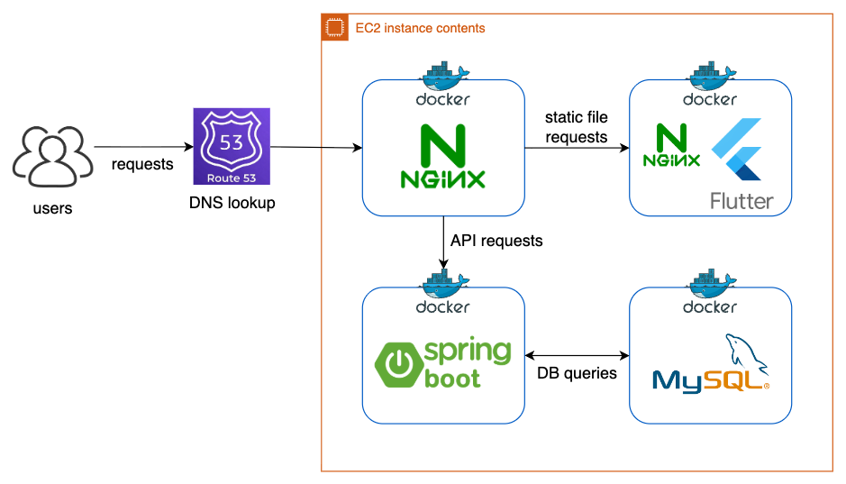
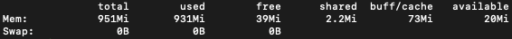
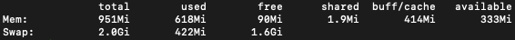
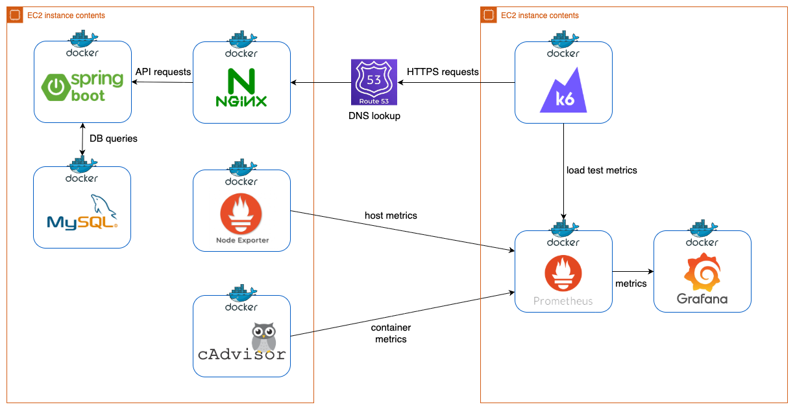
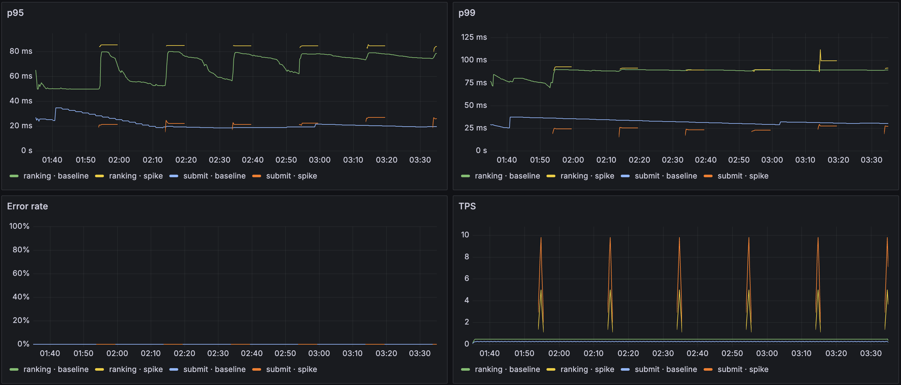
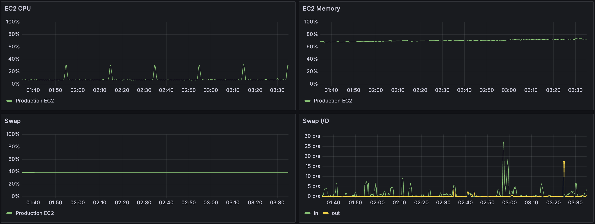
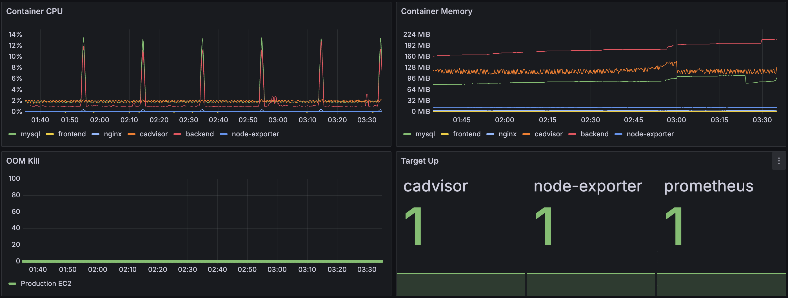
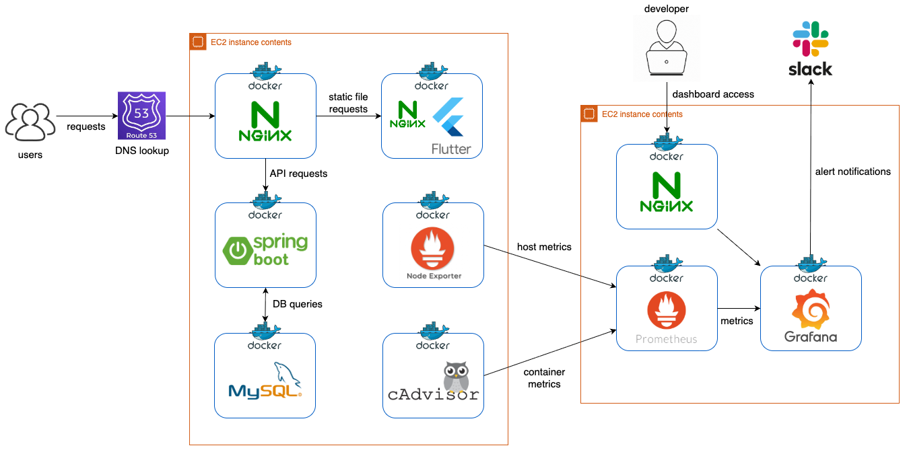
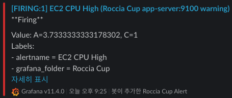

## 1. 문제 상황

클라이밍 동아리 Roccia901에서 진행하는 대회 운영을 위해 점수 제출과 랭킹 조회가 가능한 PWA(Progressive Web App)를 개발했다.

서비스 규모가 크지 않고 운영 기간도 하루였기 때문에 배포 환경은 AWS 프리티어인 EC2 t2.micro 인스턴스로 구성했다.

배포는 로컬에서 Docker 이미지를 빌드한 뒤 EC2로 전송해 컨테이너를 띄우는 방식으로 진행했다.

배포는 정상적으로 완료되었지만, 실제 운영에 앞서 서버를 점검하던 중 심각한 응답 지연이 발생했고, 결국 서버가 완전히 응답하지 않는 상태로 이어졌다.

## 2. 원인 파악

서버가 버벅이는 도중 `free -h`로 메모리 상태를 확인해보니 가용 메모리가 거의 남아 있지 않았다.

또한 AWS EC2 모니터링을 확인해보니 CPU 사용률이 100%에 도달해 있었다.

재시작 후 `journalctl -k -b -1`로 재시작 직전 부팅의 커널 로그를 확인해보니 `Out of memory: Killed process ... (mysqld)` 메시지가 남아 있었다.

EC2 호스트 전체의 메모리가 부족해지면서 Linux OOM Killer가 동작했고, 그 대상이 MySQL 프로세스였다. MySQL 자체의 오류라기보다는 호스트 전체의 메모리 부족이 근본적인 문제라고 판단했다.

> 메모리가 부족해지면 Linux 커널은 사용 가능한 메모리를 확보하기 위해 page cache 회수 등의 메모리 회수 작업을 반복한다. 이 작업 자체가 CPU를 쓰기 때문에, 요청이 많지 않아도 메모리 부족과 함께 CPU 사용률이 높아질 수 있다.
>
> 메모리 회수만으로 충분한 메모리를 확보하지 못하면 OOM Killer가 동작한다. OOM Killer는 프로세스별 `oom_score` 등을 기준으로 종료할 프로세스를 선택한다.

## 3. 문제 완화

메모리 부족에 대한 대응으로는 여러 선택지가 있었다.

- EC2 인스턴스 사양을 올리는 scale-up
- 프로세스별 메모리 설정을 조정하는 방법
- swap을 추가해 물리 메모리가 부족할 때 사용할 수 있는 메모리 공간을 확보하는 방법

하루 동안 운영되는 소규모 서비스라 scale-up은 비용 대비 과하다고 판단했고, 우선 빠르게 문제를 완화하기 위해 swap을 추가했다.

당시 사용한 t2.micro 인스턴스의 메모리는 약 1GB였고, swap 크기는 [Red Hat의 권장 기준](https://access.redhat.com/ko/solutions/744483)을 참고해 2GB로 설정했다.

> **swap이란?**
>
> swap은 물리 메모리(RAM)가 부족할 때 보조기억장치의 일부 공간을 메모리 페이지의 임시 저장 공간으로 사용하는 방식이다.
>
> 운영체제는 당장 자주 사용되지 않는 메모리 페이지를 디스크의 swap 영역으로 이동시켜 RAM 공간을 확보할 수 있다.

swap을 적용한 뒤에는 메모리 부족으로 프로세스가 바로 종료되는 상황을 완화할 수 있었다.

다만 swap은 디스크를 쓰기 때문에 밀려난 페이지를 다시 읽어 오는 일이 잦아지면 응답이 느려질 수 있고, 이것만으로 대회 당일 트래픽을 감당할 수 있는지는 알 수 없었기 때문에 운영 전에 부하 테스트를 진행했다.

## 4. 부하 테스트

부하 테스트 도구로는 k6를 사용했다. JavaScript 기반으로 테스트 시나리오를 작성할 수 있어 직관적이고, 가상 사용자를 OS 스레드가 아닌 Go의 경량 고루틴으로 실행하기 때문에 리소스 부담이 적어 선택했다.

테스트는 운영 서버와 부하 테스트 서버를 분리해 진행했다. 같은 서버에서 k6를 실행하면 부하 발생 자체가 CPU와 메모리를 써서, 운영 서버의 리소스 사용량을 정확히 판단하기 어렵기 때문이다.

서버의 메모리 자원이 여유롭지 않았기 때문에, 모니터링 컴포넌트를 추가하는 것 자체도 부담이 될 수 있었다. 그럼에도 장애 발생 시 운영 서버 상태와 컨테이너별 리소스 사용량을 확인하기 위해 Node Exporter와 cAdvisor를 운영 서버에 구성했다.

**모니터링 구성**

| 관측 대상 | 지표 | 수집 도구 |
| --- | --- | --- |
| 호스트 리소스 | CPU · 메모리 · swap 사용률, swap 페이지 in/out, OOM Kill 발생 | Node Exporter |
| 컨테이너 리소스 | 컨테이너별 CPU · 메모리 | cAdvisor |
| 부하 테스트 결과 | 응답 시간 p95 · p99, 에러율, 처리량 | k6 |
| 수집 상태 | Node Exporter · cAdvisor scrape 성공 여부 (up) | Prometheus |

### 4.1 테스트 시나리오

대회는 20분 단위 6개 섹터, 2시간 동안 진행되고 참가자는 최대 약 100명이다. 참가자는 대회 중 자유롭게 점수를 제출하고 랭킹을 조회하지만, 섹터가 끝나는 무렵에는 둘 다 늘어날 수 있다고 봤다.

이를 반영해 테스트는 상시 흐름 위에 섹터 경계를 얹는 구조로 잡았다. 대회와 같은 2시간을 돌리고, 각 섹터가 끝나는 마지막 1분에 경계를 두어 20분 간격으로 여섯 번 넣었다. 강도는 대회 조건에서 추정한 값에 여유를 두어 3배로 잡았다.

| 구간 | 요청 | 실제 추정 | 시험값 | 지속 |
|---|---|---|---|---|
| 상시 | 점수 제출 | 100명 × 6섹터 = 600건, 600건 ÷ 120분 = 분당 5건 | 분당 15건 | 2시간 |
| 상시 | 랭킹 조회 | 100명 × 섹터당 2회 = 20분에 200회 → 0.17 TPS | 0.5 TPS | 2시간 |
| 섹터 경계 | 랭킹 조회 | 100명이 1분 안에 1회 = 1.67 TPS | 5 TPS | 20분마다 1분씩, 여섯 번 |
| 섹터 경계 | 점수 제출 | 100명이 1분 안에 1회 = 1.67 TPS | 5 TPS | 20분마다 1분씩, 여섯 번 |

데이터는 대회 규모에 맞춰 100명 × 6섹터, 약 600개의 점수를 미리 적재했고, 측정 전 2분간의 워밍업 구간은 결과에서 제외했다.

**운영 안정성 검증 기준**

| 지표 | 기준 | 확인 목적 |
|---|---|---|
| 처리량 | 설정한 강도대로 요청이 발생할 것 | 부하가 의도대로 들어갔는지 확인 |
| p95 | < 500ms | 사용자 체감 지연 최소화 |
| Error rate | < 1% | 반복 실패 방지 및 서비스 연속성 확보 |
| EC2 CPU | 지속 80% 미만 | CPU 자원 포화 여부 확인 |
| Swap 사용률 | 대회 2시간 동안 소진되지 않을 것 | 메모리 완충 공간 소진 여부 확인 |
| OOM Kill | 0회 | 이전에 겪은 장애의 직접 재발 여부 확인 |

### 4.2 부하 테스트 결과

| 지표 | 결과 | 기준 | 판단 |
|---|---|---|---|
| 처리량 | 상시 0.5 TPS, 경계 5 TPS 유지 | 설정한 강도대로 발생 | 통과 |
| p95 | 조회 82ms (p99 90ms), 제출 18ms (p99 22ms) | < 500ms | 통과 |
| Error rate | 0% | < 1% | 통과 |
| EC2 CPU | 상시 7%, 경계 최대 32% | 지속 80% 미만 | 통과 |
| Swap 사용률 | 2시간 동안 38.6% → 38.5% | 2시간 동안 소진되지 않을 것 | 통과 |
| OOM Kill | 0회 | 0회 | 통과 |

모든 기준을 통과했다. 경계마다 비슷한 수준으로 증가했다가 다시 안정되는 패턴을 보였고, 반복될수록 나빠지는 구간은 없었다.

swap은 38.6%에서 시작해 2시간 동안 사실상 움직이지 않았고, swap in/out도 지속되는 구간 없이 응답 시간에 영향을 주지 않았다.

Node Exporter와 cAdvisor는 합쳐서 약 150MiB를 사용했는데, 이를 포함한 상태에서도 메모리 사용률은 67~74%에 머물고 swap이 늘지 않았으므로 모니터링 컴포넌트의 리소스 비용은 감당 가능한 수준으로 판단했다.

예상 트래픽의 3배 수준에서 응답과 리소스 모두 기준을 만족했기 때문에, 운영 전 scale-up이나 프로세스별 메모리 설정 조정은 진행하지 않았다.

## 5. Alert 시스템 구축

실제 운영 환경에서는 예상하지 못한 장애가 발생할 수 있으므로, 이상 징후를 빠르게 감지하고 대응할 수 있도록 Grafana Alert와 Slack 알림을 연동했다.

부하 테스트에 사용했던 별도 서버는 운영 중 모니터링 서버로 활용했다.

Prometheus와 Grafana를 운영 서버와 동일한 인스턴스에서 운영하면, 운영 서버에 부하가 발생했을 때 모니터링 도구도 함께 영향을 받을 수 있다고 판단했다.

따라서 모니터링 환경을 별도 서버로 분리해 운영 서버의 리소스 사용량을 줄이고, 운영 중에도 이상 징후를 안정적으로 확인할 수 있도록 구성했다.

이전에 겪은 장애가 메모리 부족에서 비롯된 만큼, 같은 상황이 발생했을 때 대응할 수 있는 기준이 필요했다.

이를 위해 운영 서버에 부하 테스트의 상시 흐름을 보내면서 메모리를 1분에 40MB씩 점유하는 스크립트를 함께 실행해, 메모리가 고갈되는 과정에서 각 지표가 어떻게 변하는지 확인했다.

실험 결과 메모리 사용량이 증가하면서 swap 사용량이 증가했고, swap이 소진된 이후 새로운 메모리 할당이 발생하자 CPU 사용률이 급격히 증가했다. 이후 메모리를 더 확보하지 못하면서 OOM Killer가 동작했고, 이때 MySQL 프로세스가 종료됐다.

이를 바탕으로 메모리 부족 경로와 CPU 포화 경로를 각각 감지할 수 있도록 Alert Rule을 설정했다.

| Alert | Threshold | For | 근거 |
|---|---|---|---|
| Swap High | swap 사용률 > 70% | 2m | 메모리 부족을 조기에 감지 |
| EC2 CPU High | CPU > 80% | 2m | CPU 포화 상황 감지 |
| OOM Kill | OOM Kill 발생 | 0s | 장애 자체를 즉시 감지 |
| Monitoring Target Down | up == 0 | 30s | 모니터링 대상의 응답 중단 감지 |

Swap High는 실험에서 70%에 도달한 시점부터 OOM까지 수십 분이 남아 있었기 때문에 조기 경보 기준으로 잡았다. Monitoring Target Down은 서버 장애 시 지표 수집이 중단될 수 있기 때문에 짧게 잡았다.

또한 실험에서 OOM 직전 모니터링 지표 수집이 중단되는 구간이 있었다. 서버 장애로 인해 모니터링 데이터 자체가 끊길 수 있기 때문에, 데이터가 수집되지 않는 경우도 Alerting 상태로 처리하도록 설정했다.

임계치를 일시적으로 낮춰 조건을 충족시킨 뒤, Alert가 발생해 Slack까지 전달되는지 검증했다.

>Grafana Alert에서는 각 쿼리와 표현식에 `A`, `B`, `C`와 같은 Ref ID가 붙는다.
>
>`A`는 보통 Prometheus에서 가져온 원본 쿼리 결과를 의미하고, `B`, `C`는 Reduce나 Threshold 같은 추가 평가 단계를 의미한다.
>
>즉 Grafana는 쿼리 결과를 가져온 뒤, 필요한 경우 값을 줄이거나 임계치와 비교하는 단계를 거쳐 알림 발생 여부를 판단한다.

---

실제 대회 당일에는 서버 장애나 오류 없이 서비스를 안정적으로 운영했으며, 운영 중 별도의 대응이 필요한 상황은 발생하지 않았다.
