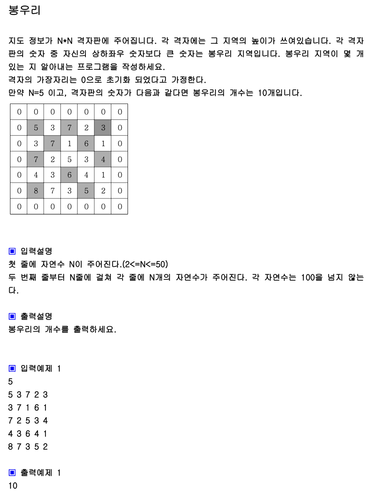
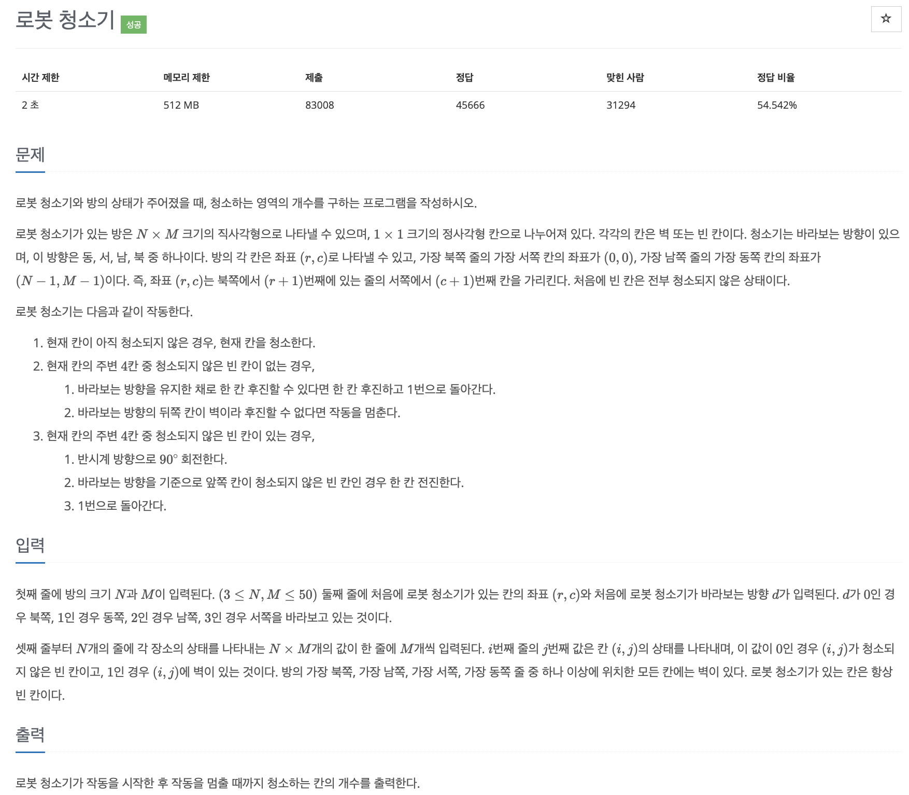

## 문제 (봉우리)




## 풀이

각 격자에서 특정 위치 `(i, j)`의 값을 기준으로 상하좌우 네 방향을 비교해야 한다.

이때 방향 이동은 방향 배열(dx, dy)로 처리하면 코드가 간결해진다.

- 북: `(i-1, j)`
- 동: `(i, j+1)`
- 남: `(i+1, j)`
- 서: `(i, j-1)`

이를 배열로 표현하면 다음과 같다.

```java
int[] dx = {-1, 0, 1, 0};
int[] dy = {0, 1, 0, -1};
```

반복문을 통해 `(i + dx[k], j + dy[k])` 형태로 네 방향을 탐색할 수 있다.

이때 dx와 dy의 같은 인덱스는 하나의 방향을 의미하므로, 두 배열의 순서를 동일하게 유지하는 것이 중요하다.

```java
import java.util.*;

public class Main{
	static int[] dx = {-1, 0, 1, 0};
	static int[] dy = {0, 1, 0, -1};
	
	public static int solution(int n, int[][] arr) {
		int answer = 0;
		
		for(int i=0; i<n; i++) {
			for(int j=0; j<n; j++) {
				boolean flag = true;
				for(int k=0; k<4; k++) {
					//주의! 맨 앞의 조건부터 순서대로 확인하기 때문에 인덱스 조건을 먼저 체크해야함!
					if(i+dx[k] >= 0 && i+dx[k] < n && j+dy[k] >= 0 && j+dy[k] < n && arr[i][j] <= arr[i+dx[k]][j+dy[k]]) {
						flag = false;
						break;
					}
				}
				if(flag) answer++;
			}
		}
		
		return answer;
	}
	
	public static void main(String[] args) {
		
		Scanner sc = new Scanner(System.in);
		
		int n = sc.nextInt();
		
		int[][] arr = new int[n][n];
		
		for(int i=0; i<n; i++) {
			for(int j=0; j<n; j++) {
				arr[i][j] = sc.nextInt();
			}
		}
		
		System.out.println(solution(n, arr));
	}
}
```

## 문제 (로봇 청소기)

[백준 14503번 로봇 청소기](https://www.acmicpc.net/problem/14503)



## 풀이
방향을 다음과 같이 인덱스로 관리한다.

- 북: 0
- 동: 1
- 남: 2
- 서: 3

이렇게 정의해두면, 방향 전환과 이동을 모두 배열로 처리할 수 있다.

### 방향 이동

각 방향에 따른 좌표 이동은 다음과 같이 표현한다.

```java
int[] dx = {-1, 0, 1, 0};
int[] dy = {0, 1, 0, -1};
```

현재 방향이 `dir`이라면, 다음 위치는 `r + dx[dir], c + dy[dir]`로 계산할 수 있다.

### 반대 방향

반대 방향은 별도의 배열로 관리할 수 있다.

`int[] opposite = {2, 3, 0, 1};`

예를 들어 현재 방향이 동쪽(1)이라면 `opposite[1] → 3 (서쪽)`으로 표현할 수 있다.

### 회전 처리

방향은 원형 구조이기 때문에 나머지 연산으로 처리한다.

- 오른쪽 회전: `(dir + 1) % 4`
- 왼쪽 회전: `(dir + 3) % 4` (-1 대신 +3을 하여 음수 방지)

예시

```java
(3 + 1) % 4 = 0  // 서 → 북
(0 + 3) % 4 = 3  // 북 → 서
```

### 구현

```java
import java.util.*;

public class Main{
		//북동남서 방향배열
		static int[] x = {-1, 0, 1, 0};
		static int[] y = {0, 1, 0, -1};
		
		//반대방향 인덱스 (op[dir] 하면 반대방향 인덱스)
		static int[] op = {2, 3, 0, 1};
		
		//반시계방향 인덱스 (북동남서에서 반시계로 돌렸을때의 인덱스)
		//문제기준 북쪽 인덱스 0 -> 반시계하면 서쪽 , 문제기준 서쪽 인덱스 3
		static int[] b = {3, 0, 1, 2};
		
	public static void main(String[] args){
		Scanner sc = new Scanner(System.in);
		int answer = 0;
		int n = sc.nextInt();
		int m = sc.nextInt();
		int r = sc.nextInt();
		int c = sc.nextInt();
		int dir = sc.nextInt();
		int[][] arr = new int[n][m];
		for(int i=0; i<n; i++) {
			for(int j=0; j<m; j++) {
				arr[i][j] = sc.nextInt();
			}
		}
		
		while(true) {
			//이동한 자리 처리
			if(arr[r][c] == 0) {
				arr[r][c] = 2; //청소 후
				answer++;
			}
			
			//현재칸의 동서남북 청소 확인
			int flag = 0;
			for(int i=0; i<4; i++) {
				int nx = r + x[i];
				int ny = c + y[i];
				
				if(arr[nx][ny] == 0) {
					flag = 1; //청소안한곳이 있으면 2번 조건
					break;
				}
			}
			
			//주변이 청소가 다 되어있다? (1번 조건)
			if(flag == 0) {
				int backDir = op[dir];
				int nx = r + x[backDir];
				int ny = c + y[backDir];
				
				if(nx >= 0 && nx < n && ny >= 0 && ny < m && arr[nx][ny] != 1) {
					//이동
					r= nx;
					c= ny;
				}
				else {
					break;
				}
			}
			//2번 조건
			else {
				//반시계 회전
                dir = (dir + 3) % 4;
				int nx = r + x[dir];
				int ny = c + y[dir];
				if(nx >= 0 && nx < n && ny >= 0 && ny < m && arr[nx][ny]==0) {
					//이동
					r = nx;
					c = ny;
				}
			}
		}

		System.out.println(answer);
	}
}
```
