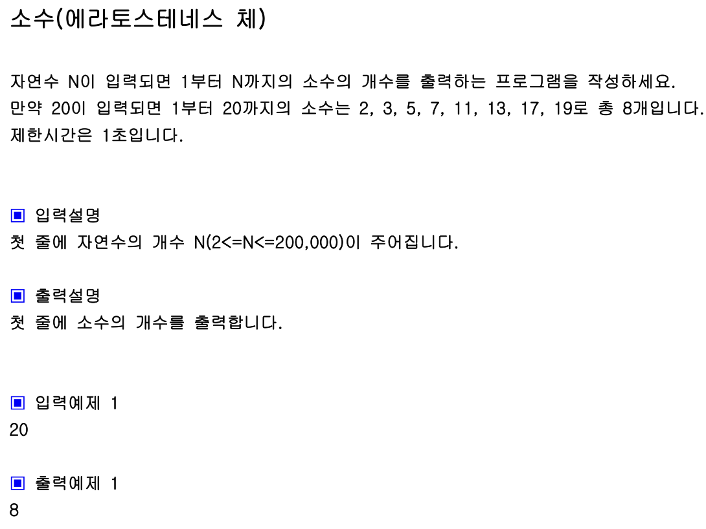

고대 그리스의 수학자 에라토스테네스가 만들어 낸 소수를 찾는 방법으로,

임의의 자연수 n에 대해 그 이하의 소수를 모두 찾는, 가장 간단하고 빠른 방법이다.

### 핵심 원리

1. 1부터 n까지의 숫자 배열을 만든 후, 1을 제거한다.

2. 지워지지 않은 수 중 가장 작은 수 p를 찾는다.

3. p를 제외한 p의 배수들을 모두 제거한다.

4. 위 과정을 n의 제곱근($$\sqrt{n}$$)까지만 반복하면 남은 숫자들이 모두 소수가 된다.

### 에라토스테네스의 체 시간복잡도

각 소수 p에 대해 n/p번씩 배수를 지운다.

전체 연산 횟수는 $$n⋅(1/2+1/3+1/5+⋯)$$

여기서 소수의 역수 합은 $$log(logn)$$ 수준으로 증가.

따라서 전체 시간 복잡도는 $$O(n·loglogn)$$

## 문제 (소수)



## 풀이

```java
import java.util.*;

public class Main{
	public static int solution(int n) {
		//인덱스 0부터 n까지 0으로 채우기
		int[] arr = new int[n+1];
		
		int answer = 0; //소수 개수
		
		//2부터 소수이면 카운트 증가 시키고 배수를 1 바꾸기
		for(int i=2; i<n+1; i++) {
			if(arr[i] == 0) { //i가 0이면 소수
				answer++;
				for(int j=i; j<n+1; j += i) { //i배니깐 i를 계속 더해주기
					if(arr[j] == 0) arr[j] = 1; //i포함 배수 전부 1로 변경
				}
			}
		}
		
		return answer;
	}
	
	public static void main(String[] args) {
		
		Scanner sc = new Scanner(System.in);
		
		int n = sc.nextInt();
		
		System.out.println(solution(n));

	}
}
```

## 응용 문제 (제곱 ㄴㄴ 수)

[백준 1016번 제곱 ㄴㄴ 수](https://www.acmicpc.net/problem/1016)


## 풀이

어떤 수의 배수를 지워나가는 **체 방식**으로 풀면 된다.

제곱수의 배수를 지우고 남은 것이 답이다.

```java
import java.util.*;

public class Main{
	static long n;
	static long m;
	static int[] ch; //제곱수의 배수인지 확인하는 배열

	public static int solution() {
		int answer = 0;
		int size = (int)(m-n + 1);
		
		//제곱수의 배수를 지워나갈꺼임
		for(long i = 2; i*i<=m; i++){
			long square = i*i; //제곱수를 구하고
			
			//제곱수의 몇배수부터 시작해야 하는지 구함
			//나눴을때 나머지가 있다면 그 다음 배수 부터 해야 범위 안에 들어감
			long start = n / square;
			if(n % square != 0) start++;
			
			//제곱수의 배수가 끝보다 작을때까지 지워나감
			for(long j = start; j * square <= m; j++) {
				long realNum = j * square;
				
				//오프셋 활용
				//큰 숫자 범위를 배열 인덱스로 사용하기 위해 기준값(n)을 빼서 0부터 시작하도록 변환
				int index = (int)(realNum - n);
				
				
				ch[index] = 1; //제곱수의 배수라면 1로 변경
			}
			
		}
		
        for (int i = 0; i < size; i++) {
            if(ch[i] == 0) answer++;
        }

		return answer;
	}
	
	
	public static void main(String[] args) {
		Scanner sc = new Scanner(System.in);
		n = sc.nextLong();
		m = sc.nextLong();
		ch = new int[(int)(m-n+1)];
		System.out.println(solution());
	}
}
```
