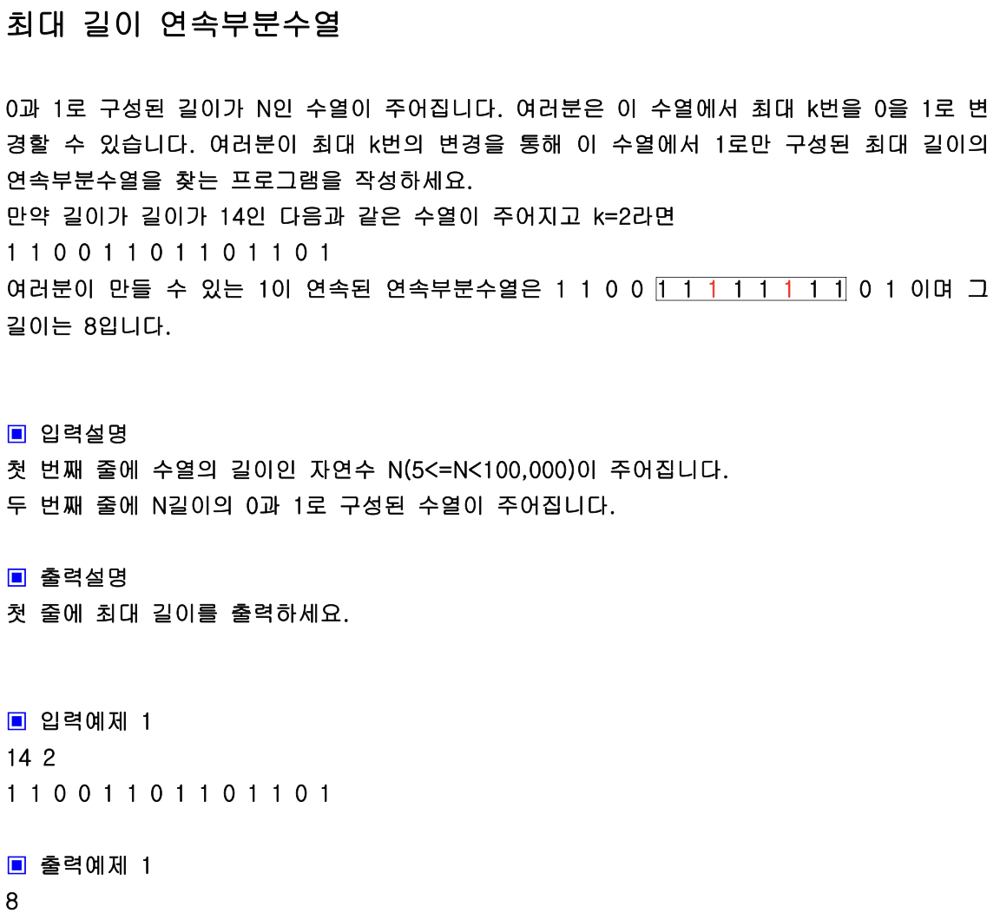

## Two Pointers

두 개의 포인터를 사용하여 범위 또는 두 값을 효율적으로 탐색하는 기법이다.

- 유형 1

`left`, `right`가 0에서 시작하여 오른쪽으로 이동 (구간 조절)
    
- 유형 2

`left`는 0, `right`는 $$N-1$$에서 시작하여 서로를 향해 이동 (두 값 비교)

각 포인터는 최대 $$N$$번 이동하므로 전체 시간 복잡도는 $$O(N)$$이다.

## Sliding Window

연속된 구간(window)을 유지하면서, 조건에 따라 포인터를 이동시켜 구간을 확장하거나 축소하며 문제를 해결하는 기법이다.

기존 구간의 정보를 재활용하여 매번 전체를 다시 계산하지 않고 효율적으로 값을 갱신할 수 있다.

주로 “연속된 부분 배열”과 관련된 문제에서 사용된다.

Sliding Window를 구현하는 대표적인 방법이 Two Pointers이다.

(단, 모든 Two Pointers가 Sliding Window는 아니다.)

### 주의 사항

이 방식은 보통 배열에 음수가 없는 경우(양수 또는 0)에서 잘 동작한다.

이는 구간의 합이나 크기 변화가 단조성을 가지기 때문이다.

## 문제



## 풀이

```java
import java.util.*;

public class Main{
	public static int solution(int n, int k, int[] arr) {
		int answer = Integer.MIN_VALUE;
		
		int lp=0;
		int cnt = 0; //0을 1로 바꾼 횟수
		for(int rp = 0; rp < n; rp++) {
			if(arr[rp] == 0) cnt++;
			while(cnt > k) {
				if(arr[lp] == 0) cnt --;
				lp++;
			}
			answer = Math.max(answer, rp - lp + 1);
		}
		
		return answer;
	}
	
	
	public static void main(String[] args) {
		Scanner sc = new Scanner(System.in);
		
		int n = sc.nextInt();
		int k = sc.nextInt();
		
		int[] arr = new int[n];
		for(int i=0; i<n; i++) {
			arr[i] = sc.nextInt();
		}
		
		System.out.println(solution(n, k, arr));
	}
}
```
