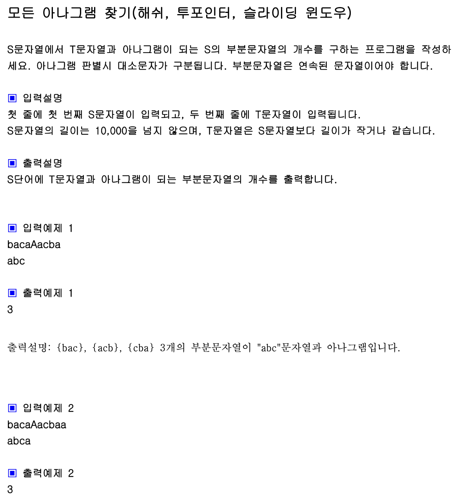
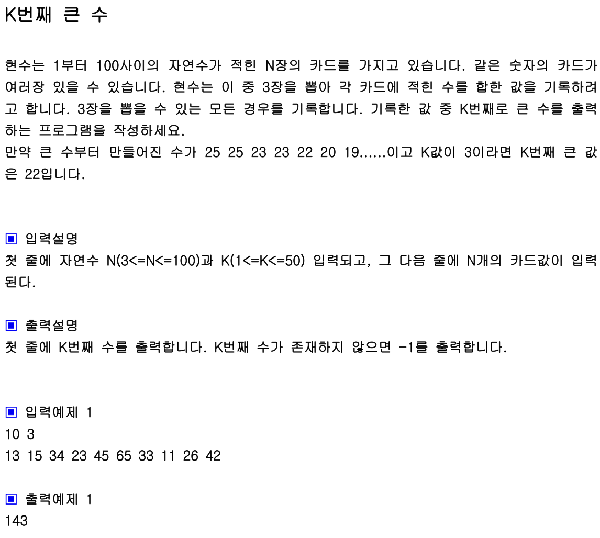

## HashMap

`HashMap`은 (Key, Value) 쌍을 해시 기반으로 저장해서 평균적으로 `O(1)`에 빠르게 꺼낼 수 있는 자료구조이다.

- **값을 저장할 때**

`hashCode()`를 먼저 호출하여 `key`의 해시값으로 어느 버킷에 넣을지 결정하고,

그 버킷 안에 이미 `key`가 있을 때 `equals()`로 비교한다.

같으면 값을 덮어쓰고 다르면 같은 버킷 안에 다른 `key`로 추가한다.  
(서로 다른 `key`라도 해시 함수의 결과가 같으면 같은 버킷에 들어갈 수 있다.)

- **값을 꺼낼 때**

`hashCode()`를 먼저 호출하여 `key`가 들어있을 후보 버킷을 찾고, 그 버킷 안에서 `equals()`로 정확히 같은 `key`인지 찾는다.

> `Map` 객체 2개를 `equals()`로 비교하면 `Map` 인터페이스의 `equals()` 규약에 따라, 각 구현체(`HashMap`, `TreeMap` 등)가 내부적으로 모든 `entry`를 비교한다.
>
(여기서 `entry`란 하나의 (key, value) 쌍을 말한다.)

## 문제



## 풀이

HashMap의 **`getOrDefault()`**를 사용하여 문자가 처음 등장할 때는 0을, 이미 존재할 때는 기존 빈도수를 가져와 카운팅하였다.

```java
import java.util.*;

public class Main{
	public static int solution(String a, String b) {
		int answer = 0;
		
		//비교할 b 문자열은 다 넣기
		HashMap<Character, Integer> bm = new HashMap<>();
		for(char c : b.toCharArray()) {
			bm.put(c, bm.getOrDefault(c, 0) + 1);
		}
		
		//슬라이딩할 a 문자열은 구간에서 하나 작은 만큼만 넣어놓고
		//구간 끝부터 추가하면서 비교하면서 사용하기
		HashMap<Character, Integer> am = new HashMap<>();
		int lt=0, rt=b.length();
		for(int i=0; i<rt-1; i++) {
			am.put(a.charAt(i), am.getOrDefault(a.charAt(i), 0)+1);
		}
		
		for(rt=b.length()-1; rt<a.length(); rt++) {
			//오른쪽 추가
			am.put(a.charAt(rt), am.getOrDefault(a.charAt(rt), 0)+1);
			if(am.equals(bm)) answer++;
			//왼쪽 제거
			am.put(a.charAt(lt), am.get(a.charAt(lt))-1);
			if(am.get(a.charAt(lt)) == 0) am.remove(a.charAt(lt));
			lt++;
		}
		
		return answer;
	}
	
	
	public static void main(String[] args) {
		Scanner sc = new Scanner(System.in);
		
		String a = sc.next();
		String b = sc.next();
		
		System.out.println(solution(a,b));
	}
}
```

## TreeSet

`TreeSet`은 내부적으로 균형 이진 탐색 트리 구조를 사용하기 때문에 새 값이 들어올 때마다 정렬 규칙에 맞는 자리를 찾아서 삽입한다.

**기본적인 정렬규칙은 오름차순**이며, 내림차순 정렬규칙을 원하면 `Collections.reverseOrder()`로 만든 Comparator를 생성자에 전달하여 정렬 기준을 변경할 수 있다.

## 문제



## 풀이

```java
import java.util.*;

public class Main{
	public static int solution(int n, int k, int[] arr) {
		TreeSet<Integer> tset = new TreeSet<>(Collections.reverseOrder()); //내림차순
		
		for(int i=0; i<n; i++) {
			for(int j=i+1; j<n; j++) {
				for(int l=j+1; l<n; l++) {
					tset.add(arr[i]+arr[j]+arr[l]);
				}
			}
		}
		
		//카운트를 활용하여 K번째 큰 수 리턴
		int cnt = 0;
		for(int i : tset) {
			cnt++;
			if(cnt == k) return i;
		}
		
		return -1;
	}
	
	
	public static void main(String[] args) {
		Scanner sc = new Scanner(System.in);
		
		int n = sc.nextInt();
		int k = sc.nextInt();
		
		int[] arr = new int[n];
		for(int i=0; i<n; i++) {
			arr[i] = sc.nextInt();
		}
		
		System.out.println(solution(n, k, arr));
	}
}
```
