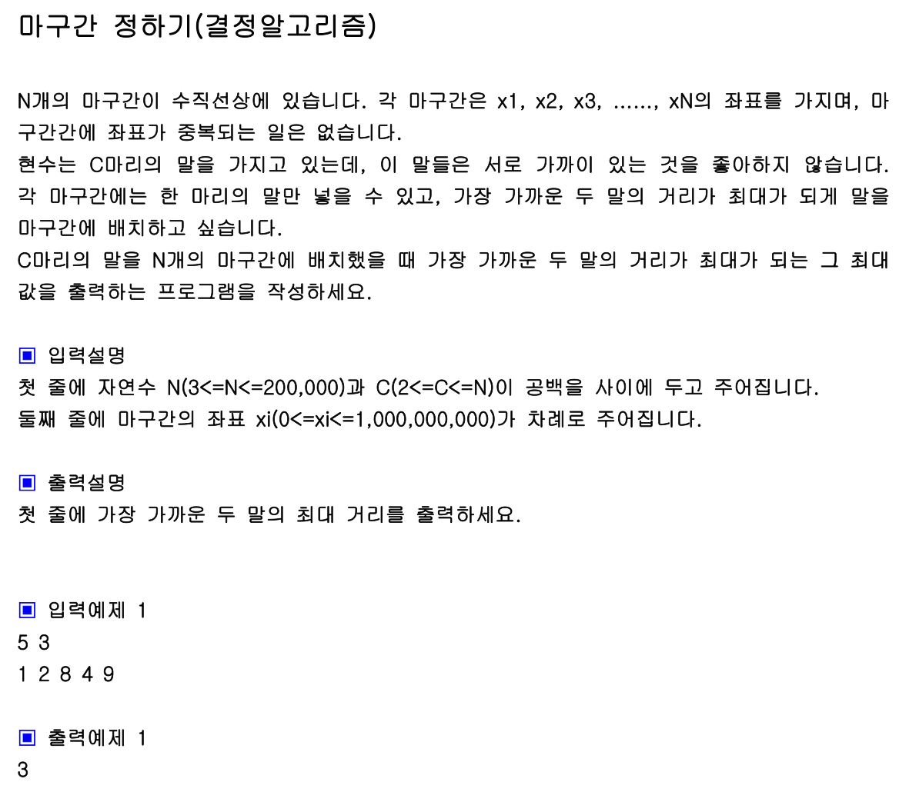

## 결정 알고리즘

결정 알고리즘은 **"최적화 문제"**를 **"결정 문제(Yes/No)"**로 바꾸어 푸는 것을 말한다.

최적화 문제: "K개를 만들 수 있는 최대 길이는 얼마인가?"  
↓  
결정 문제: "길이 X로 잘랐을 때 K개 이상 만들 수 있는가?"

**결정 문제에서 "Yes"라는 대답이 나오는 지점들 중에서 가장 큰 X를 찾는 과정이 바로 이분 탐색이다.**

결정 알고리즘에서는 K개 이상만 만들 수 있다면, 일단 K개를 확보한 것이니 성공으로 간주한다고 약속한다.(남은건 버리면 되기 때문)

## 이분 탐색

이분 탐색은 **정렬된 상태**에서 범위를 절반씩 날려버리며 정답을 찾는 방식이다.

`left`: 문제에서 요구하는 정답이 될 수 있는 이론상 최솟값  
`right`: 문제에서 요구하는 정답이 될 수 있는 이론상 최댓값  
`mid`: 현재 범위에서 이번에 테스트해볼 정답 후보

문제에 조건에 따라 `mid`의 왼쪽이나 오른쪽으로 범위를 좁혀가면 된다.

## 문제 (마구간 정하기)



## 풀이

```java
import java.util.*;

public class Main{
	public static void main(String[] args){
		Scanner sc = new Scanner(System.in);
		int n = sc.nextInt();
		int c = sc.nextInt();
		long[] arr = new long[n];
		for(int i=0; i<n; i++) {
			arr[i] = sc.nextLong();
		}
		long answer = 0;
		
		Arrays.sort(arr);
		
		//두 말의 거리의 가능한 최대, 최소 거리
		long left = 1;
		long right = arr[n-1] - arr[0];
		
		//이분 탐색 시작
		while(left <= right) {
			//mid: 우리가 시도해볼 '최소 간격'의 기준
			//모든 말은 적어도 mid만큼은 떨어져야 함 (기준 통과)
			//목표: 이 기준(mid)을 최대한 높여서 말들이 최대한 멀리 떨어지게 만들기
			long mid = (left + right) / 2;
			
			//말을 두는 위치를 계속 갱신해 나가며 탐색
			//일단 처음에는 제일 맨 왼쪽에 놓기
			long cur = arr[0];
			int cnt = 1; //놓은 말 수
			for(int i=1; i<n; i++) {
				//다음 둘 곳 확인
				if(arr[i] - cur >= mid) {
					cur = arr[i]; //현재 두는 말 위치 갱신
					cnt++;
				}
			}
			
			//c마리 이상이면 c마리는 배치할 수 있다는 것이니 답 갱신 후
			//가장 가까운 거리를 더 크게 할 수 있는지 확인
			if(cnt >= c) {
				answer = mid;
				left = mid + 1;
			}
			//c마리 미만이면 거리를 더 좁혀서 확인
			else {
				right = mid - 1;
			}
		}
		
		System.out.println(answer);
	}
}

/*
기준 먼저 정하기 --> 두 말의 거리가 기준!
*/
```

## 문제 (랜선 자르기)

[백준 1654번 랜선 자르기](https://www.acmicpc.net/problem/1654)

## 풀이

```java
import java.util.*;

public class Main{
	public static void main(String[] args){
		long answer = 0;
		Scanner sc = new Scanner(System.in);
		int n = sc.nextInt();
		int m = sc.nextInt();
		long[] arr = new long[n];
		for(int i=0; i<n; i++) {
			arr[i] = sc.nextLong();
		}
		
		Arrays.sort(arr); // 이분 탐색을 위한 정렬
		
		long left = 1;
		long right = arr[n-1];
		
		while(left <= right) {
			//테스트 해볼 정답 후보
			long mid = left + (right - left)/2;
			
			long cnt = 0; //잘라서 나오는 개수
			for(int i=0; i<n; i++) {
				cnt += arr[i] / mid;
			}
			
			// 1. 개수가 m개 보다 크거나 같다면 가능한 경우이니 정답 갱신하고
			// 더 크게 잘라서도 되는지 확인
			// --> left 이동
			if(cnt >= m) {
				answer = mid;
				left = mid + 1;
			}
			// 2. 개수가 m개 보다 작다면 더 작게 잘라서 개수를 늘려야 함
			// -> right 이동
			else if(cnt < m) {
				right = mid - 1;
			}
			
			cnt = 0; // 초기화
		}
		
		System.out.println(answer);
	}
}
```
