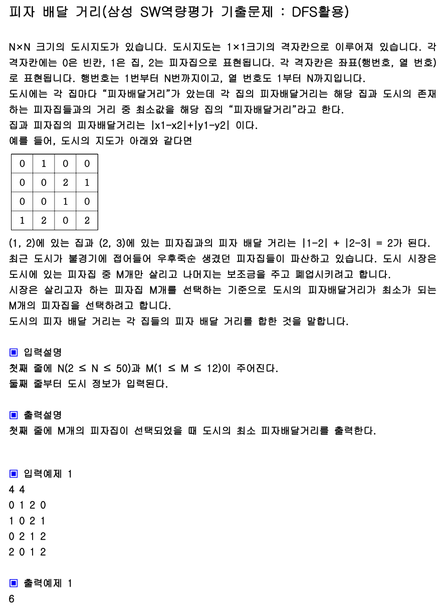
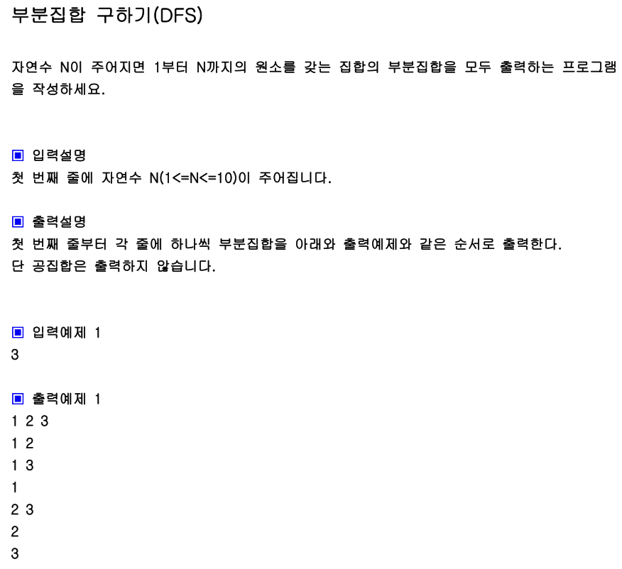

## DFS(Depth First Search)

DFS(Depth First Search)는 이름 그대로 깊이를 최우선으로 하여 탐색하는 알고리즘이다.

**갈 수 있는 한 가장 깊은 곳까지 내려갔다가, 더 이상 갈 곳이 없으면 바로 직전의 갈림길로 돌아와 다른 방향을 탐색한다.**

## Backtracking

백트래킹은 모든 경우를 탐색하되, **정답이 될 가능성이 없는 경로는 중간에 차단하는 탐색 기법이다.**

기본적으로 DFS 구조를 사용하며, 깊게 탐색하다가 **조건에 맞지 않으면 즉시 되돌아가 다른 선택지를 탐색한다.**

이때 단순히 돌아오는 것이 아니라, **이전 선택을 취소하는 되돌리기 과정이 포함된다.**

또한 탐색 도중 **유망성 판단(가지치기)을 통해 불필요한 탐색을 줄여 효율을 높인다.**

## 문제 (순열)

[백준 5568번 카드놓기](https://www.acmicpc.net/problem/5568)

## 풀이

백트래킹은 마치 카드를 한 장씩 뽑아 바닥에 내려놓았다가 (`ch[i] = 1` 사용중 표시)  
그 시나리오가 끝나면 다시 집어서 원래 자리로 되돌려 놓는  것 (`ch[i] = 0` 원상 복구)

```java
import java.util.*;

public class Main{
	static HashSet<String> set = new HashSet<>();
	static int[] arr;
	static int n, k;
	static int[] ch;
	
	public static void DFS(int L, String s) {
		//레벨이 k가 되면 그만큼의 카드 수를 사용한 것 --> base case
		if(L == k) {
			set.add(s);
			return;
		}
		else {
			//배열에 있는 모든 i번째 카드가 시작점이 될 수 있도록
			for(int i=0; i<n; i++) {
				if(ch[i] == 0) {
					ch[i] = 1;
					DFS(L+1, s + arr[i]);
					ch[i] = 0; //다음 i를 위해 선택 해제
				}
			}
		}
	}
	
	public static void main(String[] args) {
		Scanner sc = new Scanner(System.in);
		
		n = sc.nextInt();
		k = sc.nextInt(); //k장의 카드를 뽑음
		
		arr = new int[n];
		ch = new int[n]; //배열의 자리 기준
		for(int i=0; i<n; i++) {
			arr[i] = sc.nextInt();
		}
		
		DFS(0, "");
		
		System.out.println(set.size());
	}
}
```

## 문제 (조합)



## 풀이

전체 피자집 중 M개를 뽑는 경우의 수를 모두 탐색합니다. 단순 순열이 아닌 조합이므로, 이전에 선택한 요소는 다시 고려하지 않도록 구현하는 것이 핵심이다.

`L` (Level): 현재까지 선택된 피자집의 개수를 의미한다. 재귀의 깊이를 결정하며, `L == M`이 되었을 때가 하나의 완전한 조합이 완성된 시점(Base Case)이다.

`s` (Start Index): 조합을 구성할 때 탐색을 시작할 인덱스 번호이다. `s`를 통해 이전에 선택한 피자집보다 뒤에 있는 것들만 탐색하게 하여, 중복 조합 방지 및 불필요한 탐색을 차단한다.

`combi[]` 배열: 선택된 피자집의 인덱스를 차곡차곡 저장하는 공간이다.

>**백트래킹 과정**
>
for 루프를 통해 `s`부터 마지막 피자집까지 순회하며 `combi[L]`에 인덱스를 저장합니다.
>
`DFS(L + 1, i + 1)`을 호출하여 다음 피자집을 찾으러 깊이 들어갑니다.
>
`L == M`에 도달하면 저장된 `combi[]` 배열을 바탕으로 모든 집과의 최소 거리를 계산하여 `answer`를 갱신합니다.
>
함수가 반환(`return`)되면 다음 루프에서 새로운 값을 `combi[L]`에 덮어씌우며 자연스럽게 이전 상태로 돌아가 다른 경우를 탐색합니다.

조합이 완성됐을 때, 각 집의 피자배달 거리를 계산하다가 최솟값을 넘으면 더 이상 계산할 필요가 없으니 유망성 판단 조건을 추가하여 가지치기를 하였다.

```java
import java.util.*;

class Point{
	int x;
	int y;
	
	Point(int x, int y){
		this.x = x;
		this.y = y;
	}
}

public class Main{
	
	static int n;
	static int m;
	static List<Point> h, p;
	static int[] sel; //조합에서 선택된 피자집 좌표의 인덱스를 담는 배열
	static int answer = Integer.MAX_VALUE;
	
	static void DFS(int L, int s) {
		if(L == m) { //m개가 선택됨
			int sum = 0;
			for(int i=0; i<h.size(); i++) {
				int min = Integer.MAX_VALUE;
				for(int j=0; j<m; j++) {
					min = Math.min(min, Math.abs(h.get(i).x - p.get(sel[j]).x) + Math.abs(h.get(i).y - p.get(sel[j]).y));
				}
				sum += min;
				if(sum > answer) return; //가지치기(더하는 와중에 answer보다 커지면 더 볼 필요 없음)
			}
			answer = Math.min(answer, sum);
		}
		else {
			for(int i=s; i<p.size(); i++) {
				sel[L] = i;
				DFS(L+1, i+1);
			}
		}
	}

	public static void main(String[] args){
		Scanner sc = new Scanner(System.in);
	
		n = sc.nextInt();
		m = sc.nextInt();
		sel = new int[m];
		
		h = new ArrayList<>();
		p = new ArrayList<>();
		
		for(int i=0; i<n; i++) {
			for(int j=0; j<n; j++) {
				int temp = sc.nextInt();
				if(temp == 1) h.add(new Point(i, j));
				else if(temp == 2) p.add(new Point(i, j));
			}
		}
		
		DFS(0, 0);
		
		System.out.println(answer);
	}
}
```

## 문제 (부분집합)



## 풀이

```java
import java.util.*;

public class Main{
	
	static int n;
	static int[] ch; //사용여부 확인용 배열
	
	public static void DFS(int cur) {
		if(cur == n+1) { //n보다 크면 지금까지 만든 부분 집합 출력
			String tmp = "";
			for(int i=1; i<=n; i++) {
				if(ch[i] == 1) tmp += i + " "; //사용된 것 만
			}
			System.out.println(tmp);
		}
		else {
			//먼저 왼쪽(사용한다)으로 뻗어나가기
            //현재 숫자 사용한다 하고 다음 숫자 재귀호출
			ch[cur] = 1;
			DFS(cur+1);
			//돌아왔을 때는 오른쪽(사용하지 않는다)로 뻗어나가기
            //현재 숫자 사용안함 표시하고 다음 숫자 재귀호출
			ch[cur] = 0;
			DFS(cur+1);
		}
	}
    
	public static void main(String[] args) {
		n = 3;
		ch = new int[4]; //배열 인덱스 1부터 사용하기 위해 크기를 n+1 만큼 잡음
		DFS(1); //1부터 넣어서 사용하냐 안하냐로 탐색할거임
		
	}
}
```

## 문제 (N-Queen)

[백준 9663번 N-Queen](https://www.acmicpc.net/problem/9663)

## 풀이

```java
import java.util.*;

class Main {
    static int[] rowch;
    static int[] diag1; // row + col 값이 일정한 우상향 대각선 (/)
    static int[] diag2; // row - col + N 값이  우하향 대각선 (\)
    static int answer = 0;
    static int N;
    
    //0행 열중에 하나에 먼저 놓고 같은 행, 대각선 두개 방향 전부 체크 해놓고
    //그 다음 행으로 가서 체크 안되있는 열에 또 놓고 체크하고 또 그 다음 행 가고 반복
    public static void DFS(int row){
        if(row == N){ //n까지오면 다 놓은거니 카운팅
            answer++;
        }
        else{
            //0행에서 n개의 열에 하나씩 다 놓아가면서 탐색하기
            for(int col=0; col<N; col++){
                //놓을 수 있는지 확인
                if(rowch[col] == 0 && diag1[row+col] == 0 && diag2[row-col+N] == 0){
                    rowch[col] = 1;
                    diag1[row+col] = 1; //왼쪽 대각선은 대각선의 어떤 위치든 더하면 같음.
                    diag2[row-col+N] = 1; //오른쪽 대각선은 대각선의 어떤 위치든 빼면 같음. 음수 대비해서 N만큼 shift
                    DFS(row+1); //다음 행으로 탐색
                    //백트래킹 (해당 열을 사용하고 탐색하러 갔다 다시 와서 다른 열 탐색하러 가는 백트래킹 기법. 다른 열을 갈땐 해당 열을 사용 안한 상태로 되돌려야함)
                    rowch[col] = 0;
                    diag1[row+col] = 0;
                    diag2[row-col+N] = 0; 
                }
            }
        }
    }
    
    public static void main(String[] args) {
    	Scanner sc = new Scanner(System.in);
        answer = 0; 
        N = sc.nextInt();
        rowch = new int[N];
        diag1 = new int[N*2]; 
        diag2 = new int[N*2]; 
        DFS(0); //0행부터 시작
        System.out.println(answer);
    }
}
```
