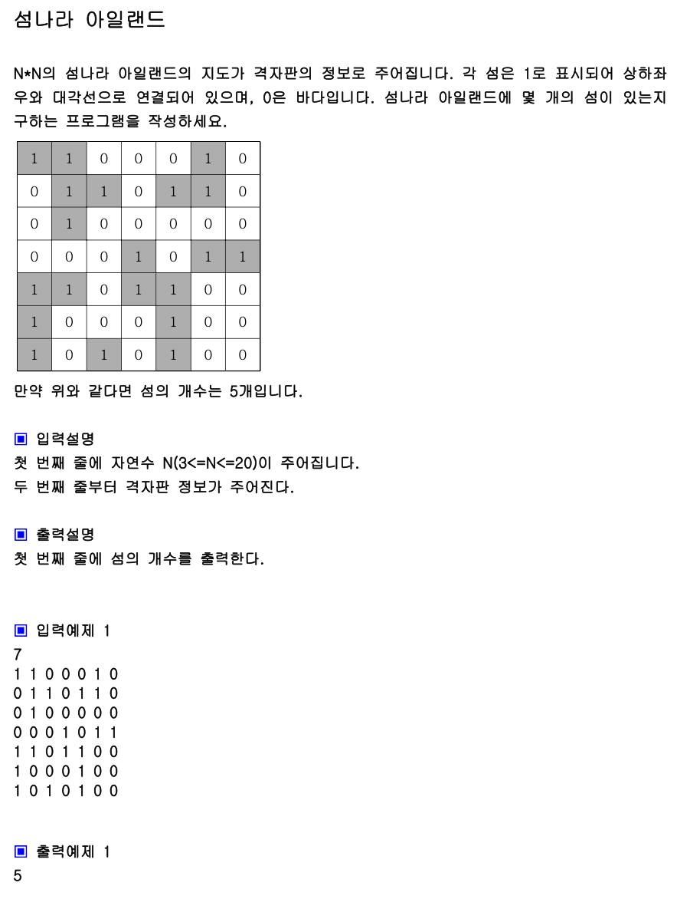
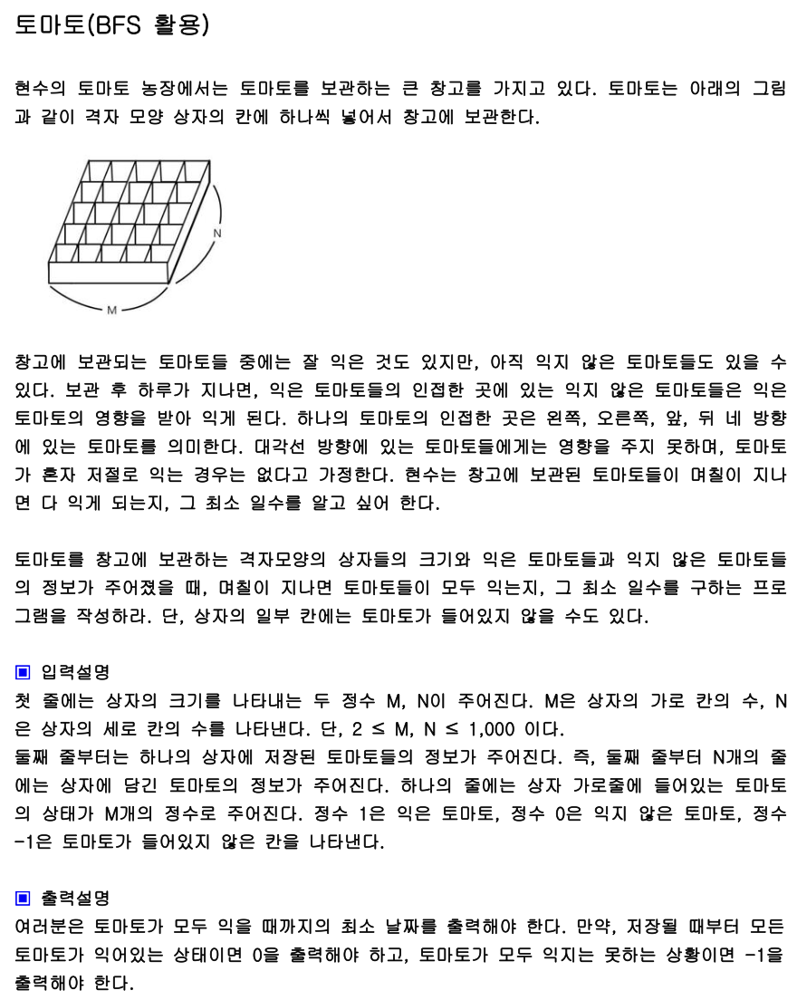

BFS(Breadth First Search)는 그래프나 트리에서 너비를 우선해서 탐색하는 알고리즘이다.

쉽게 말해, 시작 노드에서 가까운 노드들을 먼저 전부 방문하고, 그 다음에 한 단계 더 멀리 있는 노드들을 방문 하는 방식이다.

> **핵심 동작 원리 (Queue 활용 및 방문처리)**
>
1. 시작 노드를 큐에 넣고 방문 처리를 한다.
2. 큐가 빌 때까지 다음 과정을 반복한다.
3. 큐에서 노드 하나를 꺼낸다.
4. 꺼낸 노드의 **인접한 노드 중 방문하지 않은 노드**를 모두 큐에 넣고 **방문 처리**를 한다.

## 시간 복잡도

노드 수를 $$V$$, 간선 수를 $$E$$라고 할 때, 시간 복잡도는 $$O(V+E)$$이다. 모든 노드와 간선을 한 번씩 확인하기 때문이다.

## 문제 (섬나라 아일랜드)



## 풀이

```java
import java.util.*;

class Point{
	int x;
	int y;
	
	public Point(int x, int y){
		this.x = x;
		this.y = y;
	}
}

public class Main{
	//왼쪽 위 대각선부터 시계방향
	static int[] dx = {-1, -1, -1, 0, 1, 1, 1, 0};
	static int[] dy = {-1, 0, 1, 1, 1, 0, -1, -1};
	static int n;
	static int[][] arr;
	static int answer = 0;
	
	static void BFS(int x, int y) {
		Deque<Point> q = new ArrayDeque<>();
		
		//시작 노드 큐에 넣고 방문 처리
		arr[x][y] = 0;
		q.offer(new Point(x, y));
		
		//큐가 빌 때까지
		while(!q.isEmpty()) {
			//큐에서 노드 하나 꺼내기
			Point cur = q.poll();
			
			//꺼낸 노드의 인접한 노드들 확인
			for(int i=0; i<8; i++) {
				int nx = cur.x + dx[i];
				int ny = cur.y + dy[i];
				
				//범위 안에 있고 방문을 하지 않았다면
				if(nx >= 0 && nx < n && ny >= 0 && ny < n && arr[nx][ny] == 1) {
					arr[nx][ny] = 0; //방문 처리하고
					q.offer(new Point(nx, ny)); //큐에 넣기
				}
			}
		}
	}
	
	public static void main(String[] args){
		Scanner sc = new Scanner(System.in);
		
		n = sc.nextInt();
		arr = new int[n][n];
		
		for(int i=0; i<n; i++) {
			for(int j=0; j<n; j++) {
				arr[i][j] = sc.nextInt();
			}
		}
		
		//배열을 돌면서 1일때 BFS로 들어가서 주변 탐색
		for(int i=0; i<n; i++) {
			for(int j=0; j<n; j++) {
				if(arr[i][j] == 1) {
					answer++; //새로운 1은 곧 새로운 섬의 시작점
					BFS(i, j);
				}
			}
		}
		
		System.out.println(answer);
	}
}
```

## 문제 (토마토)



## 풀이

```java
import java.util.*;

class Point{
	int x;
	int y;
	
	public Point(int x, int y){
		this.x = x;
		this.y = y;
	}
}

public class Main{
	static int[][] arr;
	static int[][] dis; //걸린 날짜 수
	static int n;
	static int m;
	//북동남서
	static int[] dx = {-1, 0, 1, 0};
	static int[] dy = {0, 1, 0, -1};
	//익지 못하는 상황에 대한 예외 처리 및 최대값 비교를 위한 초기화
	static int answer =	-1;
	
	static Deque<Point> q = new ArrayDeque<>();
	
	static void BFS() {
		while(!q.isEmpty()) {
			Point cur = q.poll();
			for(int i=0; i<4; i++) {
				int nx = cur.x + dx[i];
				int ny = cur.y + dy[i];
				
				if(nx >= 0 && nx < n && ny >= 0 && ny < m && arr[nx][ny] == 0) {
					arr[nx][ny] = 1;
					dis[nx][ny] = dis[cur.x][cur.y] + 1; //주변 노드는 현재 노드의 + 1일이 걸림
					q.offer(new Point(nx, ny));
				}
			}
		}
	}
	
	public static void main(String[] args){
		Scanner sc = new Scanner(System.in);
		
		m = sc.nextInt();
		n = sc.nextInt();
		
		dis = new int[n][m];
		arr = new int[n][m];
		
		for(int i=0; i<n; i++) {
			for(int j=0; j<m; j++) {
				arr[i][j] = sc.nextInt();
				//1인 지점 미리 넣어놓기(출발지가 여러 곳이기 때문)
				if(arr[i][j] == 1) {
					dis[i][j] = 0;
					q.offer(new Point(i, j));
				}
			}
		}
		
		BFS(); //시작점 넣을 필요 없음 이미 q에 넣어서
		
		//예외처리 1. 모든 토마토가 이미 익어있는 상태면 0 출력
		//--> arr이 다 1이기 때문에 dis는 그대로 0출력 됨
		
		//예외처리 2. 익지 못하는것만 처리
		//탐색 후에도 0이 남아있다면 모두 익지 못하는 상황임
		//answer 기본값을 -1로 했기 때문에 그대로 -1 출력
		boolean flag = true;
		for(int i=0; i<n; i++) {
			for(int j=0; j<m; j++) {
				if(arr[i][j] == 0) flag = false;
			}
		}
		
		//모두 익을 수 있는 상황이면 제일 마지막에 익은 토마토 걸린 날짜 수 출력
		if(flag) {
			for(int i=0; i<n; i++) {
				for(int j=0; j<m; j++) {
					answer = Math.max(answer, dis[i][j]);
				}
			}
		}
		
		System.out.println(answer);
	}
}
```

## 문제 (숨바꼭질)

[백준 1697번 숨바꼭질](https://www.acmicpc.net/problem/1697)

## 풀이

현재 위치에서 이동 가능한 `-1`, `+1`, `*2` 세 가지 경우를 이용해 상태 공간을 BFS로 탐색했다.

BFS를 사용하면 시작 위치에서 가장 적은 횟수로 도달하는 경우를 먼저 찾을 수 있으므로, 이 문제의 최단 시간을 구하기에 적합하다.

또한 큐의 현재 크기를 기준으로 같은 레벨의 노드들을 한 번에 처리하여, 각 레벨을 1초 단위의 이동으로 해석했다.

이미 방문한 위치를 다시 탐색하지 않도록 방문 체크 배열을 사용해 중복 탐색을 방지했고, 이를 통해 전체 탐색을 효율적으로 수행했다.

```java
import java.util.*;
public class Main{
	static int n;
	static int k;
	static int answer = 0;
	
	static int[] ch = new int[100001]; //방문 체크 배열
	
	public static void BFS(int L){
		Deque<Integer> q = new ArrayDeque<>();
		
		ch[n] = 1;
		q.offer(n);
		
		while(!q.isEmpty()) {
			
			int size = q.size(); //해당 레벨의 노드들을 훑을거임.
			
			for(int i=0; i<size; i++) {
				int cur = q.poll();
				if(cur == k) answer = L;
				if(cur-1 >= 0 && ch[cur-1] == 0) {
					ch[cur-1] = 1;
					q.offer(cur-1);
				}
				if(cur+1 < 100_001 && ch[cur+1] == 0) {
					ch[cur+1] = 1;
					q.offer(cur+1);
				}
				if(cur*2 < 100_001 && ch[cur*2] == 0) {
					ch[cur*2] = 1;
					q.offer(cur*2);
				}
			}
			
			L++; //하나의 레벨이 끝나면 다음 레벨로
		}
	}

	public static void main(String[] args){
		Scanner sc = new Scanner(System.in);
		n = sc.nextInt();
		k = sc.nextInt();
		
		BFS(0);
		
		System.out.println(answer);
	}
}
```
