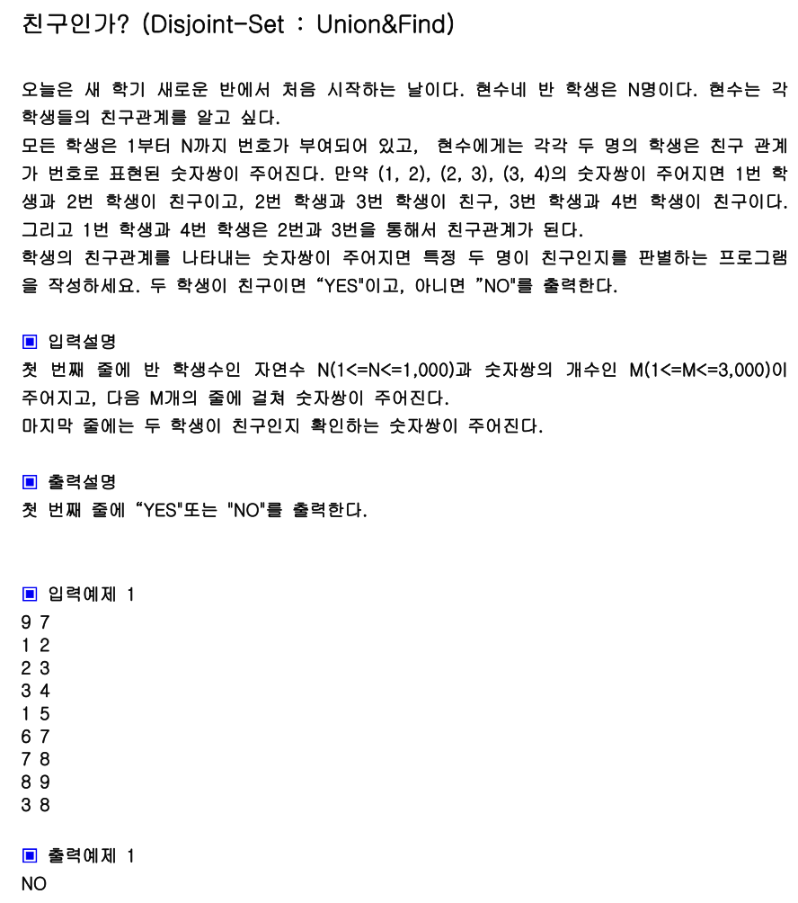

## Disjoint Set

서로소 집합(Disjoint Set)은 공통 원소가 없는 즉, 상호 베타적인 부분 집합들로 나눠진 원소들에 대한 자료구조이다.


## Union-Find

Union-Find 알고리즘이란 서로소 집합(Disjoint Set)을 관리하며, 여러 개의 노드 중 두 노드가 같은 집합에 속해 있는지 확인하거나, 두 집합을 하나로 합치는 알고리즘이다.

### 핵심 배열

`unf[]`를 사용하여 각 노드의 부모 번호를 저장한다. 초기화 시에는 모든 노드가 자기 자신을 가리키도록 `unf[i] = i`로 설정한다.

### 주요 함수

- **`Find(v)`**

노드 `v`가 속한 집합의 루트 노드를 찾는다.  
루트 노드를 찾으러 갈 때 **`unf[v] = Find(unf[v])`**와 같이 재귀적으로 부모를 갱신하면 경로 압축이 일어나 탐색 속도가 비약적으로 빨라진다.

- **`Union(a, b)`**

두 노드 `a`, `b`의 루트 노드를 각각 찾아, 한쪽의 부모를 다른 쪽에 연결하여 하나의 집합으로 만든다.

>**활용**
>
> 그래프의 사이클(Cycle) 판별, 최소 신장 트리(MST), 네트워크 연결성 확인 등에 사용된다.

## 문제



## 풀이

```java
import java.util.*;

public class Main{
	static int[] unf; //인덱스의 부모 노드 담는 배열
	
	//합치기
	public static void Union(int a, int b) {
		//각자 대표 확인
		int fa = Find(a);
		int fb = Find(b);
		//a의 대표를 b의 대표로 연결
		if(fa != fb) unf[fa] = fb;
	}
	
	//대표 확인
	public static int Find(int v) {
		if(v == unf[v]) return v; //자기 자신이 대표
		/*
		 * 자기 자신이 대표가 아니라면
		 * 재귀: 부모를 따라 올라가서 최종 대표를 찾기
		 * 경로 압축: 찾은 대표를 현재 노드의 부모로 바로 연결 --> 시간복잡도 대폭 줄임 O(N) -> O(1)
		 */
		else return unf[v] = Find(unf[v]);
	}
	
	public static void main(String[] args){
		Scanner sc = new Scanner(System.in);
		int n = sc.nextInt();
		int m = sc.nextInt();
		
		//초기 설정
		unf = new int[n+1];
		for(int i=1; i<=n; i++) {
			unf[i] = i;
		}
		
		//순서쌍 합치기
		for(int i=0; i<m; i++) {
			int a = sc.nextInt();
			int b = sc.nextInt();
			Union(a,b);
		}
		
		int a = sc.nextInt();
		int b = sc.nextInt();
		int fa = Find(a);
		int fb = Find(b);
		if(fa == fb) System.out.println("YES");
		else System.out.println("NO");
	}
}
```
