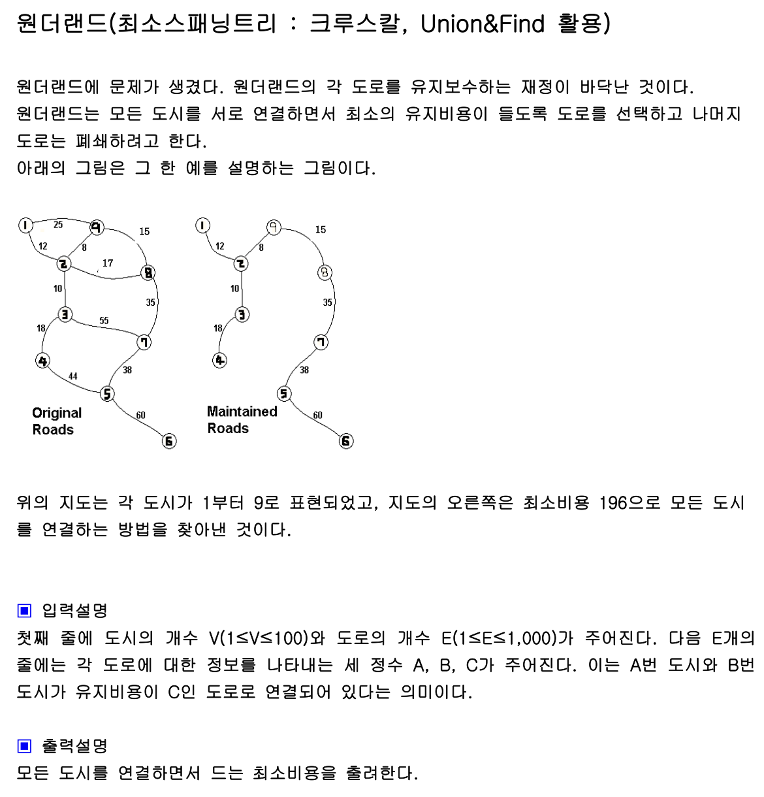
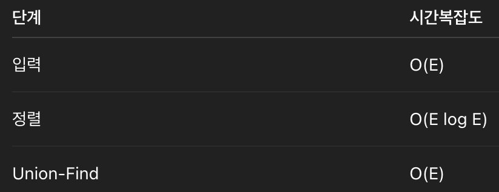

## 최소 신장 트리 (Minimum Spanning Tree)

최소 신장 트리는 연결된 무방향 그래프에서 **모든 정점을 포함**하면서 **사이클이 없고**, **간선 가중치의 합이 최소**가 되는 트리를 말한다.

## 크루스칼(Kruskal) 알고리즘

크루스칼 알고리즘은 **간선의 가중치를 기준으로 오름차순 정렬**한 뒤, **사이클이 발생하지 않도록** 간선을 선택하여 최소 신장 트리를 구하는 **그리디 알고리즘**이다.

**사이클 여부를 판단할 때 Union-Find 알고리즘을 사용**한다.

## 문제



## 풀이

크루스칼 알고리즘은 **간선 중심 알고리즘**이기 때문에 **그래프를 따로 만들 필요 없이 간선 리스트만** 있으면 된다.

간선의 가중치를 기준으로 오름차순 정렬한 후, 사이클이 발생하지 않는 경우에만 간선을 선택한다.

이때 사이클 여부를 효율적으로 판단하기 위해 Union-Find 알고리즘을 사용한다.




시간복잡도: $$O(ElogE)$$

```java
import java.util.*;

class Edge implements Comparable<Edge>{
	int v1;
	int v2;
	int cost;
	
	public Edge(int v1, int v2, int cost) {
		this.v1 = v1;
		this.v2 = v2;
		this.cost = cost;
	}
	
	//그리디(정렬) 사용을 위한 설정 (오름차순)
	@Override
	public int compareTo(Edge e) {
		return this.cost - e.cost;
	}
}

public class Main{
	static int[] unf;
	
	public static void Union(int a, int b) {
		int fa = Find(a);
		int fb = Find(b);
		if(fa != fb) unf[fa] = fb;
	}
	
	public static int Find(int v) {
		if(v == unf[v]) return v;
		else return unf[v] = Find(unf[v]);
	}
	
	public static void main(String[] args){
		Scanner sc = new Scanner(System.in);
		int n = sc.nextInt();
		int m = sc.nextInt();

		unf = new int[n+1];
		for(int i=1; i<=n; i++) {
			unf[i] = i;
		}
		
		List<Edge> list = new ArrayList<>();

		for(int i=0; i<m; i++) {
			int v1 = sc.nextInt();
			int v2 = sc.nextInt();
			int cost = sc.nextInt();
			list.add(new Edge(v1, v2, cost));
		}
		
		Collections.sort(list);
		int answer = 0;
        int cnt = 0; //선택된 간선의 수를 카운트
		
		/*
		 * 최소비용부터 오름차순 했으니 순서대로 훑으면서
		 * 하나의 집합으로 합치다가
		 * 이미 대표가 같으면 합칠 필요가 없으니 pass --> 먼저 Find하는 이유)
		 */
		for(int i=0; i<m; i++) {
			int fv1 = Find(list.get(i).v1);
			int fv2 = Find(list.get(i).v2);
			if(fv1 != fv2) {
				Union(list.get(i).v1, list.get(i).v2);
				answer += list.get(i).cost;
                cnt++; //간선 추가 시 카운트 증가
                
                //정점이 n개일 때, 간선이 n-1개가 선택되면 MST 완성
                //Big-O는 같지만 성능 개선
                if(cnt == n-1) break;
			}
		}
		
		System.out.println(answer);
	}
}
```
