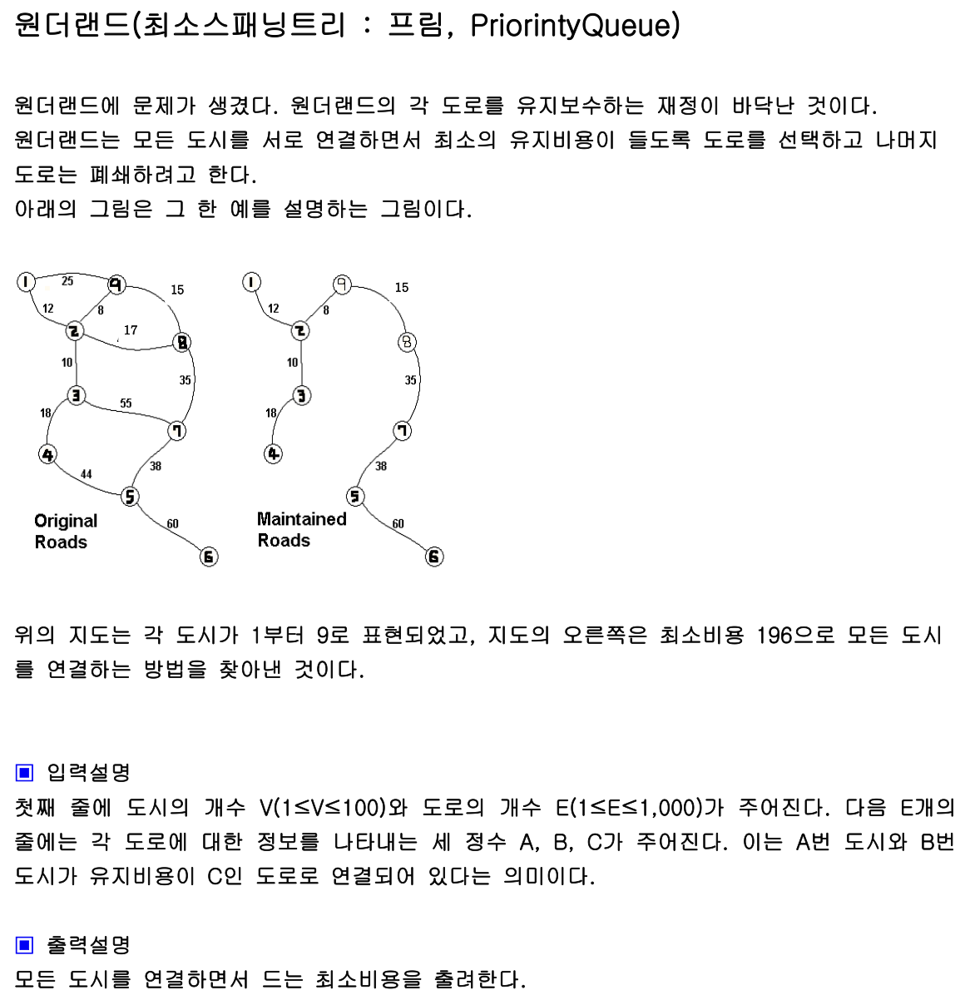

## 최소 신장 트리 (Minimum Spanning Tree)

최소 신장 트리는 연결된 무방향 그래프에서 **모든 정점을 포함**하면서 **사이클이 없고, 간선 가중치의 합이 최소**가 되는 트리를 말한다.

## 프림(Prim) 알고리즘

프림 알고리즘은 **하나의 정점에서 시작**하여, **인접한 간선 중 최소 비용을 선택**하며 트리를 확장해 나가는 **그리디 알고리즘**이다.

프림 알고리즘은 정점 중심 알고리즘이기 때문에 그래프 구조가 필요하다.

**구현의 핵심은 현재 정점에서 갈 수 있는 간선들을 우선순위 큐에 넣어놓고 가장 작은 비용을 계속 꺼낸다.**

## 문제



## 풀이

그래프를 인접리스트로 구성한 뒤, 1번 정점에서 시작하여 우선순위 큐를 통해 최소 비용 간선을 선택하고, **방문하지 않은 정점만 포함**시키며 확장한다.

```java
import java.util.*;

class Edge implements Comparable<Edge>{
	int ver;
	int cost;
	
	public Edge(int ver, int cost) {
		this.ver = ver;
		this.cost = cost;
	}
	
	//우선순위 큐 사용을 위한 설정 (오름차순)
	@Override
	public int compareTo(Edge ob) {
		return this.cost - ob.cost;
	}
}

public class Main{
	public static void main(String[] args){
		Scanner sc = new Scanner(System.in);
		int v = sc.nextInt();
		int e = sc.nextInt();
		int[] ch = new int[v+1];
		List<List<Edge>> graph = new ArrayList<>();
		for(int i=0; i<=v; i++) {
			graph.add(new ArrayList<>());
		}
		for(int i=0; i<e; i++) {
			int a = sc.nextInt();
			int b = sc.nextInt();
			int c = sc.nextInt();
			graph.get(a).add(new Edge(b, c));
			graph.get(b).add(new Edge(a, c));
		}
		
		int answer = 0;
        int cnt = 0; // 선택된 정점의 개수를 카운트
		PriorityQueue<Edge> pq = new PriorityQueue<>();
		pq.offer(new Edge(1,0)); //1번 정점부터 출발
		while(!pq.isEmpty()) {
			Edge cur = pq.poll();
			if(ch[cur.ver] == 0) { //현재 정점 선택 여부
				ch[cur.ver] = 1;
				answer += cur.cost;
                cnt++; // 정점을 트리에 추가했으므로 카운트 증가
                
                // 모든 정점(v개)이 선택되었다면 더 이상 간선을 탐색할 필요 없음
                //Big-O는 동일하지만 성능 개선
                if(cnt == v) break;
                
				for(Edge edge : graph.get(cur.ver)) {
					//다음 후보 필터링
					if(ch[edge.ver] == 0) pq.offer(new Edge(edge.ver, edge.cost));
				}
			}
		}
		
		System.out.println(answer);
	}
}
```
