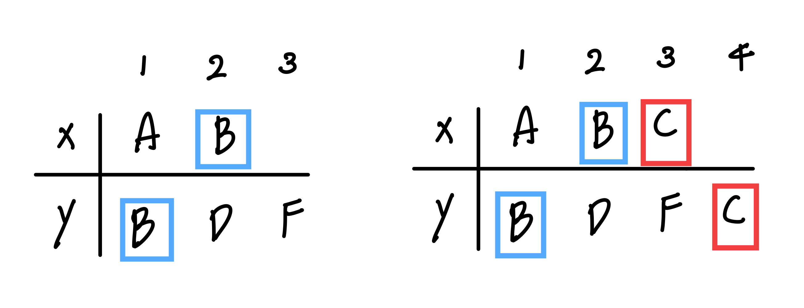
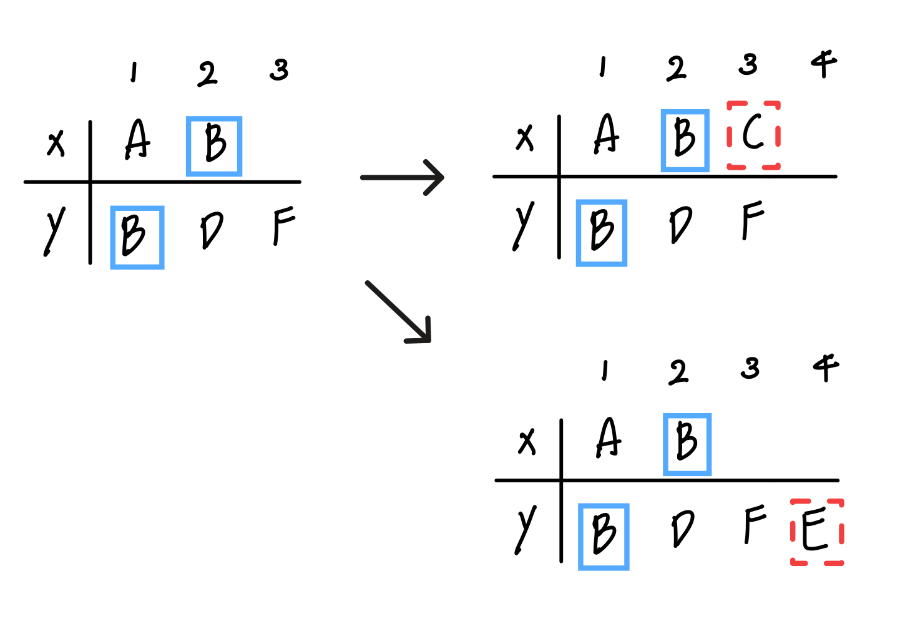

## 최장 공통 부분 수열

최장 공통 부분 수열이란 두 수열이 어떤 기준에 따라 **양쪽에서 공통으로 발견할 수 있는 가장 긴 부분 수열**을 의미한다.

#### LCS의 길이 점화식 생각하기

최장 공통 부분 수열의 길이를 반환하는 `LCS()` 함수를 다음과 같이 정의해보자.

`LCS(i, j) = x[1~i]와 y[1~j]의 LCS 길이`

그러면 다음 그림에서 `LCS(3, 4) = LCS(2, 3) + 1`이 됨을 알 수 있다.



만약 뒤에 오는게 다르다면 어떨까?

그러면 두 값 x[3], y[4]는 포함하지 않는 LCS의 길이를 찾아야 한다.

지금은 LCS(3, 3)도 1, LCS(2, 4)도 1이므로 아무거나 선택하면 된다.

이런 과정을 다음과 같이 일반화 할 수 있다.

x[i], y[j]가 다르면 `LCS(i, j) = LCS(i-1, j)와 LCS(i, j-1)을 비교하여 큰 값으로 함`



> **요약**
>
**1. x[i]와 y[j]가 같다면 두 개가 오기 전 상태에서 +1만큼 더하기**
>
현재 두 문자가 일치하므로, 두 문자 모두 없었던 상태인 대각선 왼쪽 위(`i-1, j-1`) 값에 1점을 보태기.
>
**2. x[i]와 y[j]가 다르다면 하나가 오기 전의 최대값을 채워넣기**
>
현재 문자는 일치하지 않으므로, 둘 중 하나만 있었던 상태인 위쪽(`i-1, j`)과 왼쪽(`i, j-1`) 중 더 큰 값을 그대로 가져온다.

## 문제

[백준 9251번 LCS](https://www.acmicpc.net/problem/9251)

## 풀이

**DP 테이블의 0행과 0열을 '아무것도 비교하지 않은 상태'인 0으로 비워두고, 1행과 1열부터 실제 비교를 시작한다.**

이는 첫 번째 글자를 비교할 때 발생하는 인덱스 참조 오류(IndexOutOfBounds)를 방지할 뿐만 아니라, 어떤 문자열이든 빈 문자열과 비교하면 공통 부분 수열이 0이라는 기저 조건(Base Case)을 자연스럽게 만족시켜 점화식을 일관성 있게 적용할 수 있게 해준다.

시간복잡도: 문자열의 길이가 각각 $$N$$, $$M$$ 일 때 $$O(N·M)$$

```java
import java.util.*;
import java.io.*;

public class Main {
    public static void main(String[] args){
        Scanner sc = new Scanner(System.in);
        
        String str1 = sc.next();
        String str2 = sc.next();
        
        int[][] dp = new int[str1.length()+1][str2.length()+1];
        
        
        for(int i=1; i<=str1.length(); i++) {
        	for(int j=1; j<=str2.length(); j++) {
        		if(str1.charAt(i-1) == str2.charAt(j-1)) {
        			dp[i][j] = dp[i-1][j-1] + 1;
        		}
        		else dp[i][j] = Math.max(dp[i-1][j], dp[i][j-1]);
        	}
        }
        
        System.out.println(dp[str1.length()][str2.length()]);
    }
}
```
