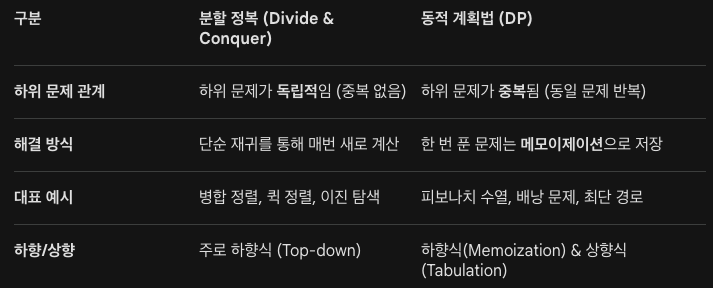

분할 정복은 해결하기 어려운 큰 문제를 작은 하위 문제로 나누어 해결한 뒤, 그 결과를 결합하여 원래 문제를 해결하는 알고리즘이다.

주로 재귀를 사용하여 구현된다.

### 핵심 3단계 과정

1. **분할**

원래 문제를 동일한 유형의 더 작은 하위 문제들로 나눈다.

2. **정복**

하위 문제가 충분히 작아서 바로 해결할 수 있다면 해결하고, 그렇지 않으면 다시 재귀적으로 분할하여 해결한다.

3. **결합**

하위 문제들의 해답을 결합하여 원래 문제의 정답을 도출한다.

### 분할 정복 vs DP

가장 큰 차이는 하위 문제들이 서로 겹치느냐의 여부이다.



## 문제

[프로그래머스 유사 칸토어 비트열](https://school.programmers.co.kr/learn/courses/30/lessons/148652)

## 풀이

거대한 비트열을 직접 생성하지 않고 $$5^{n-1}$$ 크기의 5개 구역으로 나눠 타겟 위치가 속한 구간을 재귀적으로 탐색.

```java
import java.util.*;

class Solution {
    public static long DFS(int n, long k){
        if(n == 0) return 1;
        
        else{
            // 지금 단계의 한 묶음 크기
            long size = (long)Math.pow(5, n-1);
            
            // 지금 단계의 한 묶음의 1의 개수
            long cnt = (long)Math.pow(4, n-1);
            
            // k가 속한 구간
            int part = (int)(k/size);
            
            if(part<2){
                return (long)part * cnt + DFS(n-1, k%size);
            }
            
            else if(part == 2){
                return cnt * 2;
            }
            
            else{
                return (long)(part-1) * cnt + DFS(n-1, k%size);
            }
        }
    }
    
    public int solution(int n, long l, long r) {
        return (int)(DFS(n, r-1) - DFS(n, l-2));
    }
}
```
